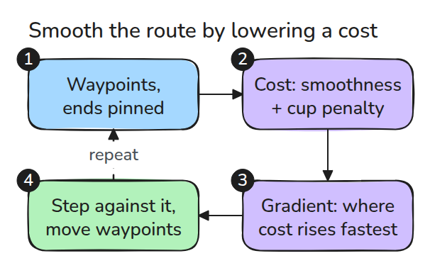
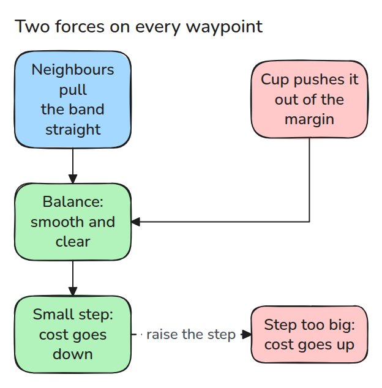
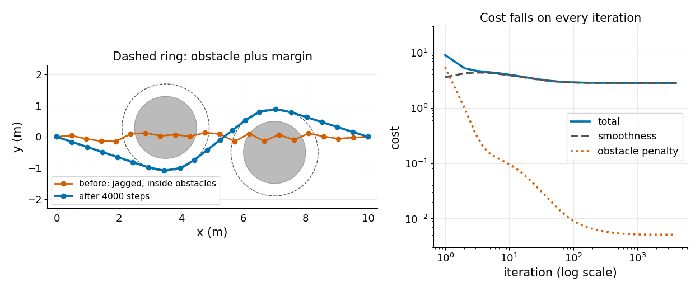

# 궤적 최적화 (Trajectory Optimisation)

> 지그재그 경로를 장애물에 다시 부딪히지 않게 부드럽게 펴서 로봇이 따라갈 수 있게 만드는 방법을 알아봅니다.

**유형:** 만들기   **선수 지식:** 09/03 충돌 검사   **시간:** 약 15분

## 쉽게 말하면

탐사 로봇의 경로는 출발점과 깃발에 고정된 waypoint 사슬이에요. 핀 두 개 사이에 당겨 둔 고무줄 앞을 컵이 막고 있는 것과 같아요.
고무줄은 각 waypoint를 양옆 이웃을 잇는 직선 쪽으로 당기고 컵은 가까이 온 waypoint를 바깥으로 밀어내요.

경로는 당기는 힘과 미는 힘이 균형을 이루는 곳에 멈춰요. 조금씩 옮기면 경로가 얼마나 나쁜지 나타내는 cost가 줄어요. 너무 크게 옮기면 오히려 늘어요.

## 핵심 용어

- **Waypoint**: 경로 위의 점 하나입니다. 경로는 이 점들의 사슬입니다.
- **Cost**: 경로가 얼마나 나쁜지 나타내는 숫자 하나입니다. 낮을수록 좋습니다.
- **Gradient**: 비용이 가장 빨리 커지는 방향입니다. 그 반대로 가면 비용이 줄어듭니다.
- **Gradient descent**: gradient의 반대 방향으로 작은 걸음을 되풀이하는 방법입니다.
- **Penalty**: waypoint가 장애물에 너무 가까워지면 더해지는 추가 비용입니다.
- **Clearance**: 경로와 장애물 사이에 남겨 두는 여유 거리입니다.

## 문제

로봇 팔이 planner의 경로를 따라가는데 그 경로는 모든 장애물을 피하지만 지그재그라서 시간이 낭비되고 팔이 흔들린다고 상상해 보세요. 손으로 펴면 경로가 다시 장애물 안으로 들어갑니다.

## 개념

실제 로봇은 부드러운 경로에서 시간과 마모를 아끼므로 부드러움과 여유를 함께 점수로 매깁니다.



*양 끝은 고정이고 부드러움과 장애물 penalty가 gradient 하나를 만들어 waypoint를 움직입니다.*

부드러움 cost는 이웃 점 사이 걸음의 제곱합의 절반입니다. 그 gradient는 `2 x_i - x_{i-1} - x_{i+1}`이므로 반대 방향으로 가면 점이 이웃을 잇는 직선 쪽으로 당겨집니다.
장애물 penalty는 waypoint가 중심에서 `r + margin`보다 가까우면 `w (r + margin - d)^2`이고 그렇지 않으면 0입니다(`w` = 8은 가중치입니다). 이 gradient의 반대 방향으로 가면 점이 바깥쪽으로 밀려납니다.
크기 `lr` = 0.04인 걸음을 되풀이하는 것이 gradient descent입니다.



*당김과 밂은 멈춘 경로에서 균형을 이루고 걸음이 너무 크면 지나쳐서 비용이 오릅니다. waypoint만 검사하므로 두 점 사이의 구간은 여전히 장애물을 스칠 수 있습니다.*

(0, 0)과 (10, 0)에 핀이 있고 그 사이에 waypoint 하나가 있으며 컵은 (5, 0)에 반지름 1이고 `margin = 0.4`입니다. waypoint는 컵 안인 (5, 0.2)에서 시작합니다. 부드러움은 0.4로 아래로 당기고 컵은 19.2로 위로 밉니다.
8걸음 뒤에는 (5, 1.24)에 멈추고 이때 두 힘은 모두 2.49이며 컵에서 0.24 떨어져 있습니다.


*빨간 화살표는 아래로 당기는 힘과 위로 미는 힘입니다. 미는 힘은 아주 크게 시작해서 두 화살표가 같아질 때까지 줄어듭니다.*



*왼쪽은 시작 경로가 두 장애물을 지나가고 결과 경로가 돌아가는 모습입니다. 오른쪽은 비용이 줄어드는 모습입니다.*

## 만들기

```python
g[1:-1] = ws * (2*X[1:-1] - X[:-2] - X[2:])
g[1:-1] -= 2 * wo * np.maximum(0, r + margin - d) * v / d
X -= lr * g
```

끝점은 gradient가 0이라서 움직이지 않습니다. 테스트가 해석적 gradient를 유한 차분과 비교합니다.

```bash
cd robotics-engineering-from-scratch
python3 -m pytest phases/09-motion-planning/04-trajectory-optimisation -q
python3 phases/09-motion-planning/04-trajectory-optimisation/code/main.py
```

## 실제 도구로 보기

SciPy의 `minimize`에 `method="L-BFGS-B"`를 주면 같은 비용과 gradient를 받습니다. 마지막 테스트가 일반 descent 4000걸음보다 나쁘지 않은 비용에 도달하는지 확인합니다.

출처는 [CHOMP, Ratliff 외 2009](https://www.ri.cmu.edu/pub_files/2009/5/icra09-chomp.pdf)이고 2026년 11월 9일에 열람했습니다.

## 결과물

`outputs/skill-path-smoothing-check.md`는 다듬은 경로의 clearance, 끝점, 걸음 크기를 점검합니다.

## 연습 문제

1. `margin`을 0.8로 올리고 가장 가까운 접근 거리가 어떻게 바뀌는지 보고하세요.
2. 03 레슨의 정확한 검사로 선분을 검사하고 가장 작은 clearance를 보고하세요.
3. `scipy.optimize.minimize`를 쓰고 일반 descent와 반복 횟수를 비교하세요.
