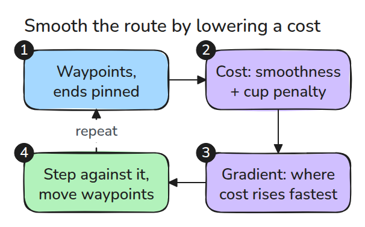
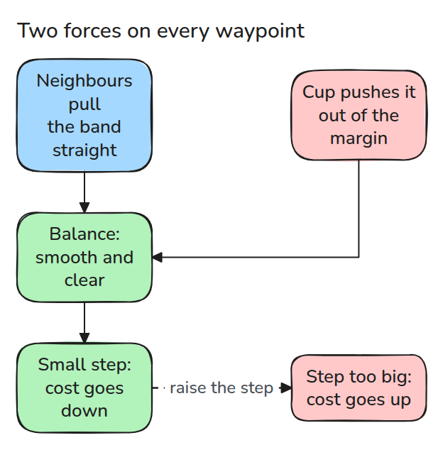
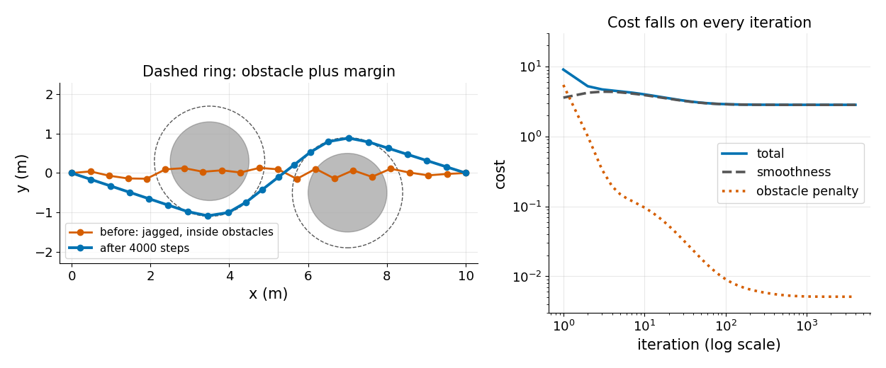

# 궤적 최적화 (Trajectory Optimisation)

> planner가 준 경로는 실행할 수는 있지만 들쭉날쭉합니다. 부드러움 비용과 장애물 penalty에 gradient descent를 걸면 로봇이 따라갈 수 있는 경로가 됩니다.

**유형:** 만들기   **선수 지식:** 09/03 충돌 검사   **시간:** 약 15분

## 쉽게 말하면

컵이 놓인 탁자에서 고정한 핀 사이로 고무줄을 걸어 보세요. 고무줄은 팽팽해지며 곧아지려 하고 컵은 그 길을 막아요.

trajectory optimisation도 경로의 waypoint에 비슷한 작용을 줘요. smoothness는 각 점을 이웃 점 쪽으로 당기고 obstacle penalty는 가까운 점을 장애물 바깥으로 밀어요. 조금씩 고치면 합친
cost가 줄지만 너무 크게 옮기면 오히려 늘 수 있어요. waypoint만 확인하면 점 사이 선분은 여전히 검사하지 않은 상태예요.

## 문제

sampling planner가 모든 장애물을 피하면서 지그재그로 걷는 경로를 줍니다. 그대로 따라가면 시간이 낭비되고 팔이 흔들립니다. 지그재그를 손으로 펴면 경로가 다시 장애물 안으로 들어가서, 두 목표가 서로 부딪칩니다.

## 개념



*경로는 양 끝이 고정된 waypoint 목록입니다. 비용 항 두 개, 곧 부드러움과 장애물 penalty가 gradient 하나를 만들어 waypoint를 움직입니다.*

부드러움은 이웃 점 사이 걸음의 제곱합의 절반입니다. waypoint에서의 gradient는 `2 x_i - x_{i-1} - x_{i+1}`이고 점을 이웃을 잇는 직선 쪽으로 끌어당깁니다.

장애물 penalty는 waypoint가 중심에서 `r + margin`보다 가까우면 `w (r + margin - d)^2`이고 그렇지 않으면 0입니다. 이 gradient는 점을 바깥쪽으로 밀어냅니다.



*경로는 당기는 힘과 미는 힘이 균형을 이루는 곳에서 멈춥니다. 걸음이 너무 크면 비용이 오릅니다.*



*왼쪽은 들쭉날쭉한 시작 경로가 두 장애물을 지나가고 결과 경로가 그것을 돌아가는 모습입니다. 오른쪽은 전체 비용이 매 반복 줄어드는 모습입니다.*

이것은 CHOMP의 작은 친척입니다. CHOMP는 covariant gradient를 쓰는 데 비해 여기서는 일반 gradient를 쓰고 waypoint에만 penalty를 주며 waypoint 사이의 선분은 검사하지 않습니다.

## 만들기

```python
g[1:-1] = ws * (2*X[1:-1] - X[:-2] - X[2:])
g[1:-1] -= 2 * wo * np.maximum(0, r + margin - d) * v / d
X -= lr * g
```

끝점은 gradient가 0이라서 움직이지 않습니다. 테스트가 해석적 gradient를 유한 차분과 비교합니다.

```bash
cd robotics-engineering-from-scratch
python3 -m pytest phases/09-motion-planning/04-trajectory-optimisation -q
python3 phases/09-motion-planning/04-trajectory-optimisation/code/main.py
```

## 실제 도구로 보기

SciPy의 `minimize`에 `method="L-BFGS-B"`를 주면 같은 비용과 gradient를 받습니다. 마지막 테스트가 일반 descent 4000걸음보다 나쁘지 않은 비용에 도달하는지 확인합니다.

출처는 [CHOMP, Ratliff 외 2009](https://www.ri.cmu.edu/pub_files/2009/5/icra09-chomp.pdf)입니다.

2026년 11월 9일에 열람했습니다. elastic band 방식은 경로에 길이나 부드러움에 대한 내부 에너지와 장애물에서 오는 외부 에너지를 주고 CHOMP는 covariant gradient 기법을 쓴다는 것을 확인했습니다.

## 결과물

`outputs/skill-path-smoothing-check.md`는 다듬은 경로의 clearance, 끝점, 걸음 크기를 점검합니다.

## 연습 문제

1. `margin`을 0.8로 올리고 가장 가까운 접근 거리가 어떻게 바뀌는지 보고하세요.
2. 03 레슨의 정확한 검사로 waypoint 사이 선분을 검사하고 가장 작은 clearance를 보고하세요.
3. `scipy.optimize.minimize`를 쓰고 일반 descent와 반복 횟수를 비교하세요.
