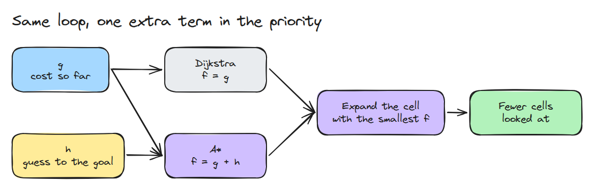
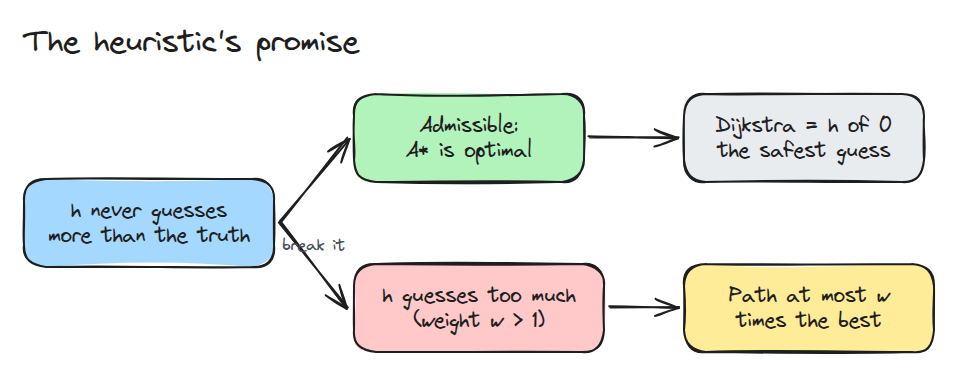
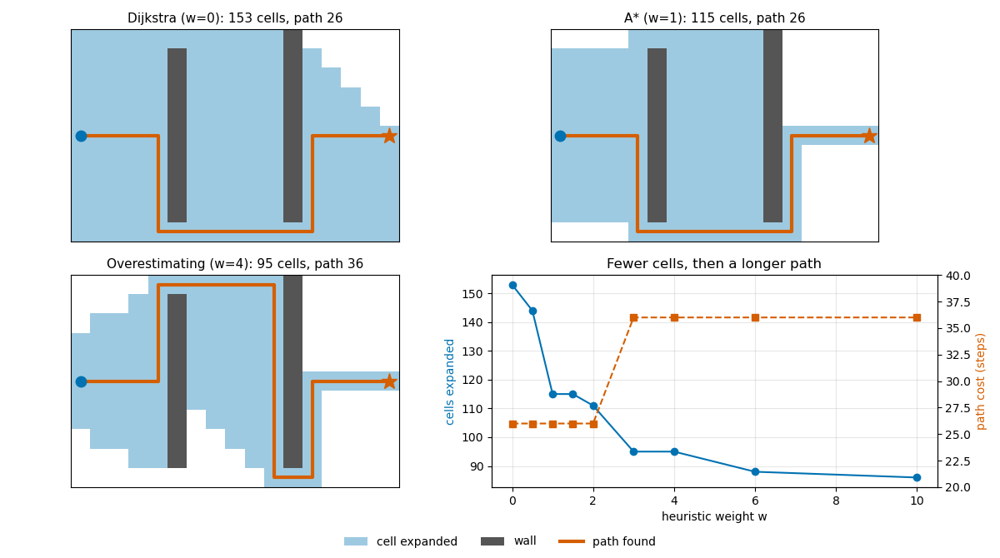

# Grid Search: Dijkstra to A*

> A* is Dijkstra with a promise: a guess of the distance left that is never too big, which lets it skip cells that cannot be on the best path.

**Type:** Build   **Prerequisites:** 09/03 Collision Checking   **Time:** ~15 minutes

## In Plain Words

On a grid board game, you need the shortest walk to a flag around blocked squares. Dijkstra tries squares
in order of the moves already spent reaching them. A* adds a guess of the moves still needed, so
promising routes get tried sooner.

If each move crosses one square horizontally or vertically, counting the remaining gaps ignores wall
detours and never overestimates the moves needed. That keeps the shortest route available. Exaggerating
the guess can favour a tempting gap that leads to a longer route.

## The Problem

A planner finds a route across a grid map in a blink, yet you do not know what it did to get there. When you swap its search for another, the path changes by 10 steps, or the run takes ten times as many steps. Without writing the search yourself you cannot tell which change was the algorithm and which was the setting.

## The Concept



*Both searches repeatedly expand the cell with the smallest priority. Only the priority differs.*

Dijkstra expands cells by `g`, the cost from the start. A* uses `f = g + h`, where `h` is a guess of the cost to the goal. On a 4-connected grid the Manhattan distance never overestimates, so A* returns the same cost as Dijkstra. Manhattan also never decreases by more than 1 per step, so no cell is expanded twice.



*Admissible `h` keeps the answer optimal. Scaling `h` by `w > 1` breaks the promise and bounds the damage at `w` times the best cost.*

On an empty grid A* looks only at cells on its path, while Dijkstra floods the map. Walls cost A* some of that edge.



*Same map, three searches. Weight 4 expands fewer cells but takes the near gap and then a long way back down. The path cost jumps from 26 to 36 between weight 2 and 3.*

## Build It

```python
heap = [(w * manhattan(start, goal), 0, start)]
while heap:
    _, _, cell = heapq.heappop(heap)
    if cell in closed:
        continue
    closed.add(cell)
    for n in neighbours(cell):
        if g[cell] + 1 < g.get(n, 1e9):
            g[n] = g[cell] + 1
            heapq.heappush(heap, (g[n] + w * manhattan(n, goal), -g[n], n))
```

`w = 0` is Dijkstra, `w = 1` is A*. On the demo's random 40 by 40 map, Dijkstra expands 1202 cells and A* 152 for the same cost 78.

```bash
cd robotics-engineering-from-scratch
python3 -m pytest phases/09-motion-planning/05-grid-search-dijkstra-to-astar -q
python3 phases/09-motion-planning/05-grid-search-dijkstra-to-astar/code/main.py
```

## Use It

Run the same grid with `w = 0` and `w = 1` and compare cost and cells expanded. Any planner with a Dijkstra-or-A* switch does the same: A* with `h = 0` is Dijkstra, and a heuristic scaled by `w > 1` gives a path at most `w` times the best.

Sources: A* search algorithm, Wikipedia, https://en.wikipedia.org/wiki/A*_search_algorithm (opened 2026-11-10).

## Ship It

`outputs/skill-grid-search-check.md` audits a planner's heuristic, weight and expansion count.

## Exercises

1. Allow diagonal moves and find a heuristic that stays admissible.
2. Break the tie on `g` the other way and count the extra cells.
3. Find the smallest `w` that makes the trap map return cost 36.
