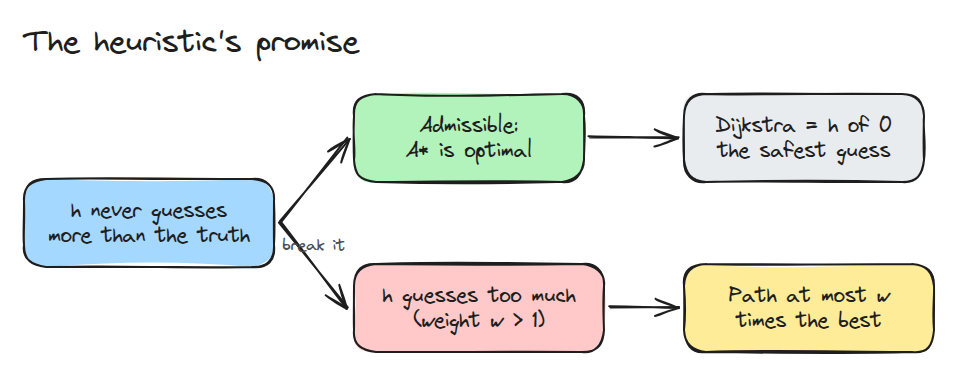
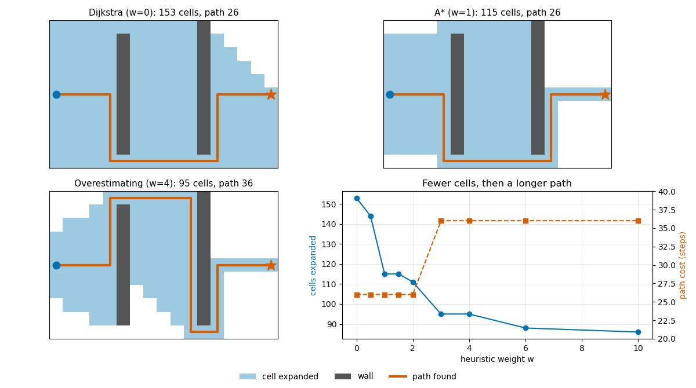
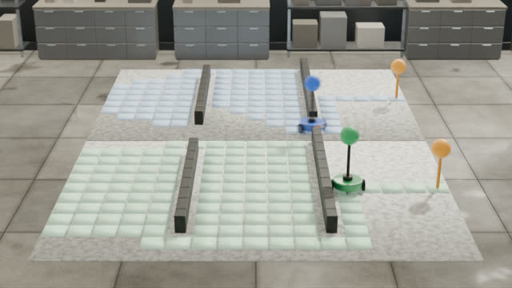

# Grid Search: Dijkstra to A*

> Learn how a robot finds the shortest route on a map without checking every square.

**Type:** Build   **Prerequisites:** 09/03 Collision Checking   **Time:** ~15 minutes

## In Plain Words

A rover seeks the shortest walk to a flag across a walled grid. Dijkstra tries squares cheapest-so-far first. A* (A-star) adds a guess of the steps still needed, so squares toward the flag are tried sooner.

A guess that is never too big still finds the shortest walk. An exaggerated guess can rush into a gap that looks close but leads to a longer walk.

## Key Terms

- **Expanding a square**: trying that square: checking its neighbours and adding them to the search.
- **Dijkstra**: a search that expands squares in order of the steps already spent reaching them.
- **A-star**: Dijkstra plus a guess of the steps still to go, so it heads toward the goal.
- **Heuristic (`h`)**: the guess of the steps remaining to the goal.
- **Admissible**: a guess that never exaggerates.
- **Manhattan distance**: squares across plus squares down, ignoring walls.

## The Problem

Picture a delivery robot crossing a grid map. Change the guess and the route can change by 10 steps, or the search can take ten times as long.

## The Concept

A robot must plan fast and well; the guess trades one for the other.

Both searches always try the best-scoring square next. That score is the priority. Dijkstra scores a square by the steps spent reaching it, so it spreads everywhere. A* adds a guess of the steps left, so it leans toward the goal.


*The score of a square: steps so far, plus the guess for A*.*

A guess that is never too big keeps the best route and skips many squares. An exaggerated one rushes toward the goal but may take a longer way.



*A guess that never exaggerates keeps the best route.*



*A bigger guess expands fewer squares but gives a longer route.*

On the trap map, the top gap leads to a longer detour, and the exaggerating search takes it.

[](../assets/clip-example.mp4)

*Blue exaggerates, walks farther; green wins.*

<details><summary>The math (optional)</summary>

Dijkstra expands squares in order of `g`, the cost from the start. A* uses `f = g + w * h`, where `w` scales the guess `h`: `w = 0` is Dijkstra, `w = 1` is A*, `w > 1` exaggerates. With up, down, left and right moves the Manhattan distance (squares across plus squares down) never overestimates, so A* returns Dijkstra's cost; a move changes it by at most 1 while `g` grows by 1, so `f` never falls. With `w > 1` the path costs at most `w` times the best. Trap map: `w = 1` expands 115 squares and finds the 26-step low walk; `w = 4` dives into the top gap and reaches the flag after 95 squares with a 36-step walk (cost jumps from 26 to 36 between weights 2 and 3). On the demo's random 40 by 40 map, Dijkstra expands 1202 squares and A* 152 for the same cost 78.

</details>

## Build It

```python
heap = [(w * manhattan(start, goal), 0, start)]
while heap:
    _, _, cell = heapq.heappop(heap)
    if cell in closed:
        continue
    closed.add(cell)
    for n in neighbours(cell):
        if g[cell] + 1 < g.get(n, 1e9):
            g[n] = g[cell] + 1
            heapq.heappush(heap, (g[n] + w * manhattan(n, goal), -g[n], n))
```

The only difference is the order squares are tried in. Dijkstra tries cheapest-so-far first; A* adds the guess.

```bash
cd robotics-engineering-from-scratch
python3 -m pytest phases/09-motion-planning/05-grid-search-dijkstra-to-astar -q
python3 phases/09-motion-planning/05-grid-search-dijkstra-to-astar/code/main.py
```

## Use It

Run one grid with the guess off and on; compare cost and squares expanded.

Sources: A* search algorithm, Wikipedia, https://en.wikipedia.org/wiki/A*_search_algorithm (opened 2026-11-10).

## Ship It

`outputs/skill-grid-search-check.md` audits a search's guess and weight.

## Exercises

1. Turn the guess off and on; compare squares expanded.
2. Make the guess bigger and watch the route get longer.
3. Allow diagonal moves costing one step. Can Manhattan distance exceed the true cost?
