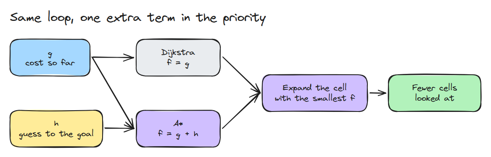

# Grid Search: Dijkstra to A*

> Learn how a robot finds the shortest route on a map without checking every square.

**Type:** Build   **Prerequisites:** 09/03 Collision Checking   **Time:** ~15 minutes

## In Plain Words

A rover seeks the shortest walk to a flag across a walled grid. Dijkstra expands cells in order of the steps already spent reaching them. A* (A-star) adds a guess of the steps still needed, so cells toward the flag come sooner.

A guess that never exceeds the true steps keeps the shortest walk available. An exaggerated guess can rush into a near gap that leads to a longer walk.

## Key Terms

- **Dijkstra**: a search that expands cells in order of the cost already spent reaching them.
- **A-star**: Dijkstra plus a guess of the cost still to go, so it heads toward the goal.
- **Expanding a cell**: checking that cell's neighbours and adding them to the search.
- **Heuristic (`h`)**: the guess of the remaining cost to the goal.
- **Admissible**: a heuristic that never guesses more than the true remaining cost.
- **Manhattan distance**: cells across plus cells down, ignoring walls.

## The Problem

Picture a delivery robot crossing a grid map. Swap its planner's search and the path changes by 10 steps, or the run takes ten times as many. Only writing the search shows why.

## The Concept

A real robot must plan fast and well; the heuristic trades one for the other.



*Same loop; only the priority differs.*

Dijkstra expands cells in order of `g`, the cost from the start. A* uses `f = g + w * h`, where `w` scales the guess `h`: `w = 0` is Dijkstra, `w = 1` is A*, `w > 1` exaggerates. With up, down, left and right moves the Manhattan distance never overestimates, so A* returns Dijkstra's cost. A move changes it by at most 1 while `g` grows by 1, so `f` never falls.


*An admissible `h` keeps A* optimal; with `w > 1` the path may cost up to `w` times the best.*


*Weight 4 expands fewer cells but costs more; cost jumps from 26 to 36 between weights 2 and 3.*

Trap map: a top gap dead-ends. With `w = 1` the search expands 115 cells and finds the 26-step low walk. With `w = 4` it dives into the top gap and reaches the flag after 95 cells, 36 steps.


*Blue (`w = 4`) walks farther, so green (`w = 1`) wins.*

## Build It

```python
heap = [(w * manhattan(start, goal), 0, start)]
while heap:
    _, _, cell = heapq.heappop(heap)
    if cell in closed:
        continue
    closed.add(cell)
    for n in neighbours(cell):
        if g[cell] + 1 < g.get(n, 1e9):
            g[n] = g[cell] + 1
            heapq.heappush(heap, (g[n] + w * manhattan(n, goal), -g[n], n))
```

On the demo's random 40 by 40 map, Dijkstra expands 1202 cells and A* 152 for the same cost 78.

```bash
cd robotics-engineering-from-scratch
python3 -m pytest phases/09-motion-planning/05-grid-search-dijkstra-to-astar -q
python3 phases/09-motion-planning/05-grid-search-dijkstra-to-astar/code/main.py
```

## Use It

Run one grid with `w = 0` and `w = 1`; compare cost and cells.

Sources: A* search algorithm, Wikipedia, https://en.wikipedia.org/wiki/A*_search_algorithm (opened 2026-11-10).

## Ship It

`outputs/skill-grid-search-check.md` audits a planner's heuristic, weight and expansion count.

## Exercises

1. Allow diagonal moves; find an admissible heuristic.
2. Break the tie on `g` the other way; count the extra cells.
3. Find the smallest `w` giving cost 36 on the trap map.
