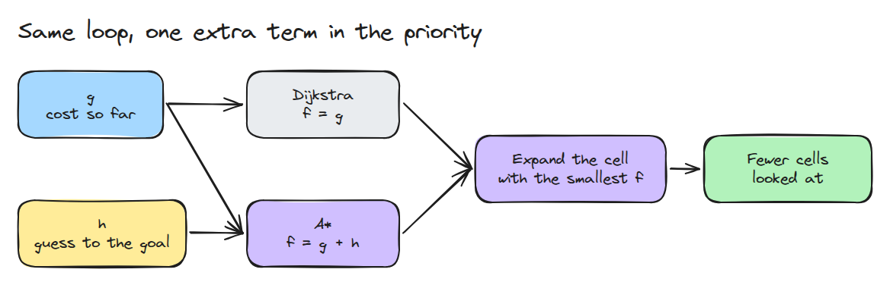
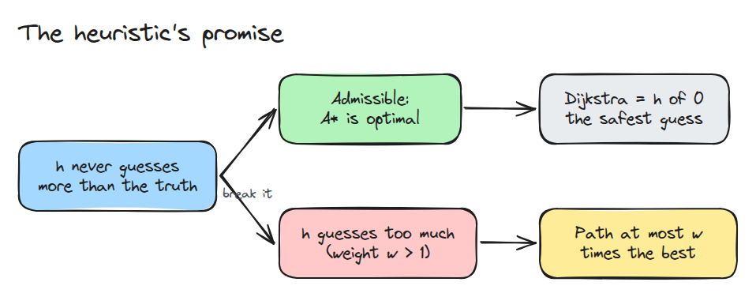
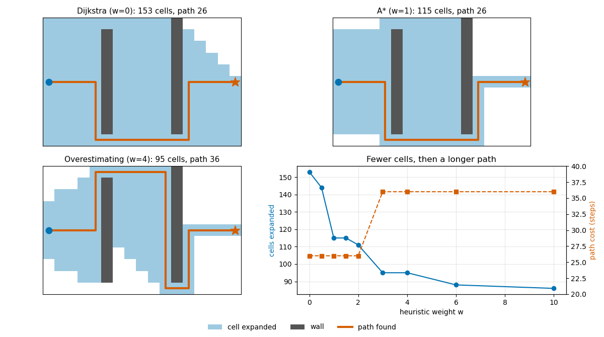

# 격자 탐색: Dijkstra에서 A*로 (Grid Search: Dijkstra to A*)

> A*는 약속이 붙은 Dijkstra입니다. 남은 거리를 절대 크게 잡지 않는 추측 덕분에 최적 경로에 있을 수 없는 칸을 건너뜁니다.

**유형:** 만들기   **선수 지식:** 09/03 충돌 검사   **시간:** 약 15분

## 쉽게 말하면

격자 보드게임에서 막힌 칸을 피해 깃발까지 가장 짧게 가려고 해요. Dijkstra는 그 칸까지 이미 쓴 이동 횟수 순으로 살펴봐요. A*는 앞으로 필요한 이동의 추측도 더해서 유망한 길부터 봐요.

가로와 세로로만 한 칸씩 움직인다면 남은 가로 칸 수와 세로 칸 수의 합은 벽을 돌아가는 거리를 빼므로 필요한 이동 횟수보다 커지지 않아요. 그래서 가장 짧은 길을 찾을 수 있어요. 추측을 부풀리면 가까워 보이는 틈을 골랐다가 더
돌아갈 수 있어요.

## 문제

planner는 격자 지도에서 경로를 눈 깜짝할 사이에 찾지만 그 안에서 무슨 일이 일어났는지는 모릅니다. 탐색을 다른 것으로 바꾸면 경로가 10칸 달라지거나 실행 단계가 열 배가 됩니다. 탐색을 직접 짜 보지 않으면 그 차이가 알고리즘 때문인지 설정 때문인지 가를 수 없습니다.

## 개념



*두 탐색 모두 가장 작은 우선순위의 칸을 계속 확장합니다. 우선순위만 다릅니다.*

Dijkstra는 시작점에서의 비용 `g` 순으로 칸을 확장합니다. A*는 `f = g + h`를 쓰고 `h`는 목표까지 비용의 추측입니다. 4방향 격자에서 맨해튼 거리는 절대 과대추정하지 않으므로 A*는 Dijkstra와 같은 비용을 돌려줍니다.

맨해튼 거리는 한 걸음에 1보다 더 줄지 않아서 같은 칸이 두 번 확장되지 않습니다.



*admissible한 `h`는 답을 최적으로 지킵니다. `h`에 `w > 1`을 곱하면 약속이 깨지고 손해는 최적 비용의 `w`배로 제한됩니다.*

빈 격자에서 A*는 자기 경로 위의 칸만 보고 Dijkstra는 지도 전체를 훑습니다. 벽이 있으면 이 이점이 일부 줄어듭니다.



*같은 지도에서 세 가지 탐색입니다. 가중치 4는 칸을 덜 확장하지만 가까운 틈으로 들어갔다가 멀리 되돌아 내려갑니다. 경로 비용은 가중치 2와 3 사이에서 26에서 36으로 뜁니다.*

## 만들기

```python
heap = [(w * manhattan(start, goal), 0, start)]
while heap:
    _, _, cell = heapq.heappop(heap)
    if cell in closed:
        continue
    closed.add(cell)
    for n in neighbours(cell):
        if g[cell] + 1 < g.get(n, 1e9):
            g[n] = g[cell] + 1
            heapq.heappush(heap, (g[n] + w * manhattan(n, goal), -g[n], n))
```

`w = 0`이 Dijkstra이고 `w = 1`이 A*입니다. 데모의 무작위 40x40 지도에서 같은 비용 78에 Dijkstra는 1202칸 A*는 152칸을 확장합니다.

```bash
cd robotics-engineering-from-scratch
python3 -m pytest phases/09-motion-planning/05-grid-search-dijkstra-to-astar -q
python3 phases/09-motion-planning/05-grid-search-dijkstra-to-astar/code/main.py
```

## 실제 도구로 보기

같은 격자를 `w = 0`과 `w = 1`로 돌려 비용과 확장한 칸 수를 비교하세요. Dijkstra와 A*를 바꿀 수 있는 planner는 모두 같습니다. `h = 0`인 A*가 Dijkstra이고 `w > 1`을 곱한 휴리스틱은 최적의 `w`배 이하인 경로를 줍니다.

출처는 Wikipedia의 A* search algorithm 문서입니다(https://en.wikipedia.org/wiki/A*_search_algorithm, 2026년 11월 10일 확인).

## 결과물

`outputs/skill-grid-search-check.md`는 planner의 휴리스틱, 가중치, 확장 수를 점검합니다.

## 연습 문제

1. 대각선 이동을 허용하고 admissible한 휴리스틱을 찾으세요.
2. `g`의 동률 처리를 반대로 바꾸고 늘어나는 칸 수를 세어 보세요.
3. trap 지도가 비용 36을 돌려주는 가장 작은 `w`를 찾으세요.
