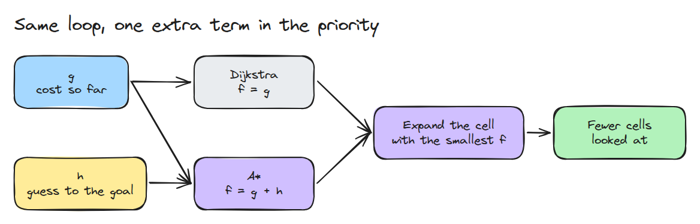
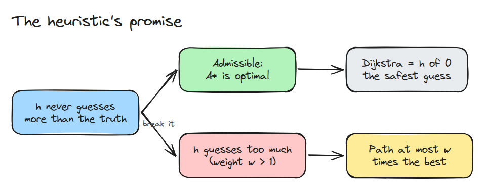
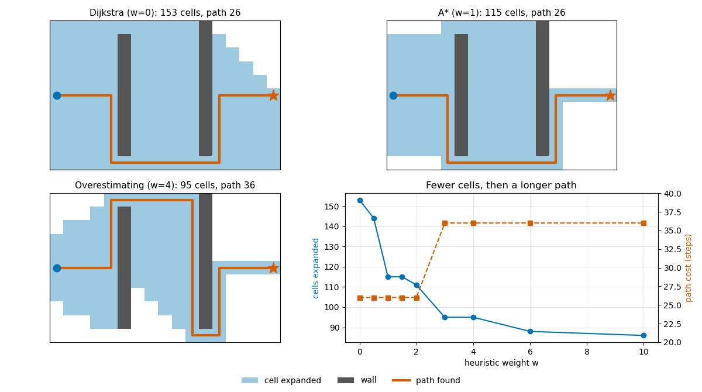

# 격자 탐색: Dijkstra에서 A*로 (Grid Search: Dijkstra to A*)

> 로봇이 모든 칸을 다 확인하지 않고 지도에서 가장 짧은 길을 찾는 방법을 알아봅니다.

**유형:** 만들기   **선수 지식:** 09/03 충돌 검사   **시간:** 약 15분

## 쉽게 말하면

탐사 로봇이 벽이 있는 격자에서 깃발까지 가장 짧게 걸어갈 길을 찾아요. Dijkstra는 그 칸까지 이미 쓴 걸음 수 순서로 칸을 확장해요. A*(A-star)는 앞으로 필요한 걸음의 추측도 더해서 깃발 쪽 칸을 먼저 확장해요.

실제로 필요한 걸음보다 크게 말하지 않는 추측은 가장 짧은 길을 남겨 두어요. 추측을 부풀리면 가까워 보이지만 더 돌아가는 틈으로 서둘러 들어갈 수 있어요.

## 핵심 용어

- **Dijkstra**: 그 칸까지 이미 쓴 비용 순서로 칸을 확장하는 탐색입니다.
- **A-star**: Dijkstra에 남은 비용의 추측을 더해서 목표 쪽으로 향하는 탐색입니다.
- **Expanding a cell**: 그 칸의 이웃을 살펴보고 탐색에 더하는 일입니다.
- **Heuristic (`h`)**: 목표까지 남은 비용의 추측입니다.
- **Admissible**: 실제 남은 비용보다 크게 추측하지 않는 heuristic입니다.
- **Manhattan distance**: 벽을 무시하고 가로 칸 수와 세로 칸 수를 더한 값입니다.

## 문제

배달 로봇이 격자 지도를 건넌다고 상상해 보세요. planner는 눈 깜짝할 사이에 답하지만 탐색을 바꾸면 경로가 10칸 달라지거나 실행 단계가 열 배가 됩니다. 탐색을 직접 짜 봐야 이유를 알 수 있습니다.

## 개념

실제 로봇은 빠르고 좋게 계획해야 하는데 heuristic이 둘을 맞바꾸는 손잡이입니다.



*두 탐색 모두 가장 작은 우선순위의 칸을 확장합니다. 우선순위만 다릅니다.*

Dijkstra는 시작점에서의 비용 `g` 순으로 칸을 확장합니다. A*는 `f = g + w * h`를 쓰고 가중치 `w`가 추측 `h`를 키우거나 줄입니다. `w = 0`이 Dijkstra이고 `w = 1`이 A*이며 `w > 1`은 추측을 부풀립니다.
상하좌우로만 움직이는 4방향 격자에서 Manhattan distance는 과대추정하지 않으므로 A*는 Dijkstra와 같은 비용을 돌려줍니다. 한 칸 움직이면 이 거리는 많아야 1 변하고 `g`는 1 늘어나므로 `f`가 줄지 않아서 같은 칸이 두 번 확장되지 않습니다.



*admissible한 `h`는 A*를 최적으로 지키고 `w > 1`이면 경로 비용이 최적의 `w`배까지 커질 수 있습니다.*



*가중치 4는 칸을 덜 확장하지만 더 긴 경로를 돌려줍니다. 경로 비용은 가중치 2와 3 사이에서 26에서 36으로 뜁니다.*

trap 지도에는 아래쪽이 열린 벽 두 개가 있고 첫 벽에는 위쪽 틈도 있는데 그 틈은 둘째 벽에 막혀 막다른 길이 됩니다.
`w = 1`이면 탐색은 115칸을 확장하고 낮은 틈을 지나는 26걸음 길을 찾습니다.
`w = 4`이면 위쪽 틈으로 파고들어 95칸을 확장한 뒤 깃발에 닿지만 길은 36걸음입니다.


*파란 쪽(`w = 4`)은 먼저 출발하지만 더 멀리 걸어서 초록 쪽(`w = 1`)이 이깁니다.*

## 만들기

```python
heap = [(w * manhattan(start, goal), 0, start)]
while heap:
    _, _, cell = heapq.heappop(heap)
    if cell in closed:
        continue
    closed.add(cell)
    for n in neighbours(cell):
        if g[cell] + 1 < g.get(n, 1e9):
            g[n] = g[cell] + 1
            heapq.heappush(heap, (g[n] + w * manhattan(n, goal), -g[n], n))
```

데모의 무작위 40x40 지도에서 같은 비용 78에 Dijkstra는 1202칸 A*는 152칸을 확장합니다.

```bash
cd robotics-engineering-from-scratch
python3 -m pytest phases/09-motion-planning/05-grid-search-dijkstra-to-astar -q
python3 phases/09-motion-planning/05-grid-search-dijkstra-to-astar/code/main.py
```

## 실제 도구로 보기

같은 격자를 `w = 0`과 `w = 1`로 돌려 비용과 확장한 칸 수를 비교하세요.

출처는 Wikipedia의 A* search algorithm 문서입니다(https://en.wikipedia.org/wiki/A*_search_algorithm, 2026년 11월 10일 확인).

## 결과물

`outputs/skill-grid-search-check.md`는 planner의 heuristic, 가중치, 확장 수를 점검합니다.

## 연습 문제

1. 대각선 이동을 허용하고 admissible한 heuristic을 찾으세요.
2. `g`의 동률 처리를 반대로 바꾸고 늘어나는 칸 수를 세어 보세요.
3. trap 지도가 비용 36을 돌려주는 가장 작은 `w`를 찾으세요.
