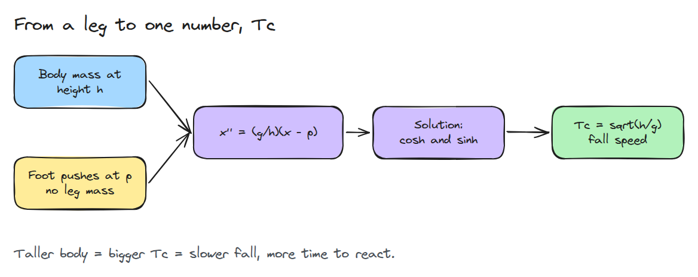
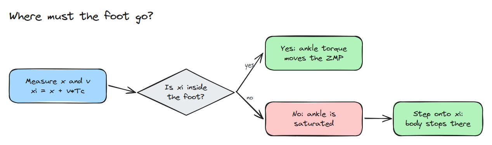
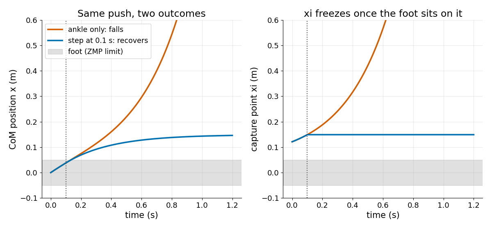

# Inverted Pendulum and ZMP

> A standing body falls like a pendulum balanced on its tip, and the capture point tells you where the next foot must land.

**Type:** Build   **Prerequisites:** 03/04 PID and Tuning   **Time:** ~15 minutes

## The Problem

A biped is nudged from behind and its ankles push back as hard as they can, yet it keeps tipping forward. The ankles can only move the force point inside the foot, so a big enough push is beyond them. A model small enough to tell you, before the fall, whether a step is required and where is what you need.

## The Concept



*Treat the body as one mass at height `h` and the leg as massless. The tipping speed then collapses into one number, `Tc`.*

With the foot at `p`, the mass obeys `x'' = (g/h)(x - p)`. Trying `exp(t/Tc)` gives `1/Tc^2 = g/h`, so `Tc = sqrt(h/g)`. The general solution is `x = p + (x0-p) cosh(t/Tc) + Tc v0 sinh(t/Tc)`. For `h = 0.9 m`, `Tc` is about 0.30 s.

The zero-moment point (ZMP) is where the ground force acts: `p = x - (h/g) x''`. It cannot leave the foot. The capture point `xi = x + v Tc` obeys `xi' = (xi - p)/Tc`, so a foot placed on `xi` freezes it and the body stops over that foot.



*If `xi` is inside the foot the ankle can hold. If not, only a step helps.*



*Same 0.4 m/s push, capture point 0.12 m, foot half-length 0.05 m. Ankle only: the body diverges. A step onto `xi` at 0.1 s: it stops at 0.15 m.*

## Build It

```python
def lipm_state(x0, v0, p, t, h, g=G):
    tc, a = time_constant(h, g), x0 - p
    c, s = np.cosh(t / tc), np.sinh(t / tc)
    return p + a * c + tc * v0 * s, a * s / tc + v0 * c

def capture_point(x, v, h, g=G):
    return x + v * time_constant(h, g)
```

`simulate()` integrates the same equation with RK4 and the tests check it against the closed form. `fall_or_recover()` clamps the ZMP to the foot and optionally steps.

```bash
cd robotics-engineering-from-scratch
python3 -m pytest phases/10-legged-and-aerial/01-inverted-pendulum-and-zmp -q
python3 phases/10-legged-and-aerial/01-inverted-pendulum-and-zmp/code/main.py
```

## Use It

SciPy's `solve_ivp` integrates the same ODE, and the last test compares it with the closed form. A full-body controller replaces the single mass with the whole-body centre of mass, but the capture-point test is the same.

## Ship It

`outputs/skill-capture-point-check.md` reviews balance code for ZMP limits, the capture-point test and the step trigger.

## Exercises

1. Raise `h` to 1.8 m and find the largest push the ankle alone can absorb.
2. Delay the step by 0.3 s and find where the foot must now land.
3. Add a foot width of 0.1 m and show the step target moves.
