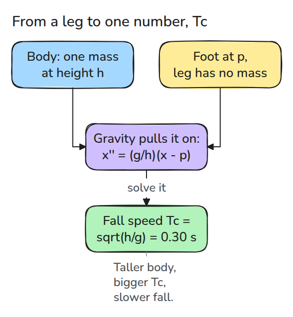
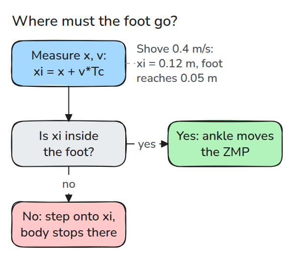
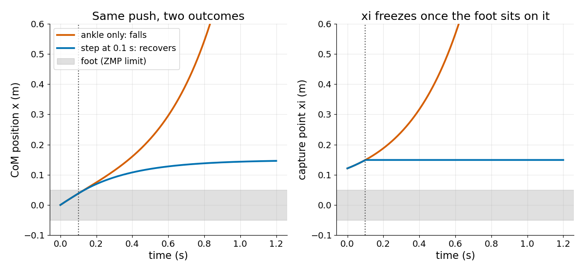

# Inverted Pendulum and ZMP

> Learn how a walking robot knows early that it will fall, and where to step.

**Type:** Build   **Prerequisites:** 03/04 PID and Tuning   **Time:** ~15 minutes

## In Plain Words

Someone shoves you from behind. You can lean on your toes, but only for a small shove, because the spot where the floor pushes up (ZMP) can move only as far as your foot is long.

A bigger shove carries your body farther before it would stop. That stopping spot, the capture point, lies beyond your toes. A foot placed there stops you.

## Key Terms

- **Inverted pendulum**: a mass balanced on top of a leg, like a pencil on its tip; it falls if not held.
- **Acceleration (`x''`)**: how fast the speed changes; here, how hard gravity pulls the body on.
- **Time constant (`Tc`)**: the time in which tipping grows by a factor of 2.7.
- **ZMP**: zero-moment point, the spot under the foot where the ground's push acts.
- **Capture point**: where the body would stop if the foot were placed there.
- **`exp`**: the exponential function, which grows by the same factor in equal time steps.

## The Problem

Picture a walking robot shoved from behind. Its ankles push back hard, yet it keeps tipping, because ankles can only shift the push inside the foot. Is a step needed, and where?

## The Concept

A walking robot has little time to react, so it needs one number that says where to step.

A standing body falls like a balanced pencil: the farther it leans, the faster it falls. If you put a foot exactly where the body would come to rest, called the capture point, the fall stops.



*One mass on a thin leg.*

For a small shove the capture point stays inside the foot, so the ankle alone can hold. For a big shove it lands beyond the toes, and only a step there helps.


*Green stays inside the foot. Blue leaves it and falls.*



*Inside the foot, the ankle holds. Outside, step.*



*Ankle only: it falls. A step to the capture point recovers.*

<details><summary>The math (optional)</summary>

`x` is the body's distance ahead of the ankle, `g` gravity and `h` the mass height. With the foot at `p`, `x'' = (g/h)(x - p)`. The solution grows like `exp(t/Tc)` with `Tc = sqrt(h/g)`, about 0.30 s for `h = 0.9 m`; a taller robot has a larger `Tc`, so more time to react. The ZMP is `p = x - (h/g) x''` and it must stay inside the foot. The capture point is `xi = x + v Tc` and moves at `xi' = (xi - p)/Tc`, so a foot placed on `xi` freezes it. A 10 cm foot lets the push sit at most 0.05 m from the ankle. With `v = 0.4 m/s`, `xi = 0.4 * 0.30 = 0.12 m`: the ankle alone fails. With 0.1 m/s, `xi = 0.03 m`: the ankle holds. After 0.1 s `xi` is 0.15 m, and a step there stops the body.

</details>

## Build It

```python
def lipm_state(x0, v0, p, t, h, g=G):
    tc, a = time_constant(h, g), x0 - p
    c, s = np.cosh(t / tc), np.sinh(t / tc)
    return p + a * c + tc * v0 * s, a * s / tc + v0 * c

def capture_point(x, v, h, g=G):
    return x + v * time_constant(h, g)
```

`simulate()` steps the equation forward (RK4). `fall_or_recover()` clamps the ZMP to the foot and optionally steps.

```bash
cd robotics-engineering-from-scratch
python3 -m pytest phases/10-legged-and-aerial/01-inverted-pendulum-and-zmp -q
python3 phases/10-legged-and-aerial/01-inverted-pendulum-and-zmp/code/main.py
```

## Use It

The last test checks the model against SciPy's ODE solver.

## Ship It

`outputs/skill-capture-point-check.md` reviews balance code for the ZMP, capture-point and step logic.

## Exercises

1. Make the robot taller and see how much push the ankle can still absorb.
2. Delay the step and see where the foot must land.
3. Make the foot wider and watch the step target move.
