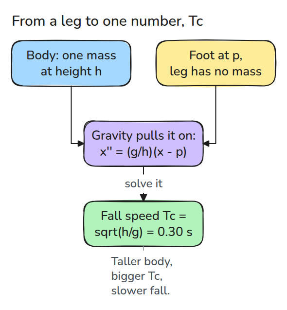
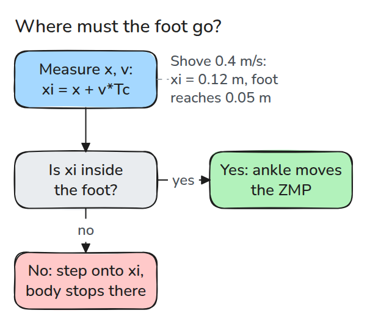
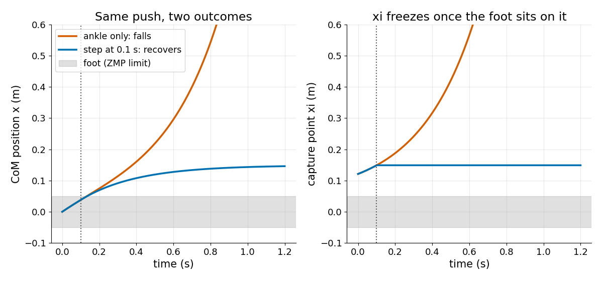

# 도립진자와 ZMP

> 서 있는 몸은 균형 잡은 연필처럼 넘어지고 capture point는 다음 발이 어디에 닿아야 하는지 알려 줍니다.

**유형:** 만들기   **선수 지식:** 03/04 PID와 튜닝   **시간:** 약 15분

## 쉽게 말하면

누가 뒤에서 확 밀었다고 해 보세요. 몸이 앞으로 움직이기 시작하고 발끝에 힘을 실어 버틸 수 있어요. 하지만 살짝 밀렸을 때만 통해요. 바닥이 위로 받치는 힘의 위치(ZMP)가 발 길이만큼밖에 움직이지 못하기 때문이에요.

더 세게 밀리면 몸이 멈추기까지 더 멀리 가요. 그렇게 멈추게 될 지점이 capture point이고 발끝 너머에 있어요. 몸을 기울여서는 거기에 닿지 못하지만 그곳에 발을 놓으면 멈출 수 있어요.

## 문제

뒤에서 밀린 걷는 로봇이 발목으로 세게 버티는데도 계속 앞으로 기웁니다. 발목은 바닥이 받치는 점을 발바닥 안에서만 옮길 수 있어서 큰 밀침은 감당하지 못합니다. 넘어지기 전에 걸음이 필요한지, 필요하다면 어디에 내디뎌야 하는지 알려 주는 모델이 필요합니다.

## 개념



*몸을 끝으로 선 연필처럼 높이 `h`의 질점 하나와 질량 없는 다리로 봅니다. 그러면 넘어지는 속도가 `Tc`라는 숫자 하나가 됩니다.*

`x`는 몸이 발목보다 앞선 거리이고 `g`는 중력가속도입니다. 발이 `p`에 있으면 질점은 `x'' = (g/h)(x - p)`를 따릅니다. 몸이 발보다 앞서 있을수록 중력이 몸을 더 세게 앞으로 끌어당깁니다(`x''`는 가속도입니다).

`exp(t/Tc)`를 대입해 보세요. 이계도함수가 `exp(t/Tc)/Tc^2`이므로 `1/Tc^2 = g/h`입니다. `h = 0.9 m`이면 `Tc = sqrt(h/g)`는 약 0.30초이고 기우는 정도는 `Tc`마다 2.7배(e)로 커집니다.

같은 식을 `p`에 대해 풀면 zero-moment point(ZMP)가 나옵니다. 발 아래에서 지면 반력이 작용하는 점으로 `p = x - (h/g) x''`입니다. 지면은 밀기만 하므로 이 점은 발 밖으로 나갈 수 없습니다.

capture point는 몸의 위치에 속도와 `Tc`의 곱을 더한 값 `xi = x + v Tc`입니다. `xi' = (xi - p)/Tc`(`xi'`는 `xi`의 속도입니다)를 따르므로 발을 `xi`에 놓으면 `xi`가 멈추고 몸은 그 발 위에서 정지합니다.

예: 길이 10 cm인 발은 지면이 미는 점을 발목에서 최대 0.05 m까지만 옮기게 해 줍니다. 밀침으로 몸이 `v = 0.4 m/s`를 얻으면 `xi = 0.4 * 0.30 = 0.12 m`로 0.05 m를 넘으므로 발목만으로는 버티지 못합니다. 0.1 m/s로 밀리면 `xi = 0.03 m`로 발 안에 있어서 발목만으로 버팁니다.


*보라색 기둥은 capture point이고 회색 기둥 두 개는 발의 양 끝입니다(둘 다 발목에서 3배 멀리 그렸습니다). 초록은 0.1 m/s로 밀렸고 보라색 기둥이 두 기둥 사이에 머뭅니다. 파랑은 0.4 m/s로 밀렸고 기둥이 벗어나 계속 멀어지며 몸이 쓰러집니다.*



*`xi`가 발 안에 있으면 발목으로 버틸 수 있습니다. 밖에 있으면 걸음만 해결책입니다.*



*발목만 쓰면 몸이 발산합니다. 0.1초를 기다리면 `xi`가 0.15 m로 옮겨 가므로 그곳에 발을 내디디면 몸이 0.15 m에서 멈춥니다.*

## 만들기

```python
def lipm_state(x0, v0, p, t, h, g=G):
    tc, a = time_constant(h, g), x0 - p
    c, s = np.cosh(t / tc), np.sinh(t / tc)
    return p + a * c + tc * v0 * s, a * s / tc + v0 * c

def capture_point(x, v, h, g=G):
    return x + v * time_constant(h, g)
```

`simulate()`는 같은 식을 시간에 따라 한 걸음씩 풉니다(RK4). `fall_or_recover()`는 ZMP를 발 안으로 제한하고 필요하면 걸음을 냅니다.

```bash
cd robotics-engineering-from-scratch
python3 -m pytest phases/10-legged-and-aerial/01-inverted-pendulum-and-zmp -q
python3 phases/10-legged-and-aerial/01-inverted-pendulum-and-zmp/code/main.py
```

## 실제 도구로 보기

마지막 테스트가 `lipm_state`를 SciPy의 `solve_ivp`와 비교합니다.

## 결과물

`outputs/skill-capture-point-check.md`는 균형 코드에서 ZMP 제한, capture point 검사, 걸음 trigger를 검토합니다.

## 연습 문제

1. `h`를 1.8 m로 올리고 발목만으로 받을 수 있는 가장 큰 밀침을 찾으세요.
2. 걸음을 0.3초 늦추고 발이 어디에 닿아야 하는지 구하세요.
3. 발 폭 0.1 m를 넣고 걸음 목표가 움직이는 것을 보이세요.
