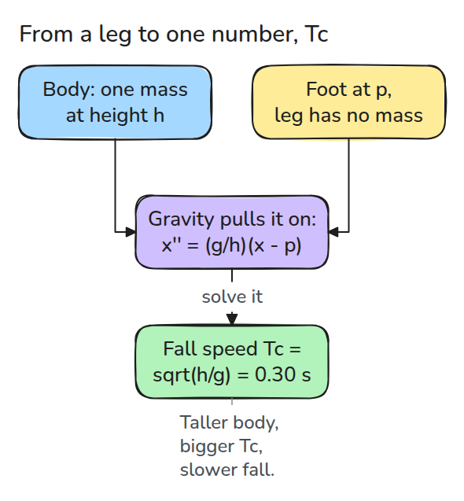
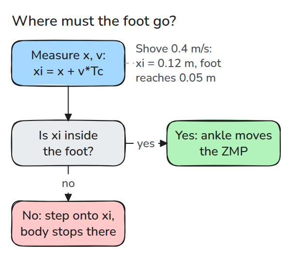
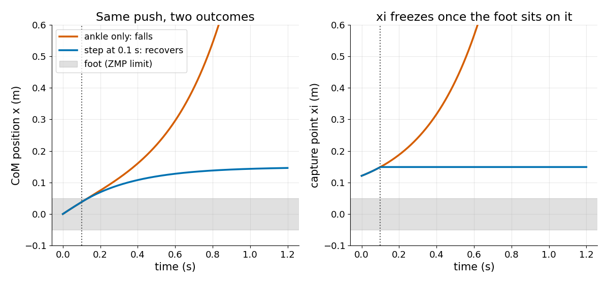

# 도립진자와 ZMP

> 걷는 로봇이 넘어지기 전에 미리 알아채는 방법과 다음 발이 어디에 닿아야 하는지 알아봅니다.

**유형:** 만들기   **선수 지식:** 없음   **시간:** 약 15분

## 쉽게 말하면

누가 뒤에서 확 밀었다고 해 보세요. 발끝에 힘을 실어 버틸 수는 있지만 살짝 밀렸을 때만 가능해요. 발 아래에서 바닥이 위로 미는 곳은 발 길이만큼밖에 움직이지 못하기 때문이에요. 그곳이 ZMP예요.

더 세게 밀리면 몸은 발끝 너머 더 먼 곳에서 멈추게 돼요. 그 지점이 capture point이고 그곳에 발을 놓으면 멈출 수 있어요.

## 핵심 용어

- **Inverted pendulum**: 다리 위에 균형 잡고 선 추입니다. 연필을 끝으로 세운 것과 같아서 잡아 주지 않으면 넘어집니다.
- **Acceleration**: 속도가 얼마나 빨리 바뀌는지입니다. 여기서는 중력 때문에 기우는 속도가 얼마나 빨리 커지는지입니다.

- **ZMP**: zero-moment point입니다. 발 아래에서 지면의 미는 힘이 작용하는 점입니다.
- **Capture point**: 발을 놓으면 넘어짐이 멈추는 지점입니다.


## 문제

걷는 로봇이 뒤에서 밀렸다고 상상해 보세요. 발목으로 세게 버티는데도 계속 기웁니다. 발목은 바닥이 받치는 점을 발바닥 안에서만 옮길 수 있기 때문입니다. 한 걸음 내디뎌야 하는지, 내디뎌야 한다면 어디에 놓아야 하는지 알아야 합니다.

## 개념

걷는 로봇은 반응할 시간이 짧으므로 어디를 디뎌야 하는지 알려 주는 숫자 하나가 필요합니다.

서 있는 몸은 균형 잡은 연필처럼 넘어집니다. 기울수록 더 빨리 넘어집니다. 몸이 멈추게 될 지점을 capture point라고 하고 그곳에 정확히 발을 놓으면 넘어짐이 멈춥니다.



*가는 다리 위에서 기우는 추 하나입니다.*

살짝 밀리면 capture point가 발 안에 있어서 발목만으로 버틸 수 있습니다. 세게 밀리면 발끝 너머에 놓이고 그곳으로 내딛는 걸음만 도움이 됩니다.


*초록은 capture point가 발 안에 머물고 파랑은 발 밖으로 벗어나 쓰러집니다.*



*발 안이면 발목이 버티고 밖이면 걸음입니다.*



*발목만 쓰면 넘어지고 capture point로 걸음을 내디디면 회복합니다.*

<details><summary>The math (optional)</summary>

`x`는 몸이 발목보다 앞선 거리, `g`는 중력가속도, `h`는 질점 높이입니다.
발이 `p`에 있으면 `x'' = (g/h)(x - p)`입니다.
해는 `exp(t/Tc)`(지수함수)처럼 커지고 time constant는 `Tc = sqrt(h/g)`입니다. 이 시간 동안 기우는 정도가 2.7배로 커지고 `h = 0.9 m`이면 약 0.30초입니다.
키가 큰 로봇은 `Tc`가 커서 반응할 시간이 더 많습니다.
ZMP는 `p = x - (h/g) x''`이고 발 안에 있어야 합니다.
capture point는 `xi = x + v Tc`이고 `xi' = (xi - p)/Tc`를 따르므로 발을 `xi`에 놓으면 `xi`가 멈춥니다.
길이 10 cm인 발에서는 지면이 미는 점이 발목에서 최대 0.05 m까지만 움직일 수 있습니다.
`v = 0.4 m/s`이면 `xi = 0.4 * 0.30 = 0.12 m`라서 발목만으로는 버티지 못합니다.
0.1 m/s이면 `xi = 0.03 m`로 발 안이라서 발목이 버팁니다.
0.1초 뒤 `xi`가 0.15 m이므로 그곳에 발을 내디디면 몸이 멈춥니다.

</details>

## 만들기

```python
def lipm_state(x0, v0, p, t, h, g=G):
    tc, a = time_constant(h, g), x0 - p
    c, s = np.cosh(t / tc), np.sinh(t / tc)
    return p + a * c + tc * v0 * s, a * s / tc + v0 * c

def capture_point(x, v, h, g=G):
    return x + v * time_constant(h, g)
```

`simulate()`는 같은 식을 짧은 시간 간격으로 나눠 풀고(RK4) `fall_or_recover()`는 ZMP를 발 안으로 제한하고 필요하면 걸음을 내디딥니다.

```bash
cd robotics-engineering-from-scratch
python3 -m pytest phases/10-legged-and-aerial/01-inverted-pendulum-and-zmp -q
python3 phases/10-legged-and-aerial/01-inverted-pendulum-and-zmp/code/main.py
```

## 실제 도구로 보기

마지막 테스트가 이 모델을 완성된 SciPy solver와 비교합니다.

## 결과물

`outputs/skill-capture-point-check.md`는 균형 코드에서 ZMP 제한, capture point 검사, 걸음 trigger를 검토합니다.

## 연습 문제

1. 로봇의 키를 키우고 발목만으로 받아낼 수 있는 밀침이 얼마나 큰지 보세요.
2. 걸음을 잠깐 늦추고 발이 닿을 자리가 어떻게 바뀌는지 보세요.
3. 발을 더 넓게 만들고 걸음의 목표 지점이 어떻게 움직이는지 보세요.
