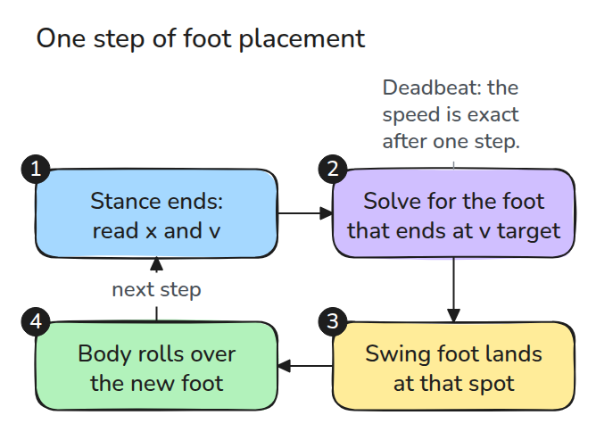
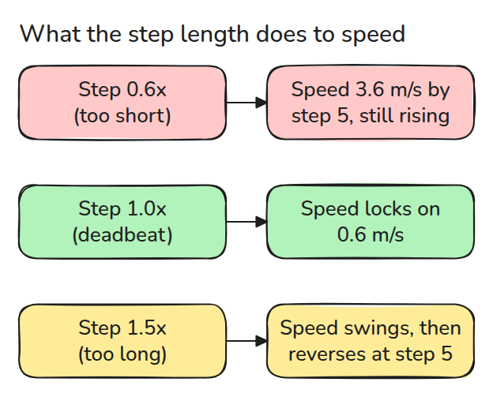
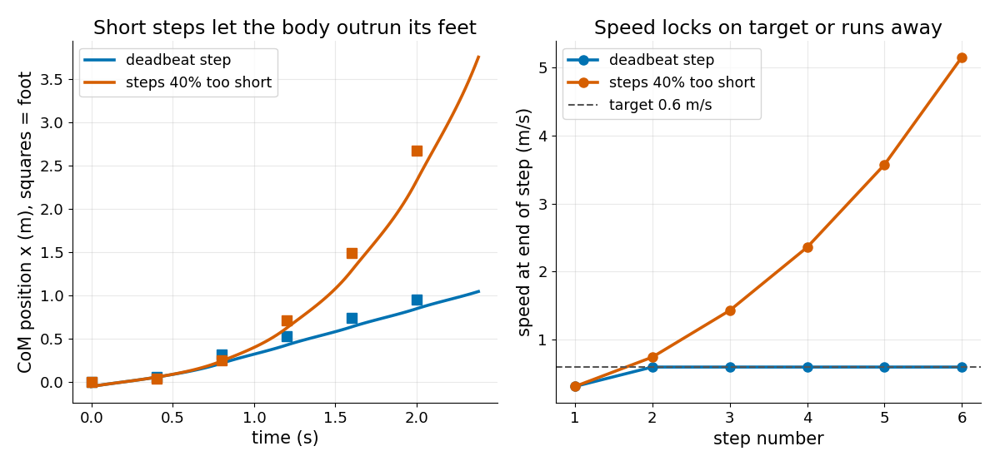

# Walking by Foot Placement

> Learn how a walking robot controls its speed just by choosing where each foot lands.

**Type:** Build   **Prerequisites:** 10/01 Inverted Pendulum and ZMP   **Time:** ~15 minutes

## In Plain Words

You control walking speed with where each foot lands. A foot well ahead leaves your body behind it, so gravity pulls you back and you slow down. A foot too close lets your body pass over it, so gravity pulls you forward and you speed up.

A walking model picks each spot from the body's position and speed.

## Key Terms

- **Foot placement**: choosing where the next foot lands in order to control speed.
- **Stance**: the time one foot stays on the ground.
- **Touchdown**: the moment a swinging foot lands.
- **Deadbeat**: a controller that reaches the target in one step and then stays exact.
- **`Tc`**: the time scale of the body's fall, from lesson 01.
- **`sinh`, `cosh`**: curves built from `exp(t/Tc)` and `exp(-t/Tc)`; they describe the falling body.

## The Problem

Picture a walking robot asked for 0.6 m/s with a plausible fixed step. It speeds up each step until its body is far ahead of its feet: the steps were a little short.

## The Concept

A real walker has no brakes, only feet, so foot placement is how it speeds up or slows down.



*Each stance end: read `x` and `v`, pick the next foot.*

Stance lasts `T` and the next foot sits at `p`. Let `u = x - p` be how far the body is ahead of that foot at touchdown. Lesson 01's `lipm_state` gives the speed at the end of the stance: `v' = (u/Tc) sinh(T/Tc) + v cosh(T/Tc)`. Setting `v' = v_target` and solving for `u` gives the foot, `p = x - u`. That is one-step deadbeat.

Start at `v = 0.3 m/s`, target 0.6 m/s. Speeds after each step (m/s): deadbeat 0.31, 0.60, 0.60 (the first foot was set in advance). Steps 1.5 times too long give 0.31, 0.42, 0.22, 0.67, -0.34 (negative: backward).


*Blue (steps 1.5 times deadbeat) barely advances; green walks at 0.6 m/s.*



*Steps scaled by 0.6: speed runs away. By 1.5: speed swings and reverses.*

In steady walking the deadbeat step is `2 Tc v tanh(T/2Tc)`: 0.21 m for `T = 0.4 s`, `h = 0.9 m`, `v = 0.6 m/s`.



*Deadbeat locks 0.6 m/s from step 2; 60% steps reach 5 m/s by step six.*

## Build It

```python
def next_foot(x, v, v_target, T, h):
    tc = time_constant(h)
    u = (v_target - v * np.cosh(T / tc)) * tc / np.sinh(T / tc)
    return x - u
```

`walk()` chains stances; `step_scale` multiplies the step length so you can break it.

```bash
cd robotics-engineering-from-scratch
python3 -m pytest phases/10-legged-and-aerial/02-walking-by-foot-placement -q
python3 phases/10-legged-and-aerial/02-walking-by-foot-placement/code/main.py
```

## Use It

The last test checks the first stance against SciPy's integrator. Real controllers clamp the foot to reachable positions.

## Ship It

`outputs/skill-foot-placement-check.md` reviews a step controller for deadbeat consistency and reach limits.

## Exercises

1. Clamp the step length to 0.15 m; find the fastest speed the walker holds.
2. Change `T` to 0.6 s; recompute the steady step.
3. Add 20 mm of error to the measured `x`; see how far the speed misses.
