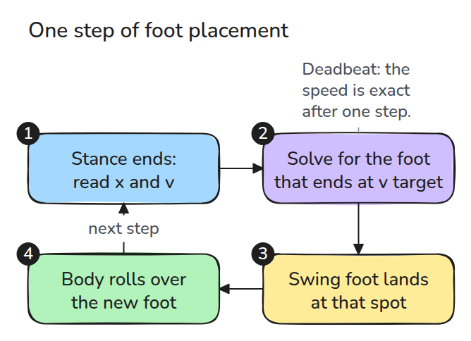
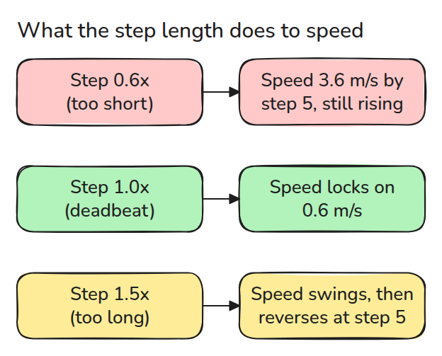
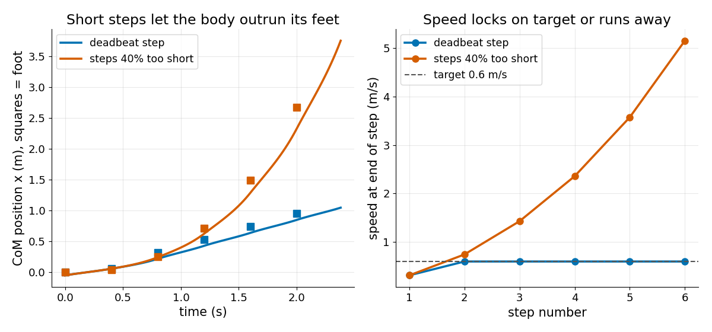

# Walking by Foot Placement

> A walker steers its speed with its feet: the next foot position is solved from where the body is now.

**Type:** Build   **Prerequisites:** 10/01 Inverted Pendulum and ZMP   **Time:** ~15 minutes

## In Plain Words

Walk across a playground and notice where your next foot lands relative to your moving body. Landing farther ahead gives the body more
time behind its support, which can slow its forward motion.

This walking model chooses that landing point from the body's current position and speed to reach the requested speed after the next
stance. Shortening the calculated step leaves the body too far ahead and speed can grow each step. Overstretching it can slow the model
into a reversal.

## The Problem

You ask a walking model for 0.6 m/s and give it a fixed, plausible step length. For a few steps it looks fine, then each step is faster than the last until the body is far ahead of its feet. The step length was a little short, and a short step pumps energy in instead of slowing you down.

## The Concept



*At the end of each stance the controller reads `x` and `v` and picks the next foot. The loop repeats every step.*

Stance lasts `T`, and the next foot sits at `p`. Write `u = x - p` for the body position relative to that foot at touchdown. The closed form from lesson 01 gives the speed at the end of the stance: `v' = (u/Tc) sinh(T/Tc) + v cosh(T/Tc)`. Setting `v' = v_target` and solving for `u` gives the foot: `p = x - u`. This is one-step deadbeat, so the speed is exact after one step.



*Scale the right step by 0.6 and speed runs away. Scale it by 1.5 and speed swings and reverses.*

In steady walking at `v_target` this gives a step of `2 Tc v tanh(T/2Tc)`. For `T = 0.4 s`, `h = 0.9 m` and `v = 0.6 m/s` that is 0.21 m.



*Same start, same target. Deadbeat steps lock the speed at 0.6 m/s from the second step. Steps scaled to 60% reach 5 m/s by step six.*

## Build It

```python
def next_foot(x, v, v_target, T, h):
    tc = time_constant(h)
    u = (v_target - v * np.cosh(T / tc)) * tc / np.sinh(T / tc)
    return x - u
```

`walk()` chains stances, each with `lipm_state` from lesson 01, and `step_scale` multiplies the commanded step length so you can break it.

```bash
cd robotics-engineering-from-scratch
python3 -m pytest phases/10-legged-and-aerial/02-walking-by-foot-placement -q
python3 phases/10-legged-and-aerial/02-walking-by-foot-placement/code/main.py
```

## Use It

The last test integrates the first stance with SciPy and compares it with the closed form used here. Real controllers add a step-time choice, swing-foot limits and a reach limit, and clamp the foot to reachable positions.

## Ship It

`outputs/skill-foot-placement-check.md` reviews a step controller for deadbeat consistency, step-length scaling and reach limits.

## Exercises

1. Clamp the step length to 0.15 m and find the fastest speed the walker can hold.
2. Change `T` to 0.6 s and recompute the steady step length.
3. Add a 20 mm error to the measured `x` and see how far the speed misses its target.
