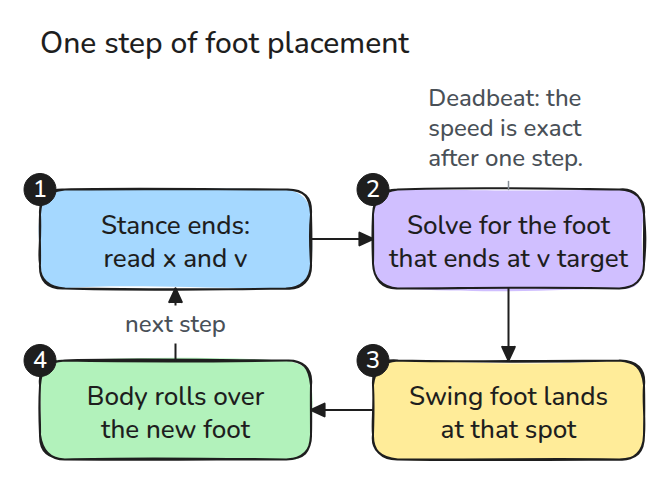
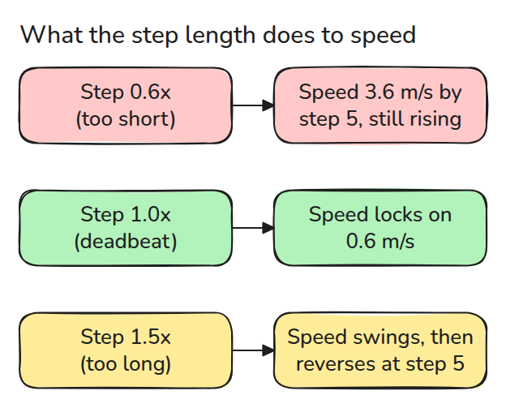
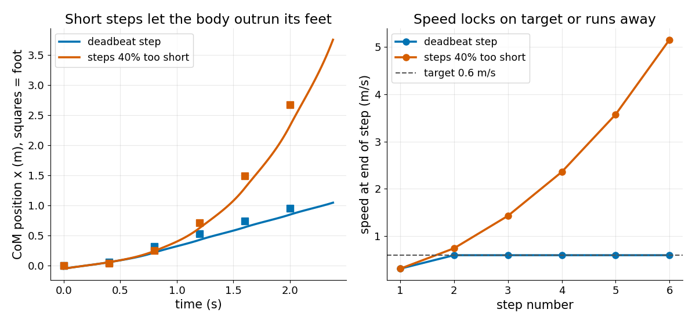

# 발 위치로 걷기

> 걷는 로봇이 발을 어디에 놓을지만 골라서 속도를 조절하는 방법을 알아봅니다.

**유형:** 만들기   **선수 지식:** 10/01 도립진자와 ZMP   **시간:** 약 15분

## 쉽게 말하면

걸을 때는 발을 어디에 놓느냐로 속도를 조절해요. 발을 몸보다 한참 앞에 놓으면 몸이 발 뒤에 남아요. 중력이 몸을 뒤로 끌어서 느려져요. 발을 너무 가까이 놓으면 몸이 발 위를 지나쳐 가요. 중력이 몸을 앞으로 끌어서 빨라져요.

보행 모델은 몸의 위치와 속도를 보고 발 놓을 자리를 골라요.

## 핵심 용어

- **Foot placement**: 속도를 조절하려고 다음 발이 닿을 자리를 고르는 일입니다.
- **Stance**: 한 발이 땅에 닿아 있는 시간입니다.
- **Touchdown**: 공중에 있던 발이 땅에 닿는 순간입니다.
- **Deadbeat**: 한 걸음 만에 목표 속도에 이르고 그대로 유지하는 규칙입니다.
- **Time constant (`Tc`)**: 몸이 얼마나 빨리 기우는지입니다. 01 레슨과 같은 값입니다.

## 문제

걷는 로봇에 일정한 속도로 걸으라고 하면서 그럴듯한 고정 보폭을 준다고 상상해 보세요. 걸음마다 빨라져 몸이 발보다 한참 앞으로 나갑니다. 걸음이 조금 짧았기 때문입니다.

## 개념

실제로 걷는 로봇에는 브레이크가 없고 발뿐이라서 발이 어디에 닿는지가 곧 속도를 올리고 내리는 방법입니다.

로봇은 걸음이 끝날 때마다 몸의 위치와 속도를 보고 다음 걸음이 정확히 목표 속도로 끝나도록 다음 발 자리를 고릅니다. 이것이 deadbeat입니다.



*걸음마다 읽고 다음 발을 고릅니다.*

발을 몸보다 한참 앞에 놓으면 몸이 발 뒤에 남아서 중력이 몸을 늦춥니다. 발을 너무 가까이 놓으면 몸이 발 위를 지나쳐서 중력이 몸을 가속합니다. 걸음이 너무 길면 속도가 요동치다가 방향이 뒤바뀌기도 합니다.


*파란 보행자는 걸음이 너무 길어 거의 나아가지 못하고 초록 보행자는 꾸준히 걷습니다.*



*너무 짧으면 속도가 걷잡을 수 없이 커지고 너무 길면 속도가 요동칩니다.*



*알맞은 걸음이면 두 번째 걸음부터 속도가 안정됩니다.*

<details><summary>The math (optional)</summary>

stance는 `T` 동안 이어지고 다음 발은 `p`에 놓입니다.
touchdown에 몸이 그 발보다 얼마나 앞에 있는지를 `u = x - p`라고 씁니다.
01 레슨의 모델로 stance 끝의 속도를 구하면 `v' = (u/Tc) sinh(T/Tc) + v cosh(T/Tc)`입니다. `sinh`와 `cosh`는 `exp(t/Tc)`로 만든 곡선이고 넘어지는 몸의 움직임을 나타냅니다.
`v' = v_target`으로 두고 `u`를 풀면 발은 `p = x - u`입니다.
0.3 m/s에서 출발하고 목표는 0.6 m/s입니다.
deadbeat로 걸으면 걸음마다 끝의 속도(m/s)는 0.31, 0.60, 0.60입니다(첫 발은 미리 놓아 둔 것입니다). 걸음을 1.5배 길게 하면 0.31, 0.42, 0.22, 0.67, -0.34입니다.
걸음을 0.6배로 줄이면 여섯 번째 걸음에서 속도가 5 m/s에 이릅니다.
일정한 속도로 걸을 때 deadbeat 걸음 길이는 `2 Tc v tanh(T/2Tc)`이고 `T = 0.4 s`, `h = 0.9 m`, `v = 0.6 m/s`이면 0.21 m입니다.

</details>

## 만들기

```python
def next_foot(x, v, v_target, T, h):
    tc = time_constant(h)
    u = (v_target - v * np.cosh(T / tc)) * tc / np.sinh(T / tc)
    return x - u
```

`walk()`는 걸음을 이어 붙이고 `step_scale`은 걸음 길이에 곱해지는 값이라 일부러 망가뜨려 볼 수 있습니다.

```bash
cd robotics-engineering-from-scratch
python3 -m pytest phases/10-legged-and-aerial/02-walking-by-foot-placement -q
python3 phases/10-legged-and-aerial/02-walking-by-foot-placement/code/main.py
```

## 실제 도구로 보기

마지막 테스트가 첫 걸음을 완성된 SciPy solver와 비교합니다.

## 결과물

`outputs/skill-foot-placement-check.md`는 발 위치 규칙의 deadbeat 일관성과 도달 범위 제한을 검토합니다.

## 연습 문제

1. 걸음을 길게도 짧게도 해 보고 속도를 보세요.
2. 걸음 길이에 상한을 두고 모델이 유지할 수 있는 가장 빠른 속도를 찾으세요.
3. 측정한 몸 위치에 작은 오차를 넣고 속도가 목표에서 얼마나 벗어나는지 보세요.
