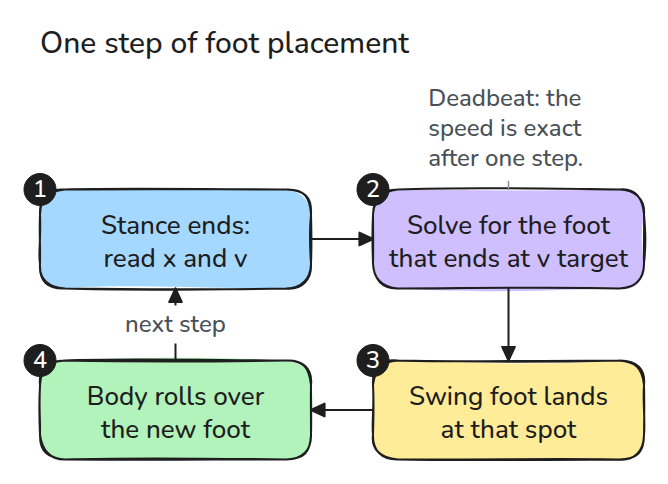
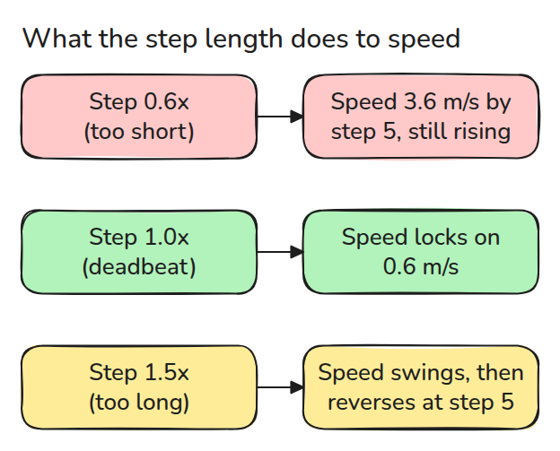
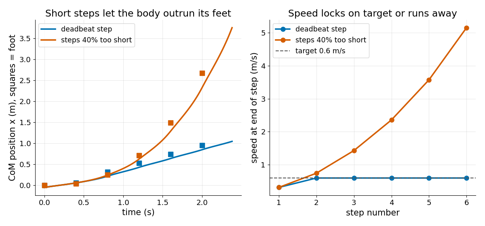

# 발 위치로 걷기

> 걷는 로봇은 발로 속도를 조종합니다. 다음 발 위치는 지금 몸이 있는 곳에서 풀어 냅니다.

**유형:** 만들기   **선수 지식:** 10/01 도립진자와 ZMP   **시간:** 약 15분

## 쉽게 말하면

걸을 때는 발을 어디에 놓느냐로 속도를 조절해요. 발을 몸보다 한참 앞에 놓으면 몸이 발 뒤에 있게 되어 중력이 몸을 뒤로 끌어서 느려져요. 발을 너무 가까이 놓으면 몸이 발 위를 지나쳐 가서 중력이 몸을 앞으로 끌어서 빨라져요.

보행 모델은 몸의 위치와 속도를 보고 발 놓을 자리를 골라서 다음 걸음이 끝날 때 요청한 속도가 되게 해요. 너무 짧은 걸음은 걸음마다 속도를 조금씩 더 키워요.

## 문제

보행 모델에 0.6 m/s를 요구하면서 그럴듯한 고정 보폭을 줍니다. 처음에는 괜찮아 보이다가 걸음마다 속도가 빨라져 몸이 발보다 한참 앞으로 나갑니다. 걸음이 조금 짧아서 중력이 몸을 줄이지 못하고 계속 앞으로 밀었기 때문입니다.

## 개념



*stance(한 발이 땅에 닿아 있는 시간)가 끝날 때마다 제어기가 몸 위치 `x`와 속도 `v`를 읽고 다음 발을 고릅니다.*

stance는 `T` 동안 이어지고 다음 발은 `p`에 놓입니다(`Tc`와 `h`는 01 레슨의 넘어지는 시간 규모와 몸 높이입니다). touchdown(발이 땅에 닿는 순간)에 몸이 그 발보다 얼마나 앞에 있는지를 `u = x - p`라고 씁니다.

01 레슨의 `lipm_state`로 stance 끝의 속도를 구하면 `v' = (u/Tc) sinh(T/Tc) + v cosh(T/Tc)`입니다(`v'`는 그 속도이고 `sinh`와 `cosh`는 `exp(t/Tc)`와 `exp(-t/Tc)`를 섞은 것입니다).

`v' = v_target`(요청한 속도)으로 두고 `u`를 풀면 발은 `p = x - u`입니다. 이것이 한 걸음 deadbeat이고 속도가 정확히 맞습니다.

예: `v = 0.3 m/s`에서 출발하고 목표는 0.6 m/s입니다. 걸음마다 끝의 속도(m/s)는 deadbeat 걸음에서 0.31, 0.60, 0.60입니다(첫 발은 미리 놓여 있었습니다).

deadbeat 길이의 1.5배인 걸음에서는 0.31, 0.42, 0.22, 0.67, -0.34입니다(음수는 뒤로 가는 속도입니다).


*파란 보행자의 걸음은 deadbeat 길이의 1.5배입니다. 발이 앞뒤로 튀고 몸은 거의 나아가지 못하는 동안 초록 보행자는 0.6 m/s로 계속 걷습니다. 바닥 선은 0.5 m 간격입니다.*



*deadbeat 걸음을 0.6배로 줄이면 속도가 발산합니다. 1.5배로 늘리면 발이 너무 앞에 닿아 중력이 몸을 되끌어서 속도가 요동치다가 뒤로 향합니다.*

`v_target`으로 일정하게 걸을 때 deadbeat 걸음 길이는 `2 Tc v tanh(T/2Tc)`입니다. `T = 0.4 s`, `h = 0.9 m`, `v = 0.6 m/s`이면 0.21 m입니다.



*출발과 목표가 같습니다. deadbeat 걸음은 2번째 걸음부터 속도를 0.6 m/s에 고정합니다. 60%로 줄인 걸음은 여섯 번째 걸음에 5 m/s에 이릅니다.*

## 만들기

```python
def next_foot(x, v, v_target, T, h):
    tc = time_constant(h)
    u = (v_target - v * np.cosh(T / tc)) * tc / np.sinh(T / tc)
    return x - u
```

`walk()`는 stance를 이어 붙입니다. `step_scale`은 걸음 길이에 곱해지므로 일부러 망가뜨려 볼 수 있습니다.

```bash
cd robotics-engineering-from-scratch
python3 -m pytest phases/10-legged-and-aerial/02-walking-by-foot-placement -q
python3 phases/10-legged-and-aerial/02-walking-by-foot-placement/code/main.py
```

## 실제 도구로 보기

마지막 테스트가 첫 stance를 SciPy의 적분기와 비교합니다. 실제 제어기는 걸음 시간 선택과 swing foot(공중을 지나는 발)의 제한을 더하고 발을 닿을 수 있는 위치로 자릅니다.

## 결과물

`outputs/skill-foot-placement-check.md`는 걸음 제어기의 deadbeat 일관성, 걸음 길이 배율, 도달 범위 제한을 검토합니다.

## 연습 문제

1. 걸음 길이를 0.15 m로 제한하고 걷는 모델이 유지할 수 있는 가장 빠른 속도를 찾으세요.
2. `T`를 0.6초로 바꾸고 정상 보행의 걸음 길이를 다시 계산하세요.
3. 측정한 `x`에 20 mm 오차를 넣고 속도가 목표에서 얼마나 벗어나는지 보세요.
