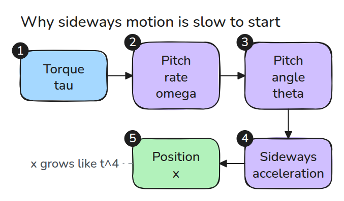

# Quadrotor Model

> Learn why a drone must tilt to move sideways, and why tilting makes it sink.

**Type:** Build   **Prerequisites:** 10/01 Inverted Pendulum and ZMP   **Time:** ~15 minutes

## In Plain Words

A quadrotor model predicts a drone's motion from its tilt and its thrust, the upward push its propellers get by throwing air down.

Tilt a hovering drone and part of the push shoves it sideways, so less holds it up. At the same thrust, a tilted drone sinks.

## Key Terms

- **Quadrotor**: a drone with four propellers.
- **Thrust (`T`)**: the total upward push of the propellers.
- **Pitch (`theta`)**: the tilt angle of the drone body.
- **Torque (`tau`)**: a twist that tilts the drone; the only way to change `theta`.
- **Hover**: staying at one height with zero acceleration.
- **Integration**: adding up a rate over time to get a total, like speed to distance.

## The Problem

Picture a drone told to move 1 m right. It seems to ignore you, then tips, drifts and loses height. It has only two inputs, thrust and one torque, for three things to move.

## The Concept

A real drone controller must know that moving sideways costs height, or it sinks on every turn.


*Tilt `theta` splits thrust into up and sideways.*

State: `x, z, theta` (sideways position, height, tilt). Inputs: `T`, `tau`. `m` is mass, `g` gravity, `I` how hard the drone is to twist:

`m x'' = T sin(theta)`, `m z'' = T cos(theta) - m g`, `I theta'' = tau`.

At `theta = 0` and `T = m g` every acceleration is zero: that is hover thrust. Tilted at that thrust, the height acceleration `g (cos(theta) - 1)` is negative. Holding height needs `T = m g / cos(theta)`, with sideways acceleration `g tan(theta)`.

A 0.5 kg drone tilted 20 degrees at `T = m g = 4.9 N` has height acceleration -0.59 m/s^2 and sinks 0.30 m in 1 s. Holding height needs 5.2 N (6% more), and the sideways acceleration is 3.6 m/s^2.


*Both at 20 degrees for 1 s. Blue (`T = m g`) sinks; green (`T = m g / cos(theta)`) holds.*



*Four integrations: a steady torque gives `x = g tau t^4 / (24 I)` for small angles.*


*Left: 10% extra thrust only climbs. Right: 0.002 Nm tilts 1 degree at 0.27 s but moves 1 cm at 0.47 s.*

## Build It

```python
def deriv(s, T, tau, m, I, g=G):
    th = s[2]
    return np.array([s[3], s[4], s[5], T*np.sin(th)/m, T*np.cos(th)/m - g, tau/I])
```

State is `[x, z, theta, vx, vz, omega]`; `simulate()` steps it forward (RK4). The example uses made-up `m = 0.5 kg`, `I = 0.004 kg m^2`.

```bash
cd robotics-engineering-from-scratch
python3 -m pytest phases/10-legged-and-aerial/03-quadrotor-model -q
python3 phases/10-legged-and-aerial/03-quadrotor-model/code/main.py
```

## Use It

The last test compares the end state with SciPy's `solve_ivp`.

## Ship It

`outputs/skill-quadrotor-model-check.md` reviews a quadrotor model for hover thrust, tilt coupling and units.

## Exercises

1. Tilt 30 degrees at `T = m g / cos(theta)`; find the sideways acceleration.
2. Find how long a 0.004 Nm torque takes to reach 10 degrees.
3. Add a drag force `-c vx`; find the new steady speed.
