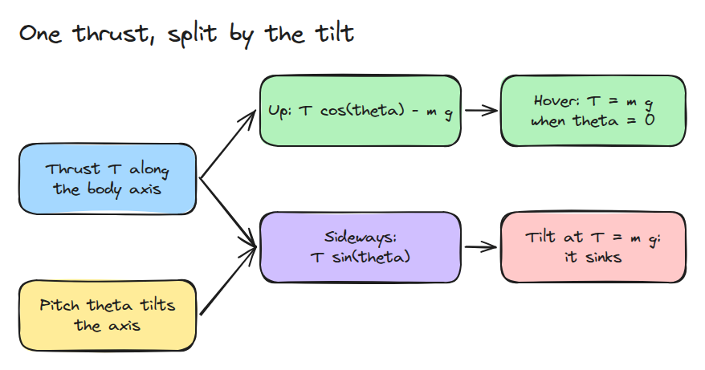
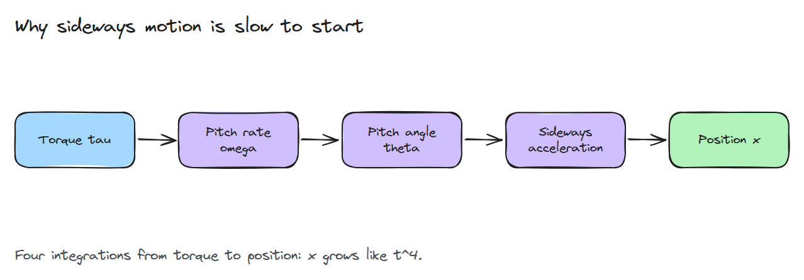
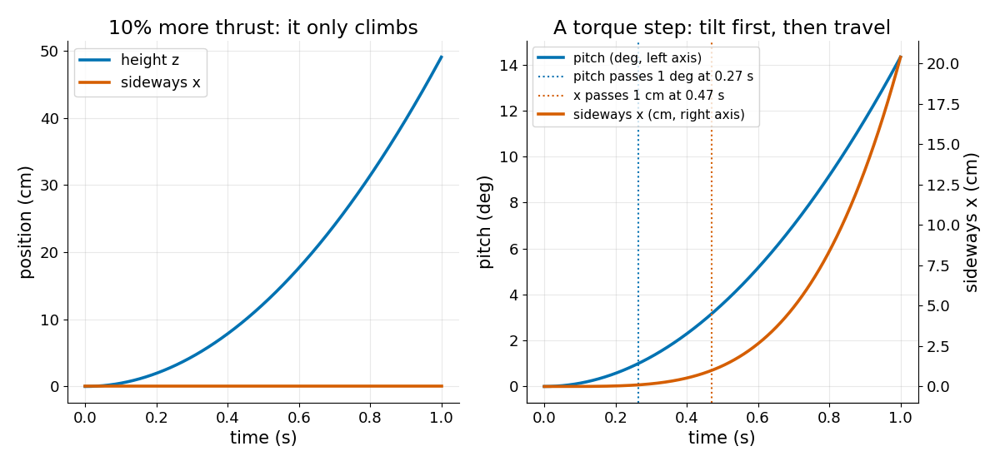

# Quadrotor Model

> A quadrotor cannot push sideways. It tilts first, and the tilt turns thrust into sideways force.

**Type:** Build   **Prerequisites:** 10/01 Inverted Pendulum and ZMP   **Time:** ~15 minutes

## The Problem

You command a drone to move 1 m to the right and at first it seems to ignore you. Then it tips, drifts and loses height. All of that comes from the vehicle having only two inputs, total thrust and one torque, and three things to move.

## The Concept



*The thrust always points along the body axis. Pitch `theta` decides how much of it goes up and how much goes sideways.*

Take the planar model with state `x, z, theta` and inputs `T` and `tau`:

`m x'' = T sin(theta)`, `m z'' = T cos(theta) - m g`, `I theta'' = tau`.

At `theta = 0` and `T = m g` every acceleration is zero, so the hover thrust is `m g`. Tilt by `theta` and keep that thrust, and the height acceleration is `g (cos(theta) - 1)`, which is negative. Holding height needs `T = m g / cos(theta)`, which gives a sideways acceleration `g tan(theta)`.



*Torque reaches position through four integrations, so a torque step gives `x = g tau t^4 / (24 I)` for small angles.*



*Left: 10% extra thrust only climbs. Right: a torque of 0.002 Nm tilts the body 1 degree at 0.27 s but moves it 1 cm only at 0.47 s.*

## Build It

```python
def deriv(s, T, tau, m, I, g=G):
    th = s[2]
    return np.array([s[3], s[4], s[5], T*np.sin(th)/m, T*np.cos(th)/m - g, tau/I])
```

State is `[x, z, theta, vx, vz, omega]`. `simulate()` runs RK4 with a control function. The example uses `m = 0.5 kg` and `I = 0.004 kg m^2`, made-up values for a small vehicle.

```bash
cd robotics-engineering-from-scratch
python3 -m pytest phases/10-legged-and-aerial/03-quadrotor-model -q
python3 phases/10-legged-and-aerial/03-quadrotor-model/code/main.py
```

## Use It

The last test integrates the same equations with SciPy's `solve_ivp` and compares the end state. A real vehicle maps `T` and `tau` to four motor speeds with a mixer, which is outside this lesson.

## Ship It

`outputs/skill-quadrotor-model-check.md` reviews a quadrotor model or controller for hover thrust, tilt coupling and units.

## Exercises

1. Tilt 30 degrees at `T = m g / cos(theta)` and find the sideways acceleration.
2. Find how long a 0.004 Nm torque takes to reach 10 degrees.
3. Add a drag force `-c vx` and find the new steady speed.
