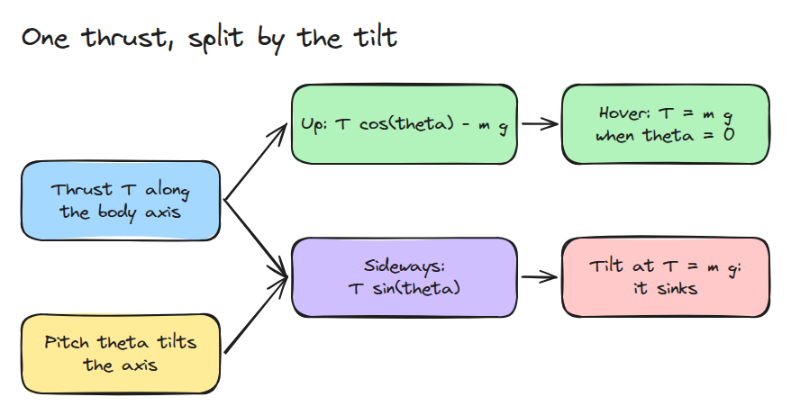
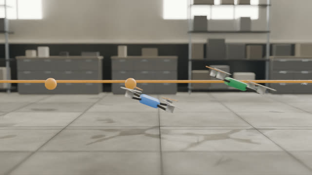
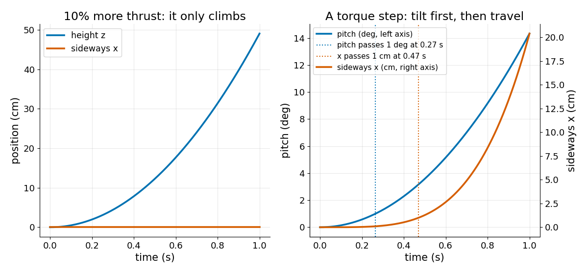

# Quadrotor Model

> Learn why a drone must tilt to move sideways, and why tilting makes it sink.

**Type:** Build   **Prerequisites:** 10/01 Inverted Pendulum and ZMP   **Time:** ~15 minutes

## In Plain Words

A drone hovers because its propellers throw air down, and the air pushes the drone up. That push is called thrust.

Tilt the hovering drone and part of the push shoves it sideways, so less holds it up. At the same thrust, a tilted drone sinks.

## Key Terms

- **Quadrotor**: a drone with four propellers.
- **Thrust (`T`)**: the total push of the propellers along the drone's body axis; it tilts with the drone.
- **Pitch (`theta`)**: the tilt angle of the drone body.
- **Torque (`tau`)**: a twist that tilts the drone; the only way to change the tilt.
- **Hover**: staying at one height.
- **Integration**: adding up a rate over time to get a total, like speed to distance.

## The Problem

Picture a drone told to move to the right. It seems to ignore you, then tips, drifts and loses height. In this flat model it has only two controls, thrust and one twist, for three things to move: sideways, up and down, and tilt.

## The Concept

A drone must know that moving sideways costs height, or it sinks on every turn.

A quadrotor cannot push sideways. It tilts first, and the tilt turns part of its upward thrust into a sideways push. But the tilt also leaves less thrust to hold it up.



*Tilt splits thrust into up and sideways.*

So a tilted drone sinks unless it pushes harder. And a position command seems to lag at first, because the tilt must build up before any sideways force exists.

[](../assets/clip-example.mp4)

*Both tilt. Blue keeps its thrust and sinks. Green pushes harder and holds height.*


*A steady twist first tilts the drone, then it moves sideways, slowly.*



*More thrust only climbs. A twist tilts first, then moves.*

<details><summary>The math (optional)</summary>

State is `x, z, theta` (sideways position, height, tilt); inputs are `T` (thrust) and `tau` (a twist); `m` is mass, `g` gravity and `I` how hard the drone is to twist. `m x'' = T sin(theta)`, `m z'' = T cos(theta) - m g`, `I theta'' = tau`. At `theta = 0` and `T = m g` every acceleration is zero: that is hover thrust. Holding height while tilted needs `T = m g / cos(theta)`, with sideways acceleration `g tan(theta)`. A 0.5 kg drone tilted 20 degrees at `T = m g = 4.9 N` sinks at 0.59 m/s^2, 0.30 m in 1 s; holding height needs 5.2 N (6% more) and gives 3.6 m/s^2 sideways. A steady torque gives `x = g tau t^4 / (24 I)` for small angles, after four integrations. The example uses `I = 0.004`: 0.002 Nm tilts the drone 1 degree at 0.27 s but moves it 1 cm only at 0.47 s.

</details>

## Build It

```python
def deriv(s, T, tau, m, I, g=G):
    th = s[2]
    return np.array([s[3], s[4], s[5], T*np.sin(th)/m, T*np.cos(th)/m - g, tau/I])
```

State is sideways position, height, tilt and their three rates; `simulate()` steps it forward in small steps.

```bash
cd robotics-engineering-from-scratch
python3 -m pytest phases/10-legged-and-aerial/03-quadrotor-model -q
python3 phases/10-legged-and-aerial/03-quadrotor-model/code/main.py
```

## Use It

The last test compares the end state with a ready-made SciPy solver.

## Ship It

`outputs/skill-quadrotor-model-check.md` reviews a quadrotor model for hover thrust, tilt coupling and units.

## Exercises

1. Tilt the drone further and see how much more thrust holding height needs.
2. Twist for longer and watch the sideways motion arrive late.
3. Add air resistance (drag) and see the speed settle.
