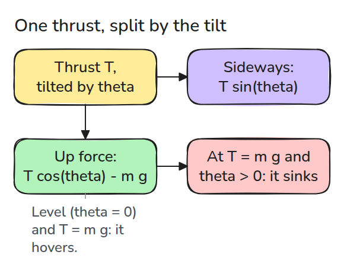
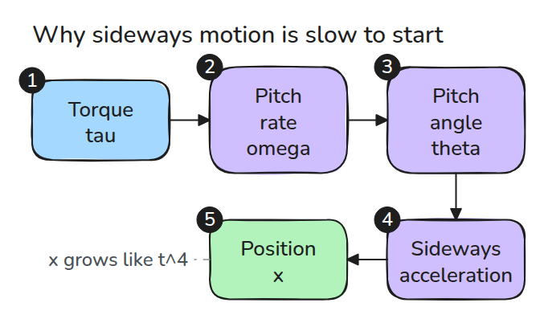
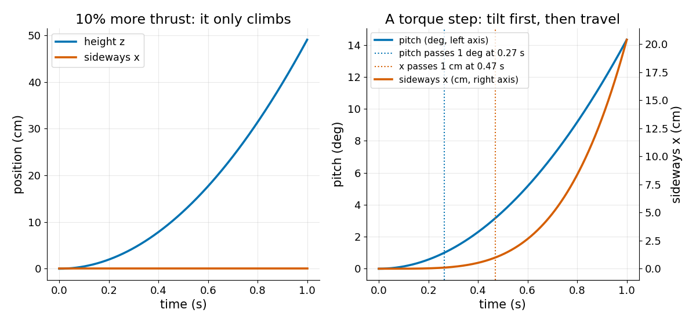

# 쿼드로터 모델

> 쿼드로터는 옆으로 직접 밀 수 없습니다. 먼저 기울고 그 기울기가 추력을 옆 방향 힘으로 바꿉니다.

**유형:** 만들기   **선수 지식:** 10/01 도립진자와 ZMP   **시간:** 약 15분

## 쉽게 말하면

quadrotor model은 드론의 기울기와 thrust로 움직임을 예측하는 모델이에요. thrust는 프로펠러가 공기를 아래로 던지면서 받는 위쪽 힘이에요. 샤워기를 들고 있으면 물이 손을 반대쪽으로 밀어요. 샤워기를 기울이면 미는 방향도 같이 기울어요.

떠 있는 드론도 같아요. 프로펠러가 공기를 곧장 아래로 밀어서 공기가 드론을 곧장 위로 밀어요. 드론을 기울이면 그 힘의 일부가 드론을 옆으로 밀어서 위로 받치는 힘이 줄어요. thrust가 그대로면 기운 드론은 내려가요.

## 문제

드론에 오른쪽 1 m 이동을 명령하면 처음에는 명령을 무시하는 것처럼 보입니다. 그러다 기울고 흘러가면서 높이도 잃습니다. 입력이 총 추력과 토크 하나뿐인데 움직여야 할 것은 셋이기 때문입니다.

## 개념



*추력은 항상 몸체 축을 따라 향합니다. 기울기 각도인 pitch `theta`가 그중 얼마가 위로 가고 얼마가 옆으로 가는지 정합니다.*

상태가 `x, z, theta`(옆 위치, 높이, 기울기)이고 입력이 `T`(총 추력)와 `tau`(드론을 기울이는 비틀림인 pitch 토크)인 평면 모델입니다. `m`은 질량, `g`는 중력가속도, `I`는 드론이 돌기 어려운 정도입니다.

`m x'' = T sin(theta)`, `m z'' = T cos(theta) - m g`, `I theta'' = tau`.

`theta = 0`이고 `T = m g`이면 모든 가속도가 0이므로 호버 추력은 `m g`입니다. 같은 추력으로 `theta`만큼 기울이면 높이 가속도는 `g (cos(theta) - 1)`이고 음수입니다.

높이를 유지하려면 `T = m g / cos(theta)`가 필요하고 이때 옆 방향 가속도는 `g tan(theta)`입니다.

예: 0.5 kg 드론을 20도 기울입니다. `T = m g = 4.9 N`이면 높이 가속도는 -0.59 m/s^2라서 1초에 0.30 m 가라앉습니다. 높이를 유지하려면 5.2 N(6% 더)이 필요하고 옆 방향 가속도는 3.6 m/s^2입니다.


*주황 공과 선(출발 높이)을 보세요. 두 드론 모두 20도로 1초 동안 고정합니다. 파란 드론(`T = m g`)은 그 아래로 가라앉고 초록 드론(`T = m g / cos(theta)`)은 높이를 지킵니다. 드론은 1.6배 크게 그렸습니다.*



*토크는 적분 네 번(회전 속도, 각도, 속도, 위치)을 거쳐 위치에 닿으므로 일정한 토크는 작은 각도에서 `x = g tau t^4 / (24 I)`가 됩니다.*



*왼쪽은 추력을 10% 더하면 위로만 올라가는 모습입니다. 오른쪽은 0.002 Nm 토크가 0.27초에 1도 기울이지만 1 cm 이동은 0.47초에야 일어나는 모습입니다.*

## 만들기

```python
def deriv(s, T, tau, m, I, g=G):
    th = s[2]
    return np.array([s[3], s[4], s[5], T*np.sin(th)/m, T*np.cos(th)/m - g, tau/I])
```

상태는 `[x, z, theta, vx, vz, omega]`입니다. `simulate()`는 제어 함수를 받아 식을 시간에 따라 한 걸음씩 풉니다(RK4). 예제는 임의의 값 `m = 0.5 kg`, `I = 0.004 kg m^2`를 씁니다.

```bash
cd robotics-engineering-from-scratch
python3 -m pytest phases/10-legged-and-aerial/03-quadrotor-model -q
python3 phases/10-legged-and-aerial/03-quadrotor-model/code/main.py
```

## 실제 도구로 보기

마지막 테스트가 최종 상태를 SciPy의 `solve_ivp`와 비교합니다. 실제 기체는 mixer로 `T`와 `tau`를 모터 네 개의 속도로 바꿉니다. 이 부분은 이 레슨의 범위 밖입니다.

## 결과물

`outputs/skill-quadrotor-model-check.md`는 쿼드로터 모델이나 제어기에서 호버 추력, 기울기 결합, 단위를 검토합니다.

## 연습 문제

1. `T = m g / cos(theta)`로 30도 기울였을 때 옆 방향 가속도를 구하세요.
2. 0.004 Nm 토크가 10도에 이르는 시간을 구하세요.
3. 항력 `-c vx`를 넣고 새로운 정상 속도를 구하세요.
