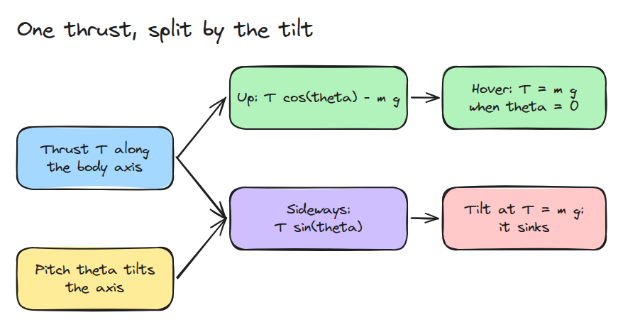
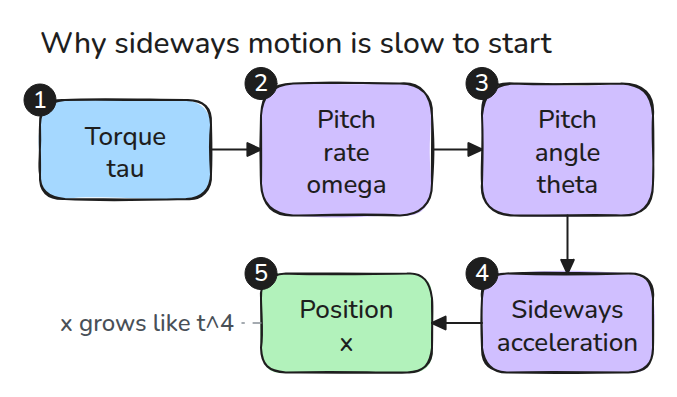
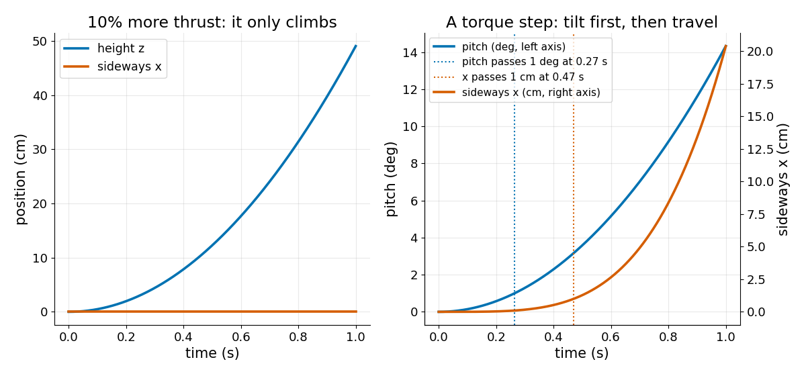

# 쿼드로터 모델

> 드론이 옆으로 가려면 왜 기울어야 하는지, 기운 드론이 더 세게 밀지 않으면 왜 가라앉는지 알아봅니다.

**유형:** 만들기   **선수 지식:** 10/01 도립진자와 ZMP   **시간:** 약 15분

## 쉽게 말하면

quadrotor model은 드론의 기울기와 thrust로 움직임을 예측하는 모델이에요. thrust는 프로펠러가 공기를 아래로 던지면서 받는 위쪽 힘이에요.

떠 있는 드론을 기울이면 그 힘의 일부가 드론을 옆으로 밀어서 위로 받치는 힘이 줄어요. thrust가 그대로면 기운 드론은 내려가요.

## 핵심 용어

- **Quadrotor**: 프로펠러가 네 개인 드론입니다.
- **Thrust (`T`)**: 프로펠러가 내는 위쪽 힘의 합입니다.
- **Pitch (`theta`)**: 드론 몸체가 기운 각도입니다.
- **Torque (`tau`)**: 드론을 기울이는 비틀림입니다. `theta`를 바꾸는 유일한 방법입니다.
- **Hover**: 가속도 없이 한 높이에 머무는 것입니다.
- **Integration**: 변화율을 시간에 따라 더해서 총량을 얻는 일입니다. 속도에서 거리를 얻는 것이 그 예입니다.

## 문제

드론에 오른쪽 1 m 이동을 명령한다고 상상해 보세요. 처음에는 명령을 무시하는 것처럼 보이다가 기울고 흘러가면서 높이도 잃습니다. 입력이 추력과 토크 하나뿐인데 움직여야 할 것은 셋이기 때문입니다.

## 개념

실제 드론 제어기는 옆으로 가면 높이를 잃는다는 것을 알아야 하고 그렇지 않으면 방향을 바꿀 때마다 추락합니다.



*추력은 몸체 축을 따라 향하고 기울기 `theta`가 그것을 위쪽과 옆쪽으로 나눕니다.*

상태는 `x, z, theta`(옆 위치, 높이, 기울기)이고 입력은 `T`와 `tau`입니다. `m`은 질량, `g`는 중력가속도, `I`는 드론이 돌기 어려운 정도입니다.

`m x'' = T sin(theta)`, `m z'' = T cos(theta) - m g`, `I theta'' = tau`.

`theta = 0`이고 `T = m g`이면 모든 가속도가 0이고 이것이 호버 추력입니다.
같은 추력으로 기울이면 높이 가속도 `g (cos(theta) - 1)`가 음수입니다.
높이를 유지하려면 `T = m g / cos(theta)`가 필요하고 이때 옆 방향 가속도는 `g tan(theta)`입니다.

0.5 kg 드론을 20도 기울이고 `T = m g = 4.9 N`이면 높이 가속도는 -0.59 m/s^2라서 1초에 0.30 m 가라앉습니다. 높이를 유지하려면 5.2 N(6% 더)이 필요하고 옆 방향 가속도는 3.6 m/s^2입니다.


*둘 다 20도로 1초 동안 고정합니다. 파란 드론(`T = m g`)은 주황 선 아래로 가라앉고 초록 드론(`T = m g / cos(theta)`)은 높이를 지킵니다.*



*적분 네 번을 거치므로 일정한 토크는 작은 각도에서 `x = g tau t^4 / (24 I)`가 됩니다.*



*왼쪽은 추력을 10% 더하면 위로만 올라가는 모습입니다. 오른쪽은 0.002 Nm 토크가 0.27초에 1도 기울이지만 1 cm 이동은 0.47초에야 일어나는 모습입니다.*

## 만들기

```python
def deriv(s, T, tau, m, I, g=G):
    th = s[2]
    return np.array([s[3], s[4], s[5], T*np.sin(th)/m, T*np.cos(th)/m - g, tau/I])
```

상태는 `[x, z, theta, vx, vz, omega]`이고 `simulate()`가 식을 한 걸음씩 풉니다(RK4). 예제는 임의의 값 `m = 0.5 kg`, `I = 0.004 kg m^2`를 씁니다.

```bash
cd robotics-engineering-from-scratch
python3 -m pytest phases/10-legged-and-aerial/03-quadrotor-model -q
python3 phases/10-legged-and-aerial/03-quadrotor-model/code/main.py
```

## 실제 도구로 보기

마지막 테스트가 최종 상태를 SciPy의 `solve_ivp`와 비교합니다.

## 결과물

`outputs/skill-quadrotor-model-check.md`는 쿼드로터 모델이나 제어기에서 호버 추력, 기울기 결합, 단위를 검토합니다.

## 연습 문제

1. `T = m g / cos(theta)`로 30도 기울였을 때 옆 방향 가속도를 구하세요.
2. 0.004 Nm 토크가 10도에 이르는 시간을 구하세요.
3. 항력 `-c vx`를 넣고 새로운 정상 속도를 구하세요.
