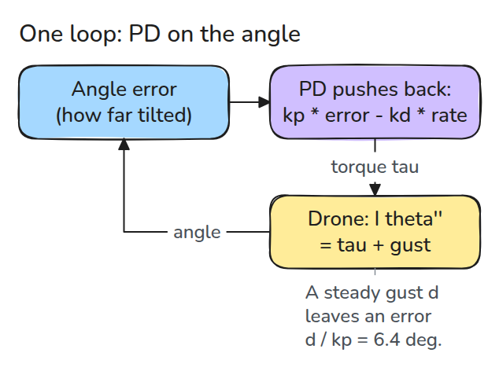
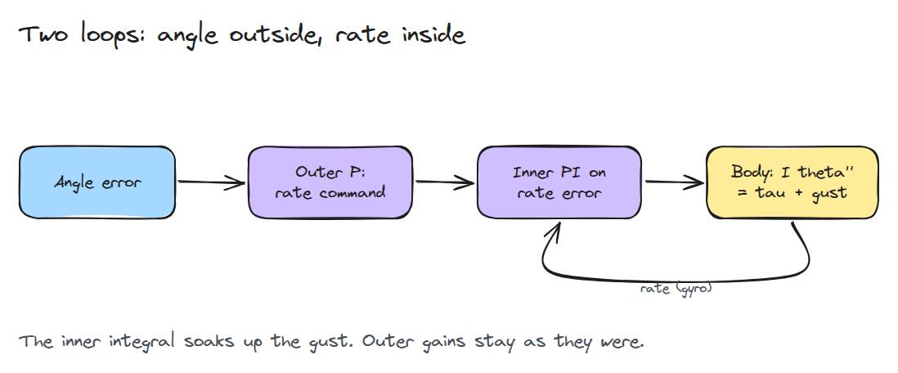
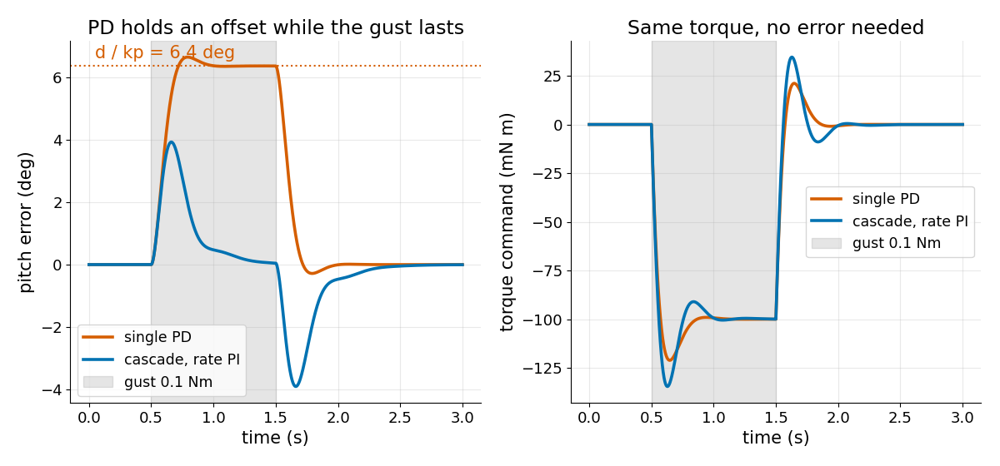

# Cascaded Attitude Control

> Learn how a drone stays level against steady wind, with a control rule that remembers.

**Type:** Build   **Prerequisites:** 10/03 Quadrotor Model   **Time:** ~15 minutes

## In Plain Words

A steady gust leans on a drone's nose. A simple rule pushes back in proportion to the tilt, so the drone must stay tilted to push as hard as the gust.

Cascaded attitude control adds a memory, the integral: a running total of the error. While the drone is not level, the memory adds push until it matches the gust. Then the drone is level and still resisting.

## Key Terms

- **Attitude**: how the drone is tilted in space.
- **PD control**: pushing back in proportion to the error and to how fast the error changes.
- **Cascade**: two loops, an angle loop outside that commands a turning speed to a rate loop inside.
- **Integral**: a running total of the error; it keeps growing while any error remains.
- **Gain**: the factor that turns an error into a push.
- **Stable**: a disturbance dies out instead of growing.

## The Problem

Picture a hovering drone pushed by a gust for a second. A simple rule leans and stays leaning for the whole gust, so the drone drifts. Pushing harder per degree shrinks the lean but costs more torque.

## The Concept

A real drone fights wind all day, so it must resist the push and still stay level.

The fix is the memory: while the drone is not level, it keeps adding push until the push matches the gust.



*Plain control: the lean stays.*



*Two loops, angle outside and turning speed inside, plus a memory.*


*Both push back equally, but only green is level.*

When the gust stops, the memory still holds the push, so the drone swings a little the other way. A real drone limits the memory so it cannot grow without bound (windup).



*Plain control stays tilted. The memory returns to level.*

<details><summary>The math (optional)</summary>

The outer loop turns angle error `e` into a turn-rate command `omega_ref = k_theta * e`; the inner loop turns rate error into torque. With P inside, `tau = k_w (k_theta e - omega)`: exactly PD with `kp = k_w k_theta` and `kd = k_w`. A steady gust torque `d` leaves plain PD with error `d / kp`. The integral (gain `k_i`) of the rate error stops growing only at zero error, so it ends equal to the gust. Stable needs every root of `I s^3 + k_w s^2 + (k_w k_theta + k_i) s + k_i k_theta = 0` to have a negative real part. With `I = 0.004`, `kp = 0.9`, `kd = 0.084`, `k_i = 0.5`, a 0.1 Nm gust holds the PD loop at 0.11 rad (6.4 degrees). The cascade peaks near 4 degrees and pushes back 0.1 Nm at 0.5 degrees by 0.5 s. Setting `k_i = 0` gives plain PD again.

</details>

## Build It

```python
def cascade(k_theta, k_w, k_i):
    z = [0.0]
    def ctrl(ref, th, w, dt):
        e_w = k_theta * (ref - th) - w
        z[0] += e_w * dt
        return k_w * e_w + k_i * z[0]
    return ctrl
```

With the memory switched off this is plain PD.

```bash
cd robotics-engineering-from-scratch
python3 -m pytest phases/10-legged-and-aerial/04-cascaded-attitude-control -q
python3 phases/10-legged-and-aerial/04-cascaded-attitude-control/code/main.py
```

## Use It

The last test checks stability against a ready-made SciPy tool.

## Ship It

`outputs/skill-cascade-loop-check.md` reviews an attitude cascade for its integral and windup limits.

## Exercises

1. Make the memory stronger and watch the swing after the gust grow.
2. Limit the torque and watch what the memory does.
3. Weaken the turning-speed loop, keep a strong memory, and watch the drone start to swing.
