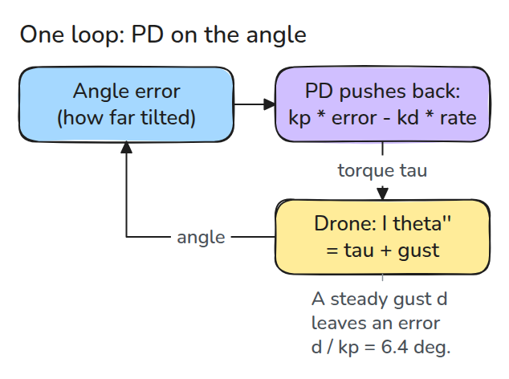
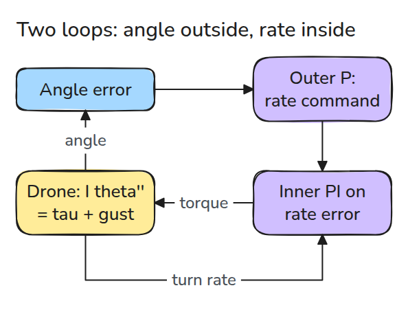
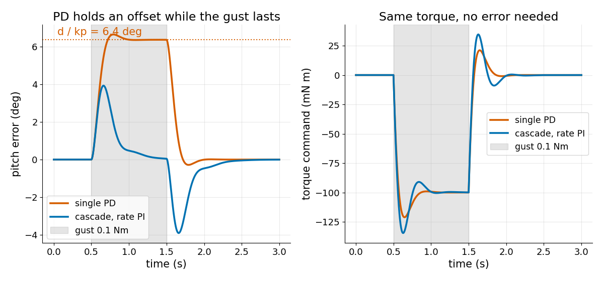

# Cascaded Attitude Control

> An angle loop around a rate loop equals PD until the inner loop gets an integral; then a gust stops costing an angle error.

**Type:** Build   **Prerequisites:** 10/03 Quadrotor Model   **Time:** ~15 minutes

## In Plain Words

A steady gust leans on a drone's nose and it must fight back. A simple controller pushes back in proportion to the tilt, so the drone must stay tilted to push as hard as the gust does.

Cascaded attitude (tilt) control adds a memory to the controller. For as long as the drone is not level and still, the memory adds a little more push. The push grows until it matches the gust. Then the drone is level again and still resisting.

## The Problem

A gust pushes the drone for a second, and a PD pitch loop (push back per tilt with `kp`, per turning speed with `kd`) holds a constant tilt for all of it, and the tilt makes the drone drift. Raising `kp` shrinks the tilt but demands more torque for every small error.

## The Concept



*The single loop turns an angle error into torque. A steady gust torque `d` needs `kp * error = d`, so the error stays at `d / kp`.*

The outer loop turns the angle error `e` into a turn-rate command, `omega_ref = k_theta * e` (`omega` is turning speed, `k_theta` the angle gain). The inner loop turns rate error into torque. With a P inner loop (rate gain `k_w`), `tau = k_w (k_theta e - omega)`, which is exactly PD with `kp = k_w k_theta` and `kd = k_w`.



*Same outer gain, plus an integral (the memory, a running total, gain `k_i`) of the rate error. It stops growing only when the rate error is zero, so it ends equal to the gust, with no angle error needed.*

Stability depends on the roots of `I s^3 + k_w s^2 + (k_w k_theta + k_i) s + k_i k_theta = 0`. Stable (a disturbance dies out) needs every root's real part negative; the example gains pass.

Example (`I = 0.004`, `kp = 0.9`, `kd = 0.084`, `k_i = 0.5`): a 0.1 Nm gust holds the PD loop at `0.1 / 0.9 = 0.11 rad` (6.4 degrees). The cascade bumps to about 4 degrees, then pushes back the same 0.1 Nm at 0.5 degrees when the gust is 0.5 s old.


*Watch the amber arrow (push back) and red arrow (gust): both drones push back 0.1 Nm, but only blue (PD) stays tilted. Tilt drawn 3 times larger.*



*The PD loop sits at 6.4 degrees for the whole gust. The cascade peaks at about 4 degrees and is near zero before the gust ends. When the gust stops, the stored integral makes it swing about 4 degrees the other way.*

## Build It

```python
def cascade(k_theta, k_w, k_i):
    z = [0.0]
    def ctrl(ref, th, w, dt):
        e_w = k_theta * (ref - th) - w
        z[0] += e_w * dt
        return k_w * e_w + k_i * z[0]
    return ctrl
```

With `k_i = 0` this is a P-P cascade and equals `pd(kp, kd)`.

```bash
cd robotics-engineering-from-scratch
python3 -m pytest phases/10-legged-and-aerial/04-cascaded-attitude-control -q
python3 phases/10-legged-and-aerial/04-cascaded-attitude-control/code/main.py
```

## Use It

The last test checks `cascade_poles()` against SciPy's `TransferFunction`. Real controllers also filter the gyro (turning-speed sensor) and cap the integral against windup.

## Ship It

`outputs/skill-cascade-loop-check.md` reviews an attitude cascade for rate-loop integral, windup limits and loop bandwidth ordering.

## Exercises

1. Raise `k_i` to 2 and compare the post-gust swing with `k_i = 0.5`.
2. Clamp the torque at 0.15 Nm and watch what the integral does.
3. Show that the same gain split with `k_w = 0.02` and `k_i = 2` is unstable.
