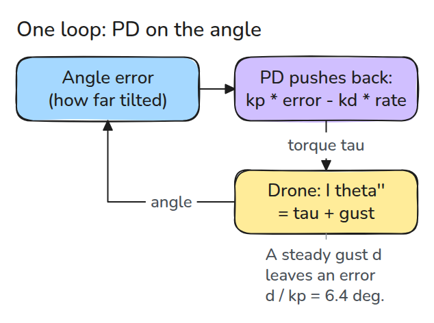
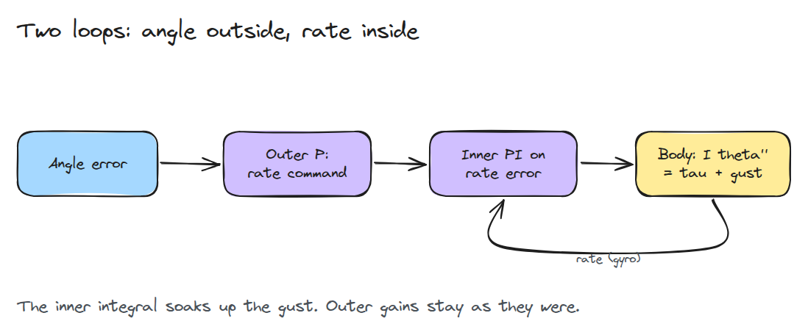
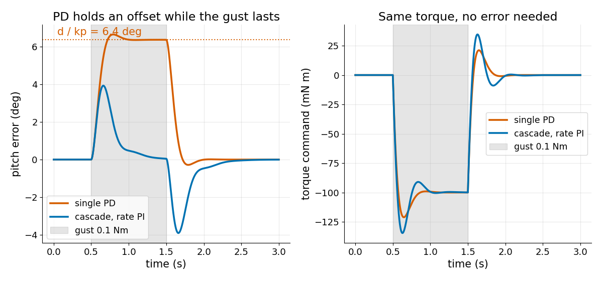

# 캐스케이드 자세 제어

> 각도 루프 안에 각속도 루프를 두는 구조는 PD와 같습니다. 안쪽 루프에 적분을 주면 돌풍이 각도 오차를 남기지 않습니다.

**유형:** 만들기   **선수 지식:** 10/03 쿼드로터 모델   **시간:** 약 15분

## 쉽게 말하면

친구가 게임 컨트롤러를 계속 비트는 동안 수평으로 잡아 보세요. 기울기와 회전 속도에 따라서만 맞서 비튼다면 회전이 멈춘 뒤에도 힘을 내려면 기울기가 남아야 해요.

cascaded attitude control은 각도 오차로 원하는 회전 속도를 정하고 안쪽 loop가 torque를 내요. loop를 나누기만 하면 여전히 PD와 같아요. rate loop에 integral을 더하면 맞서는 torque가
쌓여서 계속 비트는 힘을 받아도 기울기를 남기지 않고 버틸 수 있어요.

## 문제

돌풍이 드론을 1초 동안 밀어냅니다. PD pitch 루프는 그 1초 내내 일정한 기울기를 유지합니다. pitch가 옆 방향 속도를 정하므로 드론은 제자리에서 미끄러집니다. `kp`를 올리면 기울기는 줄지만 작은 오차마다 루프가 요구하는 토크도 커집니다.

## 개념



*단일 루프는 각도 오차를 토크로 바꿉니다. 일정한 돌풍 토크 `d`는 `kp * error = d`가 필요하므로 오차가 `d / kp`로 남습니다.*

캐스케이드는 일을 둘로 나눕니다. 바깥 루프는 각도 오차를 각속도 명령 `omega_ref = k_theta * error`로 바꿉니다. 안쪽 루프는 각속도 오차를 토크로 바꿉니다.

안쪽이 P이면 `tau = k_w (k_theta e - omega)`이고 이것은 `kp = k_w k_theta`, `kd = k_w`인 PD와 똑같습니다. 두 궤적이 일치하는 것을 테스트가 확인합니다.



*바깥 이득은 그대로이고 각속도 오차에 적분이 붙습니다. 적분 상태가 돌풍을 상쇄할 때까지 자라므로 각도 오차가 필요 없습니다.*

적분을 넣으면 특성 다항식은 `I s^3 + k_w s^2 + (k_w k_theta + k_i) s + k_i k_theta`입니다. 여기서 쓴 이득에서는 근이 모두 좌반평면에 있습니다.



*PD 루프는 돌풍 내내 6.4도에 머뭅니다. 캐스케이드는 약 4도에서 정점을 찍고 돌풍이 끝나기 전에 0으로 돌아옵니다. 돌풍이 멈추면 쌓인 적분 때문에 반대쪽으로 약 4도 흔들립니다.*

## 만들기

```python
def cascade(k_theta, k_w, k_i):
    z = [0.0]
    def ctrl(ref, th, w, dt):
        e_w = k_theta * (ref - th) - w
        z[0] += e_w * dt
        return k_w * e_w + k_i * z[0]
    return ctrl
```

`k_i = 0`이면 P-P 캐스케이드이고 `pd(kp, kd)`와 같습니다. 예제는 `I = 0.004`, `kp = 0.9`, `kd = 0.084`(고유 진동수 15 rad/s, 감쇠비 0.7), `k_i = 0.5`를 씁니다.

```bash
cd robotics-engineering-from-scratch
python3 -m pytest phases/10-legged-and-aerial/04-cascaded-attitude-control -q
python3 phases/10-legged-and-aerial/04-cascaded-attitude-control/code/main.py
```

## 실제 도구로 보기

SciPy의 `TransferFunction`이 `cascade_poles()`와 같은 폐루프 극을 주며 마지막 테스트가 그것을 확인합니다. 실제 비행 제어기는 gyro를 필터링하고 적분이 쌓이지 않게 제한합니다.

## 결과물

`outputs/skill-cascade-loop-check.md`는 자세 캐스케이드에서 각속도 루프의 적분, windup 제한, 루프 대역폭 순서를 검토합니다.

## 연습 문제

1. `k_i`를 2로 올리고 돌풍 뒤의 반대쪽 흔들림을 `k_i = 0.5`와 비교하세요.
2. 토크를 0.15 Nm로 제한하고 적분이 어떻게 되는지 보세요.
3. `k_w = 0.02`, `k_i = 2`의 같은 이득 분할이 불안정함을 보이세요.
