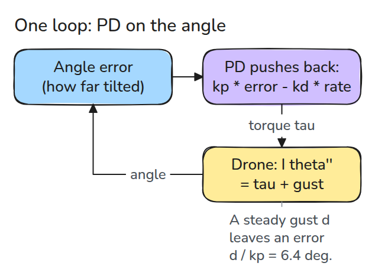
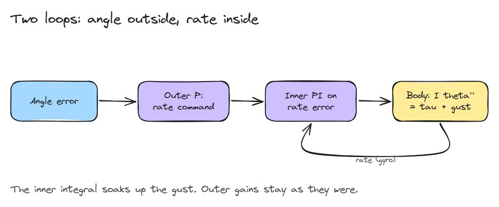
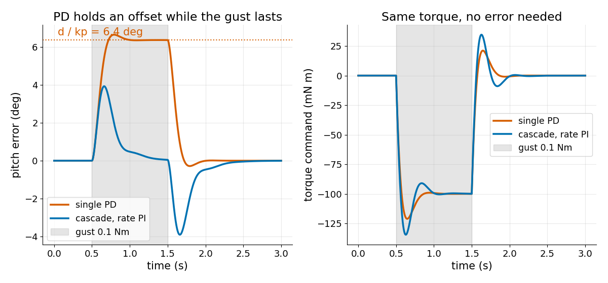

# 캐스케이드 자세 제어

> 일정한 바람 속에서도 기억하는 제어기로 드론이 수평을 지키는 방법을 알아봅니다.

**유형:** 만들기   **선수 지식:** 10/03 쿼드로터 모델   **시간:** 약 15분

## 쉽게 말하면

일정한 돌풍이 드론의 앞머리를 밀면 드론은 맞서야 해요. 단순한 제어기는 기울어진 만큼 비례해서 되밀기 때문에 돌풍만큼 세게 밀려면 드론이 기울어진 채로 있어야 해요.

cascaded attitude control은 제어기에 기억을 더해요. 드론이 수평이 아닌 동안 되미는 힘이 조금씩 더 쌓여서 돌풍과 같아져요. 그러면 드론은 다시 수평이 되고 여전히 버텨요.

## 핵심 용어

- **Attitude**: 드론이 공간에서 기울어진 모습입니다.
- **PD control**: 오차에 비례하는 힘(`kp`)과 오차가 변하는 빠르기에 비례하는 힘(`kd`)으로 되미는 제어입니다.
- **Cascade**: 바깥의 각도 루프가 안쪽의 회전 속도 루프에 속도를 명령하는 두 겹의 루프입니다.
- **Integral**: 오차의 누적합입니다. 오차가 남아 있는 동안 계속 자랍니다.
- **Gain**: 오차를 힘으로 바꾸는 배율입니다.
- **Stable**: 외란이 커지지 않고 사라지는 성질입니다.

## 문제

떠 있는 드론을 돌풍이 1초 동안 민다고 상상해 보세요. 단순한 제어기는 돌풍 내내 일정한 기울기를 유지해서 드론이 흘러갑니다. `kp`를 올리면 기울기는 줄지만 작은 오차마다 더 큰 토크를 요구합니다.

## 개념

실제 드론은 하루 종일 바람과 싸우므로 밀림에 맞서면서도 수평을 지켜야 합니다.



*일정한 돌풍 토크 `d`는 오차를 `d / kp`로 남깁니다.*

바깥 루프는 각도 오차 `e`를 회전 속도 명령 `omega_ref = k_theta * e`로 바꿉니다.
안쪽 루프는 회전 속도 오차를 토크로 바꿉니다.
안쪽이 P이면 `tau = k_w (k_theta e - omega)`이고 이것은 `kp = k_w k_theta`, `kd = k_w`인 PD와 똑같습니다.



*회전 속도 오차에 적분(gain `k_i`)을 붙이면 오차가 0일 때만 자라기를 멈추므로 돌풍과 같아진 채 멈춥니다.*

안정하려면 `I s^3 + k_w s^2 + (k_w k_theta + k_i) s + k_i k_theta = 0`의 모든 근의 실수부가 음수여야 하고 예제 gain은 이를 만족합니다.

`I = 0.004`, `kp = 0.9`, `kd = 0.084`, `k_i = 0.5`일 때 0.1 Nm 돌풍은 PD 루프를 `0.1 / 0.9 = 0.11 rad`(6.4도)에 붙잡아 둡니다.
캐스케이드는 약 4도까지 기울었다가 돌풍이 0.5초 지났을 때는 같은 0.1 Nm로 되밀면서 0.5도입니다.


*주황 화살표는 되미는 힘이고 빨간 화살표는 돌풍입니다. 두 드론 모두 0.1 Nm로 되밀지만 파란 PD 드론만 기운 채로 있습니다.*



*PD는 6.4도에 머뭅니다. 캐스케이드는 약 4도에서 정점을 찍고 0 가까이 돌아온 뒤 돌풍이 멈추면 반대쪽으로 약 4도 흔들립니다.*

## 만들기

```python
def cascade(k_theta, k_w, k_i):
    z = [0.0]
    def ctrl(ref, th, w, dt):
        e_w = k_theta * (ref - th) - w
        z[0] += e_w * dt
        return k_w * e_w + k_i * z[0]
    return ctrl
```

`k_i = 0`이면 P-P 캐스케이드이고 `pd(kp, kd)`와 같습니다.

```bash
cd robotics-engineering-from-scratch
python3 -m pytest phases/10-legged-and-aerial/04-cascaded-attitude-control -q
python3 phases/10-legged-and-aerial/04-cascaded-attitude-control/code/main.py
```

## 실제 도구로 보기

마지막 테스트가 `cascade_poles()`를 SciPy의 `TransferFunction`과 비교합니다. 실제 제어기는 gyro도 필터링하고 windup이 생기지 않게 적분을 제한합니다.

## 결과물

`outputs/skill-cascade-loop-check.md`는 자세 캐스케이드에서 회전 속도 루프의 적분과 windup 제한을 검토합니다.

## 연습 문제

1. `k_i`를 2로 올리고 돌풍 뒤의 반대쪽 흔들림을 `k_i = 0.5`와 비교하세요.
2. 토크를 0.15 Nm로 제한하고 적분을 보세요.
3. `k_w = 0.02`, `k_i = 2`가 불안정함을 보이세요.
