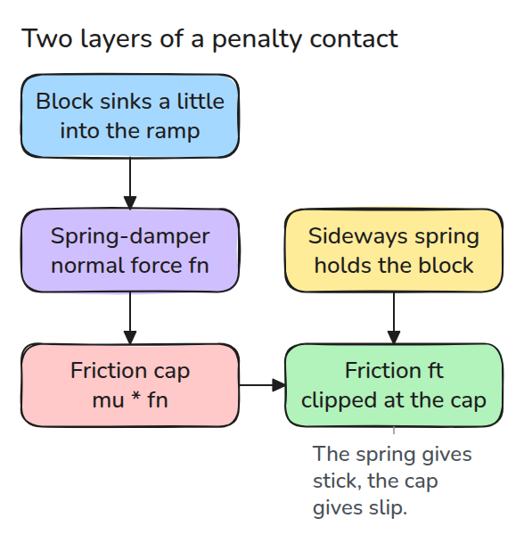
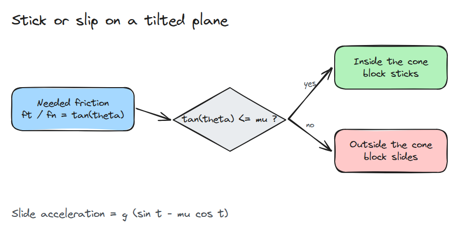
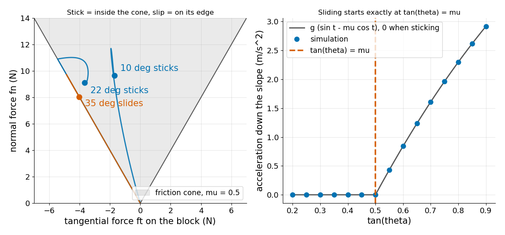

# Contact Models

> A block sticks on a tilted plane exactly when tan(theta) is at most mu, because friction can only push inside its cone.

**Type:** Build   **Prerequisites:** 03/02 Gravity Compensation   **Time:** ~15 minutes

## In Plain Words

Place an eraser on a textbook and slowly tilt the book. Gravity pulls the eraser downhill, while friction from the book acts uphill.
Tilting more increases the downhill pull and reduces the force pressing the eraser into the book.

A contact model limits friction according to that pressing force. Once the uphill friction needed to hold the eraser exceeds the limit,
it slides. The model's small spring-like contact deformation supplies the supporting force; friction cannot grow without bound.

## The Problem

Your gripper holds a part, you tilt the wrist a few degrees, and the part slides out. The same part held a little flatter would have stayed. Contact decides this. A rigid-body simulator gets it right only if its contact model has the same switch between sticking and sliding.

## The Concept



*Penetration gives the normal force. That force sets the cap on friction, and a tangential spring tries to hold the contact still until it hits the cap.*

On a plane tilted by `theta`, gravity splits into `m g cos(theta)` pressing in and `m g sin(theta)` pulling along. Sticking needs friction `ft = m g sin(theta)` against `fn = m g cos(theta)`, so `ft / fn = tan(theta)`. The Coulomb cone allows `ft / fn` up to `mu`.



*The only question is whether the needed friction fits inside the cone.*



*Left: the sticking blocks end inside the cone, the sliding block rides its edge. Right: simulated acceleration is zero until tan(theta) passes mu, then follows g (sin t - mu cos t).*

## Build It

Normal force is a spring-damper on penetration that never pulls. Friction is a tangential spring to an anchor, clipped at `mu * fn`. When it clips, the anchor is dragged along.

```python
fn = max(K * pen - C * nv, 0.0)
ft = -KT * (s - anchor) - CT * v
if abs(ft) > mu * fn:
    ft = np.sign(ft) * mu * fn
    anchor = s + ft / KT
```

Assumptions: a point block, one contact, a planar slope, fixed spring constants, semi-implicit Euler at 0.1 ms. The block starts touching the plane at rest.

```bash
cd robotics-engineering-from-scratch
python3 -m pytest phases/11-contact-and-manipulation/01-contact-models -q
python3 phases/11-contact-and-manipulation/01-contact-models/code/main.py
```

## Use It

Simulators such as MuJoCo use the same two ideas: a soft normal force and a friction cone, which the MuJoCo docs say can be elliptic or pyramidal. Build the same tilted block there and compare the angle where it starts to slide with `arctan(mu)`.

Sources: MuJoCo documentation, Computation chapter (opened 2026-11-09), for the cone shapes and spring-damper contact.

## Ship It

`outputs/skill-contact-model-check.md` checks a contact setup for a stick/slip surprise before you blame the controller.

## Exercises

1. Raise `K` by 10 times and check that the sticking angle does not move but the settling time does.
2. Make `mu` differ for static and sliding contact and find the angle where the block starts and keeps moving.
3. Add a horizontal push on the block and find the push at which it begins to slide up the slope.
