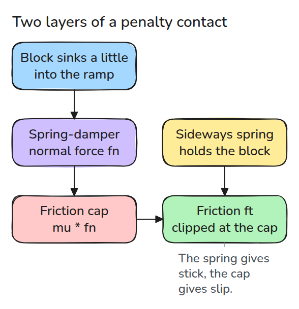
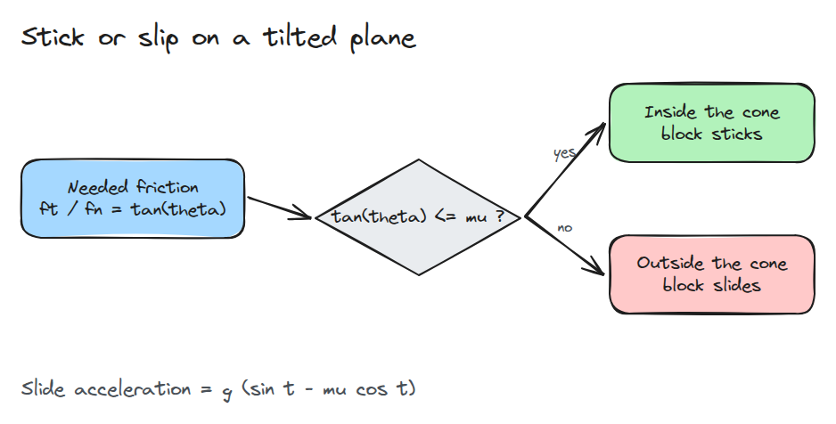
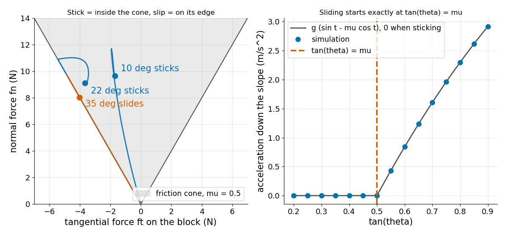

# Contact Models

> Learn why a gripped part slides out when the wrist tilts, and how to predict the angle.

**Type:** Build   **Prerequisites:** 03/02 Gravity Compensation   **Time:** ~15 minutes

## In Plain Words

Place an eraser on a textbook and slowly tilt the book. Gravity pulls the eraser downhill and friction pulls it back uphill.

Friction has a cap: at most `mu` times the force pressing the eraser into the book. All friction forces up to that cap form the friction cone. When the friction needed passes the cap, the eraser slides.

## Key Terms

- **Contact model**: the rule a simulator uses to compute the forces where two bodies touch.
- **Normal force**: the push of a surface straight out of itself, perpendicular to the surface.
- **`mu`**: the friction coefficient; how grippy the surfaces are.
- **Friction cone**: all friction forces that do not exceed `mu` times the normal force.
- **Stick and slip**: two states of a contact; holding still, or sliding.
- **Penetration**: how far a simulated body sinks into a surface.

## The Problem

Picture a gripper holding a part. Tilt the wrist a few degrees and the part slides out, though flatter it would have stayed. A simulator needs the same stick-or-slip switch.

## The Concept

A real gripper drops a part when friction runs out, so you need the angle where that happens.

With tilt `theta`, mass `m` and gravity `g`, gravity presses the block into the plane with `fn = m g cos(theta)` and pulls it down the slope with `m g sin(theta)`. Staying put needs friction `ft = m g sin(theta)`, so `ft / fn = tan(theta)`; the cone allows up to `mu`.



*Penetration gives the normal force, which caps friction. A sideways spring holds the contact until the cap.*

Take `mu = 0.5`. A 25 degree ramp needs 0.47 and holds. A 35 degree ramp needs 0.70 and slides, with net pull `m g (sin(theta) - mu cos(theta))`, about 1.6 m/s².


*The block holds until the plank passes the marker at 26.6 degrees, then slides.*



*Does the needed friction fit inside the cone?*



*Left: sticking blocks end inside the cone; the sliding block rides its edge. Right: acceleration is zero until tan(theta) passes mu.*

## Build It

Normal force is a spring-damper on penetration that never pulls. Friction is a sideways spring to an anchor, clipped at `mu * fn`; clipping drags the anchor.

```python
fn = max(K * pen - C * nv, 0.0)
ft = -KT * (s - anchor) - CT * v
if abs(ft) > mu * fn:
    ft = np.sign(ft) * mu * fn
    anchor = s + ft / KT
```

Assumptions: point block, one contact, planar slope, fixed spring constants, semi-implicit Euler at 0.1 ms.

```bash
cd robotics-engineering-from-scratch
python3 -m pytest phases/11-contact-and-manipulation/01-contact-models -q
python3 phases/11-contact-and-manipulation/01-contact-models/code/main.py
```

## Use It

MuJoCo uses the same two ideas: a soft normal force and a friction cone. Build the same block there; compare its sliding angle with `arctan(mu)`.

Sources: MuJoCo documentation, Computation chapter (opened 2026-11-09).

## Ship It

`outputs/skill-contact-model-check.md` checks a contact setup for a stick/slip surprise before you blame the controller.

## Exercises

1. Raise `K` 10 times; the sticking angle should stay, the settling time change.
2. Use different static and sliding `mu`; find where the block starts and keeps moving.
3. Add a horizontal push; find where the block slides up.
