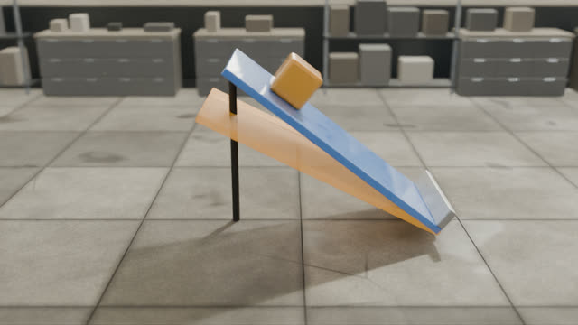

# Contact Models

> Learn why a gripped part slides out when the wrist tilts, and how to predict the angle.

**Type:** Build   **Prerequisites:** none   **Time:** ~15 minutes

## In Plain Words

Place an eraser on a textbook and slowly tilt the book. Gravity pulls the eraser downhill. Friction, the grip between the surfaces, pulls it back uphill.

Friction has a cap: at most `mu` times the force pressing the eraser into the book. The allowed pairs of pressing force and friction force form the friction cone. When the needed friction passes the cap, the eraser slides.

## Key Terms

- **Contact model**: the rule a simulator uses to compute the forces where two bodies touch.
- **Normal force**: the push of a surface straight out of itself, perpendicular to the surface.
- **Friction coefficient (`mu`)**: how grippy the surfaces are.
- **Friction cone**: the allowed combinations of normal force and sideways friction force at a contact.
- **Stick and slip**: two states of a contact; holding still, or sliding.
- **Penetration**: how far a simulated body sinks into a surface.

## The Problem

Picture a robot hand holding a part. Tilt the wrist a few degrees and the part slides out, though held flatter it would have stayed.

## The Concept

A gripper drops a part when friction runs out, so you need to know the angle where that happens.

Friction holds the eraser until the slope gets too steep, then it slides. Friction can only push back up to a limit, set by how hard the surfaces press together and how grippy they are.


*A simulated block sinks a tiny bit. The deeper it sinks, the harder friction can hold.*

[](../assets/clip-example.mp4)

*The block holds until the plank passes the marker, then slides.*


*Does the friction needed fit inside the cone?*


*Sticking blocks stay inside the cone. The sliding block rides its edge.*


<details><summary>The math (optional)</summary>

With tilt `theta`, mass `m` and gravity `g`, gravity presses the block into the plane with `fn = m g cos(theta)` and pulls it down the slope with `m g sin(theta)`. Staying put needs friction `ft = m g sin(theta)`, so `ft / fn = tan(theta)`; the friction cone allows up to `mu`. With `mu = 0.5` the block slides beyond about 26.6 degrees: a 25 degree ramp needs 0.47 and holds, a 35 degree ramp needs 0.70 and slides with acceleration `g (sin(theta) - mu cos(theta))`, about 1.6 m/s². Mass cancels, so doubling it changes nothing.

</details>

## Build It

A spring and a shock absorber push back on penetration. Friction is a sideways spring, cut off at `mu` times the normal force.

```python
fn = max(K * pen - C * nv, 0.0)
ft = -KT * (s - anchor) - CT * v
if abs(ft) > mu * fn:
    ft = np.sign(ft) * mu * fn
    anchor = s + ft / KT
```

Assumptions: point block, one contact, flat slope, fixed springs.

```bash
cd robotics-engineering-from-scratch
python3 -m pytest phases/11-contact-and-manipulation/01-contact-models -q
python3 phases/11-contact-and-manipulation/01-contact-models/code/main.py
```

## Use It

MuJoCo, a physics simulator, uses a different soft-contact solver. Build the same block there and compare sliding angles.

Sources: MuJoCo documentation, Computation chapter (opened 2026-11-09).

## Ship It

`outputs/skill-contact-model-check.md` checks a contact setup for a stick/slip surprise before you blame the robot's control code.

## Exercises

1. Tilt the plank a little at a time and find where the block starts to slide.
2. Make the surface more or less grippy and watch the angle move.
3. Push the block along the slope; find the push that makes it slide uphill.
