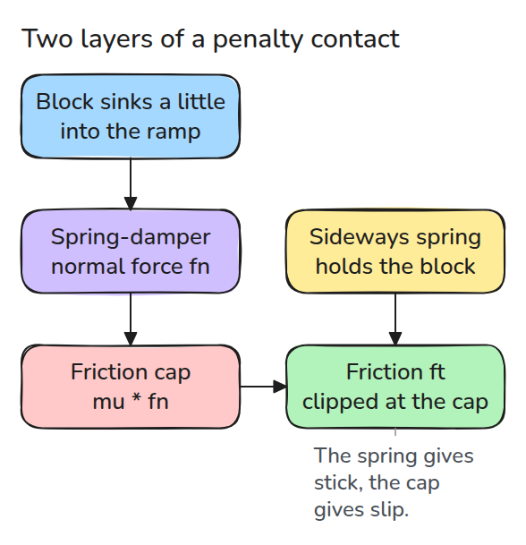
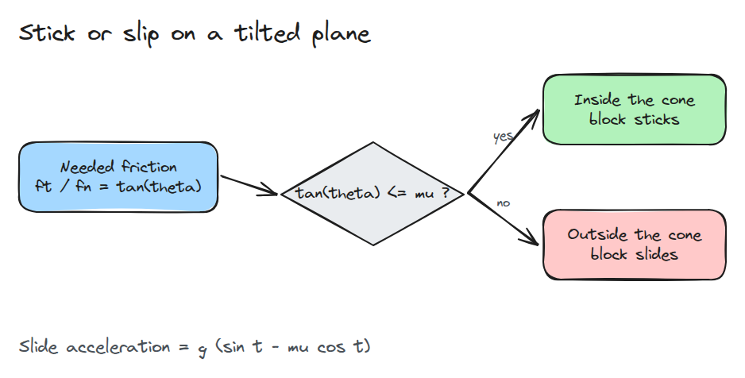
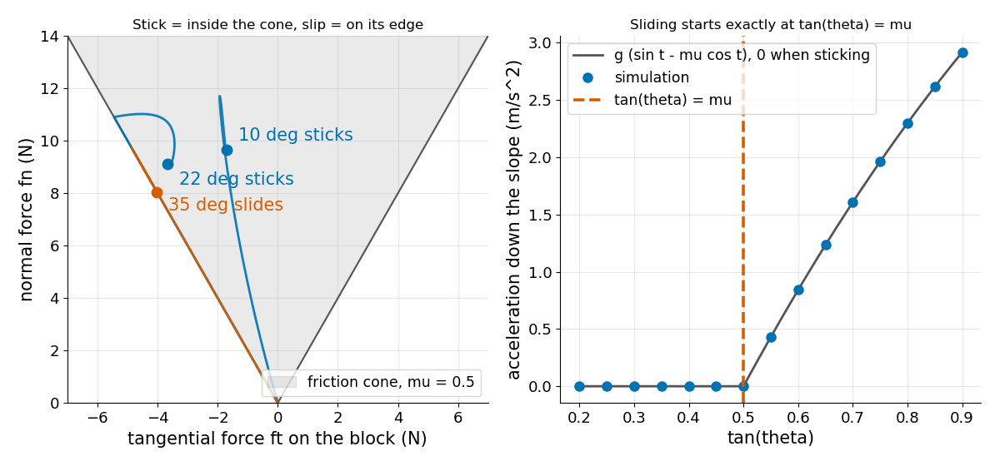

# 접촉 모델 (Contact Models)

> 손목을 기울이면 잡은 부품이 왜 미끄러져 빠지는지, 미끄러지기 시작하는 각도를 예측하는 방법을 알아봅니다.

**유형:** 만들기   **선수 지식:** 03/02 중력 보상   **시간:** 약 15분

## 쉽게 말하면

교과서 위에 지우개를 놓고 책을 천천히 기울여 보세요. 중력은 지우개를 경사 아래로 당기고 책의 마찰력은 위쪽으로 잡아 줘요.

마찰력에는 상한이 있어요. 지우개를 책에 누르는 힘에 `mu`를 곱한 값까지만 낼 수 있어요. 이 상한 안에 드는 마찰력의 모음이 friction cone이에요. 필요한 마찰력이 상한을 넘으면 지우개는 미끄러져요.

## 핵심 용어

- **Contact model**: 두 물체가 닿는 곳의 힘을 simulator가 계산하는 규칙입니다.
- **Normal force**: 면이 면에 수직으로 밀어내는 힘입니다.
- **`mu`**: 마찰 계수입니다. 표면이 얼마나 잘 붙는지를 나타냅니다.
- **Friction cone**: `mu`에 normal force를 곱한 값을 넘지 않는 마찰력의 모음입니다.
- **Stick and slip**: 접촉의 두 상태입니다. 붙어서 멈춰 있거나 미끄러집니다.
- **Penetration**: simulator 안에서 물체가 면 속으로 파고든 깊이입니다.

## 문제

gripper가 부품을 잡고 있다고 상상해 보세요. 손목을 몇 도 기울이자 부품이 미끄러져 빠지지만 조금 더 평평하게 들었다면 붙어 있었을 것입니다. simulator도 접촉 모델에 stick과 slip을 가르는 같은 스위치가 있어야 결과가 맞습니다.

## 개념

실제 gripper는 마찰이 모자라면 부품을 떨어뜨리므로 그 각도를 알아야 합니다.

기울기를 `theta`, 질량을 `m`, 중력 가속도를 `g`라고 하겠습니다.
중력은 블록을 면 안쪽으로 누르는 `fn = m g cos(theta)`와 경사 아래로 당기는 `m g sin(theta)`로 나뉩니다.
붙어 있으려면 경사를 따라 마찰 `ft = m g sin(theta)`가 필요하므로 `ft / fn = tan(theta)`입니다.
cone은 `ft / fn`을 `mu`까지 허용합니다.



*침투량이 normal force를 만들고 normal force가 마찰의 상한을 정합니다. 옆으로 늘어나는 spring이 상한에 닿을 때까지 접촉을 붙들어 둡니다.*

`mu = 0.5`로 두면 25도 경사는 필요한 값이 0.47이라 블록이 붙어 있습니다.
35도 경사는 0.70이라 블록이 미끄러집니다.
마찰력은 상한 `mu * fn`에 머물러 순수하게 당기는 힘이 `m g (sin(theta) - mu cos(theta))`가 되고 35도에서 약 1.6 m/s²입니다.


*블록은 판자가 26.6도 표시를 지나는 순간부터 미끄러집니다.*



*필요한 마찰력이 cone 안에 들어가는가?*



*왼쪽은 붙어 있는 블록이 cone 안에서 끝나고 미끄러지는 블록은 cone의 모서리를 타는 모습입니다. 오른쪽은 가속도가 tan(theta)가 mu를 넘을 때까지 0인 모습입니다.*

## 만들기

normal force는 침투량에 대한 spring-damper이고 당기는 힘은 내지 않습니다. 마찰은 anchor에 매단 접선 spring이며 `mu * fn`에서 잘리고 잘리는 순간 anchor가 끌려옵니다.

```python
fn = max(K * pen - C * nv, 0.0)
ft = -KT * (s - anchor) - CT * v
if abs(ft) > mu * fn:
    ft = np.sign(ft) * mu * fn
    anchor = s + ft / KT
```

가정은 점 블록, 접촉 하나, 평면 경사, 고정된 spring 상수, 0.1 ms의 semi-implicit Euler입니다.

```bash
cd robotics-engineering-from-scratch
python3 -m pytest phases/11-contact-and-manipulation/01-contact-models -q
python3 phases/11-contact-and-manipulation/01-contact-models/code/main.py
```

## 실제 도구로 보기

MuJoCo도 같은 두 아이디어를 씁니다. 부드러운 normal force와 friction cone입니다. 같은 블록을 거기에 만들고 미끄러지기 시작하는 각도를 `arctan(mu)`와 비교하세요.

출처: MuJoCo 문서 Computation 장(2026년 11월 9일 열람).

## 결과물

`outputs/skill-contact-model-check.md`는 controller를 탓하기 전에 접촉 설정에서 stick/slip 문제가 없는지 점검합니다.

## 연습 문제

1. `K`를 10배로 올려도 sticking 각도는 그대로이고 안정되는 시간만 달라지는지 확인하세요.
2. 정지 마찰과 운동 마찰의 `mu`를 다르게 두고 블록이 움직이기 시작해 계속 움직이는 각도를 찾으세요.
3. 수평 힘을 더하고 블록이 경사를 따라 올라가며 미끄러지기 시작하는 힘을 찾으세요.
