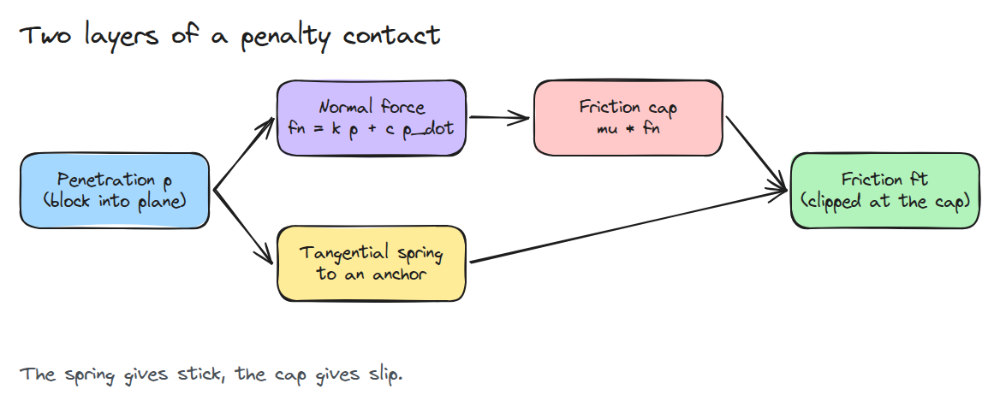
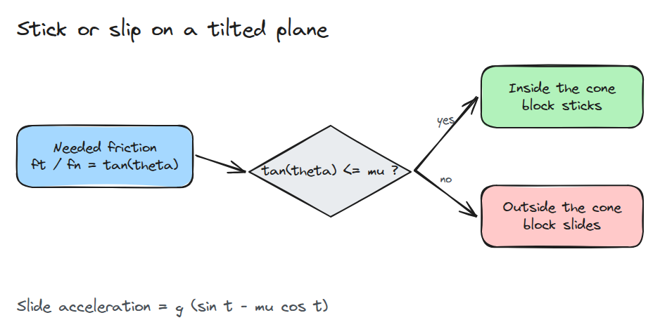
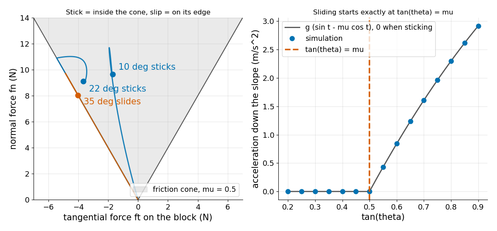

# 접촉 모델 (Contact Models)

> 기울어진 면 위의 블록은 tan(theta)가 mu 이하일 때만 붙어 있습니다. 마찰력은 friction cone 안쪽으로만 낼 수 있기 때문입니다.

**유형:** 만들기   **선수 지식:** 03/02 중력 보상   **시간:** 약 15분

## 문제

gripper가 부품을 잡고 있는데 손목을 몇 도 기울이자 부품이 미끄러져 빠집니다. 조금 더 평평하게 들었다면 그대로 붙어 있었을 부품입니다. 이 차이는 접촉이 정합니다. 강체 시뮬레이터도 접촉 모델에 stick과 slip을 가르는 같은 스위치가 있어야 결과가 맞습니다.

## 개념



*침투량이 법선력을 만듭니다. 그 힘이 마찰의 상한을 정하고 접선 spring은 상한에 닿을 때까지 접촉을 붙들려 합니다.*

`theta`만큼 기운 면에서 중력은 누르는 `m g cos(theta)`와 잡아당기는 `m g sin(theta)`로 나뉩니다.

붙어 있으려면 `fn = m g cos(theta)`에 맞서 마찰 `ft = m g sin(theta)`가 필요하므로 `ft / fn = tan(theta)`입니다. 쿨롱 cone은 `ft / fn`을 `mu`까지 허용합니다.



*질문은 하나입니다. 필요한 마찰력이 cone 안에 들어가는가입니다.*



*왼쪽은 붙어 있는 블록이 cone 안에서 끝나고 미끄러지는 블록은 cone의 모서리를 타는 모습입니다. 오른쪽은 시뮬레이션 가속도가 tan(theta)가 mu를 넘을 때까지 0이다가 g (sin t - mu cos t)를 따르는 모습입니다.*

## 만들기

법선력은 침투량에 대한 spring-damper이고 당기는 힘은 내지 않습니다. 마찰은 anchor에 매단 접선 spring이며 `mu * fn`에서 잘립니다. 잘리는 순간 anchor를 따라 끌고 갑니다.

```python
fn = max(K * pen - C * nv, 0.0)
ft = -KT * (s - anchor) - CT * v
if abs(ft) > mu * fn:
    ft = np.sign(ft) * mu * fn
    anchor = s + ft / KT
```

가정은 점 블록, 접촉 하나, 평면 경사, 고정된 spring 상수, 0.1 ms의 semi-implicit Euler입니다. 블록은 면에 닿은 채 정지한 상태에서 시작합니다.

```bash
cd robotics-engineering-from-scratch
python3 -m pytest phases/11-contact-and-manipulation/01-contact-models -q
python3 phases/11-contact-and-manipulation/01-contact-models/code/main.py
```

## 실제 도구로 보기

MuJoCo 같은 시뮬레이터도 같은 두 아이디어를 씁니다. 부드러운 법선력과 friction cone입니다. MuJoCo 문서에 따르면 cone은 elliptic이나 pyramidal일 수 있습니다.

같은 경사 블록을 거기서 만들고 미끄러지기 시작하는 각도를 `arctan(mu)`와 비교합니다.

출처: MuJoCo 문서 Computation 장(2026년 11월 9일 열람), cone 모양과 spring-damper 접촉.

## 결과물

`outputs/skill-contact-model-check.md`는 controller를 탓하기 전에 접촉 설정에서 stick/slip 문제가 없는지 점검합니다.

## 연습 문제

1. `K`를 10배로 올려도 sticking 각도는 그대로이고 안정되는 시간만 달라지는지 확인하세요.
2. 정지 마찰과 운동 마찰의 `mu`를 다르게 두고 블록이 움직이기 시작해 계속 움직이는 각도를 찾으세요.
3. 블록에 수평 힘을 더하고 경사를 따라 올라가며 미끄러지기 시작하는 힘을 찾으세요.
