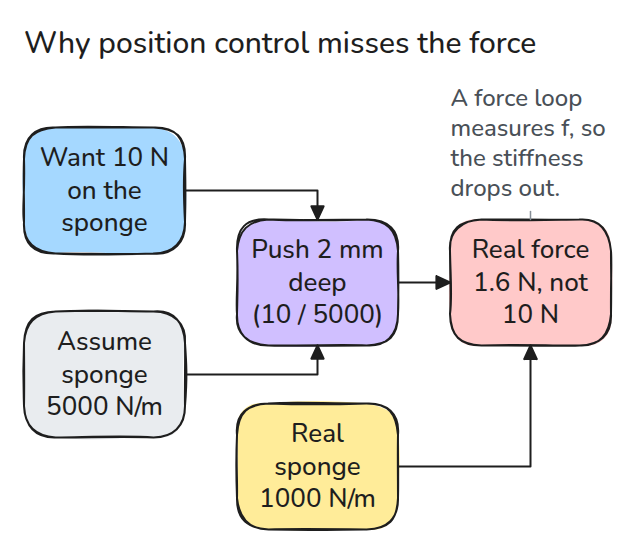
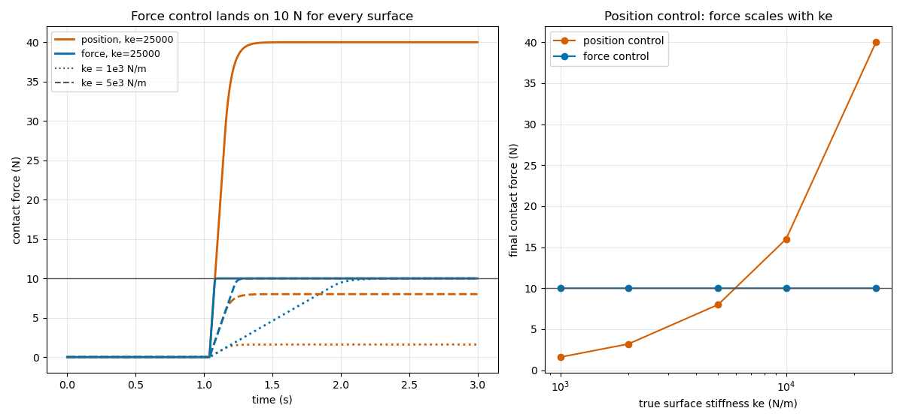
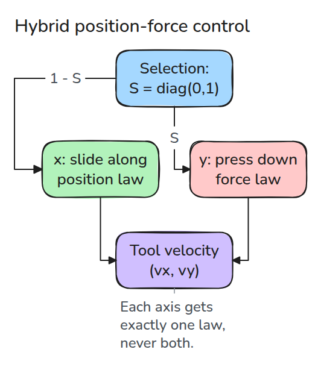
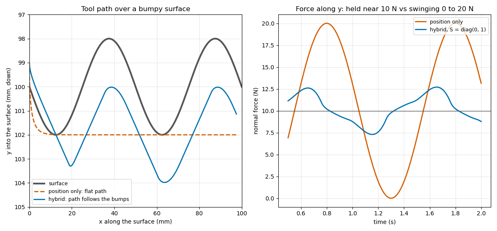

# Force and Hybrid Control

> Position control turns every error in your stiffness guess into a force error. A force loop measures the force, so the guess drops out.

**Type:** Build   **Prerequisites:** 11/01 Contact Models   **Time:** ~15 minutes

## In Plain Words

Wiping a desk with a sponge means guiding it across the desk while pressing downward. Pushing to a fixed depth gives different forces
when the sponge or surface is softer than expected.

Force control measures the push and moves deeper when it is too weak, or backs off when it is too strong. Hybrid control gives the
sliding direction a position target and the pressing direction a force target. That lets the tool follow surface bumps while
maintaining its push.

## The Problem

A tool must press with 10 N. You command the depth that gives 10 N for the stiffness you assumed. If the real surface is softer you press with 1.6 N, and if it is stiffer you press with 40 N.

## The Concept



*The depth is right only for the assumed stiffness. The real stiffness turns it into the force you get.*



*Left: the force loop reaches 10 N on every surface, slower on soft ones. Right: position control's force grows with stiffness.*

For a velocity `v = ki * (fd - f)` on a spring surface `f = ke * x`, the force follows `f_dot = ke * ki * (fd - f)`. It settles with time constant `1 / (ke * ki)` and no overshoot. In discrete time it stays stable only while `ke * ki * dt < 2`.

A real task needs both laws. The selection matrix `S` gives each axis exactly one: force law where `S = 1`, position law where `S = 0`.



*Position control along x, force control along y.*



*Left: the hybrid path follows the bumps. Right: force stays near 10 N instead of swinging between 0 and 20 N.*

## Build It

The whole hybrid law is one line. `v_pos` and `v_frc` are the two laws on every axis.

```python
v = (1 - S) * v_pos + S * v_frc
p = p + np.clip(v, -lim, lim) * dt
```

Assumptions: the probe tracks the commanded velocity exactly, the surface is a linear spring without friction along x, and force is measured with no noise or delay. Real sensors add both, which tightens the stability limit.

```bash
cd robotics-engineering-from-scratch
python3 -m pytest phases/11-contact-and-manipulation/02-force-and-hybrid-control -q
python3 phases/11-contact-and-manipulation/02-force-and-hybrid-control/code/main.py
```

## Use It

Repeat the press in MuJoCo with a soft-contact plane and compare the settled force with `ke * depth`. Craig covers the selection-matrix idea in chapter 11, force control of manipulators.

Sources: Craig and the original hybrid-control paper could not be opened (the publisher page returned 403), so chapter 11 is not checked against the text.

## Ship It

`outputs/skill-force-control-check.md` reviews a contact task for stiffness-sensitive position commands and unsafe integral gains.

## Exercises

1. Change `K_EST` to the true stiffness and show position control then hits 10 N, but only on that surface.
2. Find the largest `KI` that stays stable at `ke = 2.5e4` for `dt = 1 ms`.
3. Add 10 ms of delay to the force measurement and re-measure the stability limit.
