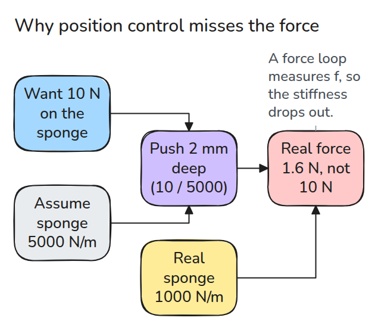
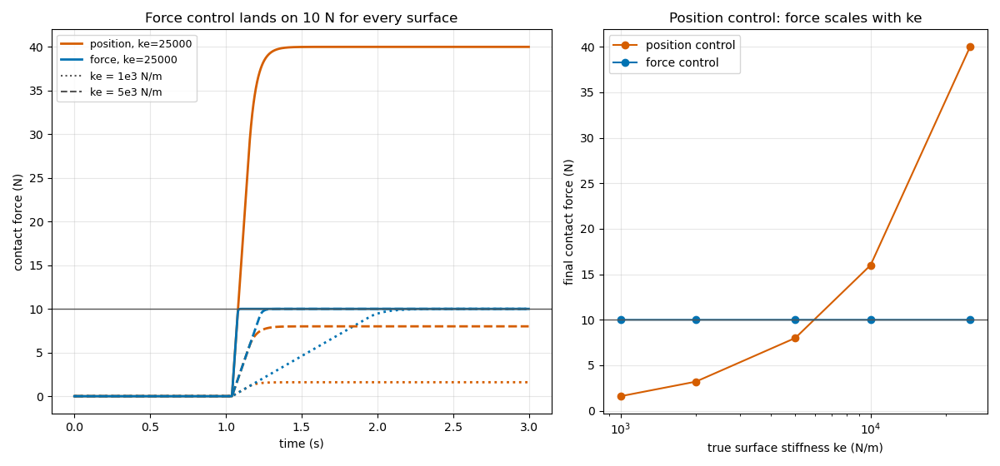
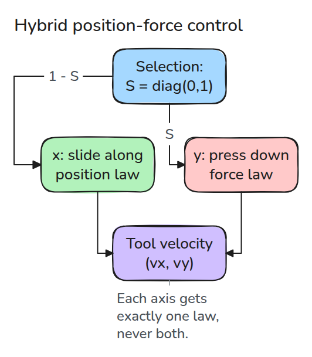
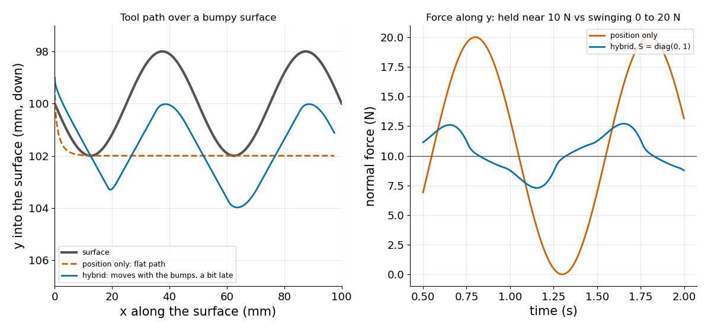

# Force and Hybrid Control

> Learn how a robot presses with the right force on a surface of unknown softness.

**Type:** Build   **Prerequisites:** 11/01 Contact Models   **Time:** ~15 minutes

## In Plain Words

Wiping a desk means moving a sponge across it while pressing down. A softer sponge gives a different force at the same depth.

Force control measures the push, going deeper when it is weak and backing off when it is strong. Hybrid control gives the sliding direction a position target and the pressing direction a force target.

## Key Terms

- **Force control**: moving the tool according to the measured force, not a planned position.
- **Hybrid control**: position control on some axes and force control on the others.
- **Stiffness (`ke`)**: how much force a surface pushes back for each metre you squeeze it.
- **Gain (`ki`)**: the factor that turns a force error into a tool speed.
- **Time constant**: the time in which an error shrinks by about two thirds.
- **Selection matrix (`S`)**: a switch for each direction that chooses force control or position control.

## The Problem

Picture a robot told to press a sponge with a steady force. It guesses how soft the sponge is and presses to a fixed depth. If the sponge is stiffer than guessed, it pushes far too hard.

[](../assets/clip-example.mp4)

*Same depth on three sponges: very different forces.*

## The Concept

A robot wiping or sanding needs a steady force, not a steady position.

Force control skips the guess: the robot measures the push. If it is weak, the tool goes deeper; if it is strong, it backs off.



*The command is right only for the guessed stiffness.*



*Force control reaches the target on every surface.*

Real tasks need both: slide along the surface by position, press into it by force. That is hybrid control.



*Position along x, force along y.*



*Hybrid control cuts the force swings on the bumps.*

<details><summary>The math (optional)</summary>

Pressing with 10 N, the robot assumes 5000 N/m and commands a 2 mm squeeze, but the sponge top sits 0.4 mm lower, so it squeezes only 1.6 mm. 1000 N/m gives 1.6 N, 5000 N/m gives 8 N, 25000 N/m gives 40 N. The force loop moves the tool at `v = ki * (fd - f)`, (`fd` wanted, `f` measured). On a spring surface `f = ke * x` the gap shrinks by about two thirds every `1 / (ke * ki)` seconds. Each step of `dt` multiplies the gap by `1 - ke * ki * dt`. While `ke * ki * dt < 1` the gap shrinks steadily, so a stiffer surface settles faster. Between 1 and 2 it flips sign each step and settles slower; above 2 it shakes. The selection matrix `S` gives each axis one law; the code stores its diagonal, `S = [0, 1]`: position on x, force on y.

</details>

## Build It

The hybrid rule takes the sliding speed from the position rule and the pressing speed from the force rule.

```python
v = (1 - S) * v_pos + S * v_frc
p = p + np.clip(v, -lim, lim) * dt
```

Assumptions: the tool moves exactly as told, the sponge acts like a spring, and the force reading has no noise.

```bash
cd robotics-engineering-from-scratch
python3 -m pytest phases/11-contact-and-manipulation/02-force-and-hybrid-control -q
python3 phases/11-contact-and-manipulation/02-force-and-hybrid-control/code/main.py
```

## Use It

Repeat the press in MuJoCo, a physics simulator, and compare the settled force with stiffness times depth.

Sources: Craig (chapter 11) and the original hybrid-control paper; neither could be opened, so both are unchecked.

## Ship It

`outputs/skill-force-control-check.md` reviews a contact task for stiffness-sensitive commands and high gain.

## Exercises

1. Set `K_EST` and `X_EST` to the true values: position control hits 10 N, on that surface only.
2. Raise the gain until the force shakes.
3. Add a small delay to the force reading and see the safe gain shrink.
