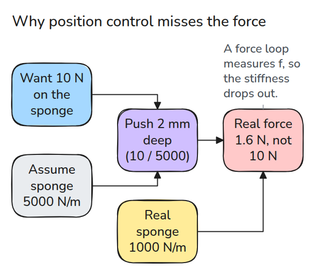
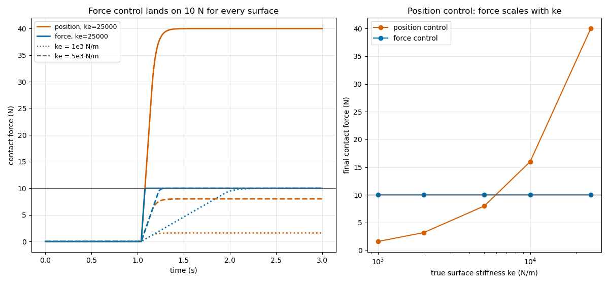
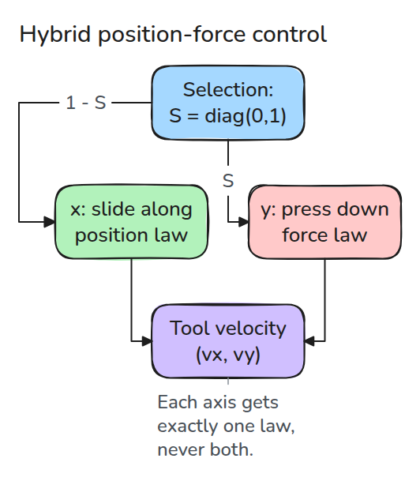
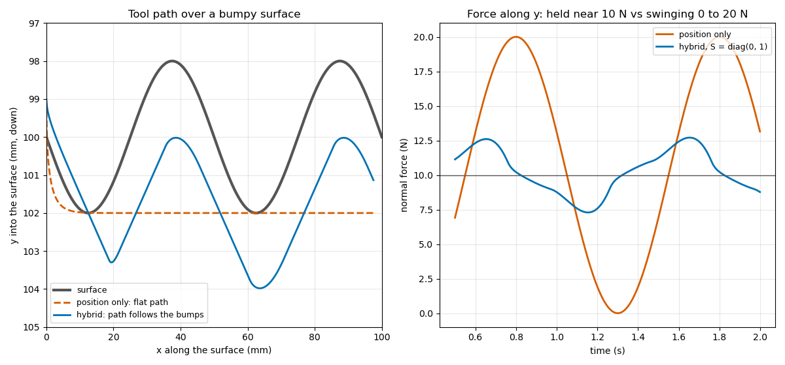

# 힘 제어와 하이브리드 제어 (Force and Hybrid Control)

> 위치 제어는 강성을 잘못 짐작한 만큼을 그대로 힘 오차로 바꿉니다. 힘 루프는 힘을 직접 재므로 그 짐작이 사라집니다.

**유형:** 만들기   **선수 지식:** 11/01 접촉 모델   **시간:** 약 15분

## 쉽게 말하면

스펀지로 책상을 닦을 때는 옆으로 움직이면서 아래로 눌러요. 같은 깊이까지 눌러도 스펀지나 표면이 예상보다 무르면 힘이 달라져요.

force control은 누르는 힘을 재고 약하면 더 들어가고 강하면 물러나요. hybrid control은 미끄러지는 방향에는 위치 목표를 주고 누르는 방향에는 힘 목표를 줘요. 그래서 도구가 표면의 굴곡을 따라 높이를 바꾸면서도 누르는
힘을 유지할 수 있어요.

## 문제

도구가 표면을 10 N으로 눌러야 합니다. 가정한 표면 강성으로 깊이를 계산해 그 깊이를 명령합니다. 실제 표면이 더 무르면 1.6 N으로 누르고 더 단단하면 40 N으로 누릅니다.

## 개념



*명령한 깊이는 가정한 강성에서만 맞습니다. 실제 강성이 그 깊이에 곱해져 실제로 나타나는 힘이 됩니다.*



*왼쪽은 힘 루프가 모든 표면에서 10 N에 도달하고 무른 표면에서만 느린 모습입니다. 오른쪽은 위치 제어의 힘이 실제 강성에 따라 커지는 모습입니다.*

스프링 표면 `f = ke * x`에서 속도를 `v = ki * (fd - f)`로 주면 힘은 `f_dot = ke * ki * (fd - f)`를 따릅니다. 시정수 `1 / (ke * ki)`로 overshoot 없이 정착합니다.

이산 시간에서는 `ke * ki * dt < 2`일 때만 안정합니다.

실제 작업은 두 법칙이 동시에 필요합니다. 선택 행렬 `S`가 각 축에 법칙을 정확히 하나씩 줍니다. `S = 1`인 축에서는 힘 법칙이, `S = 0`인 축에서는 위치 법칙이 돕니다.



*도구는 x 방향으로 위치 제어를 받으며 미끄러지고 y 방향으로 힘 제어를 받으며 누릅니다.*



*왼쪽은 하이브리드 도구 경로가 범프를 따르고 위치 제어만 쓴 경로는 범프를 무시하는 모습입니다. 오른쪽은 힘이 0에서 20 N까지 흔들리지 않고 10 N 근처에 머무는 모습입니다.*

## 만들기

하이브리드 법칙은 한 줄입니다. `v_pos`와 `v_frc`는 모든 축에서 계산한 두 법칙의 속도입니다.

```python
v = (1 - S) * v_pos + S * v_frc
p = p + np.clip(v, -lim, lim) * dt
```

가정은 프로브가 명령 속도를 정확히 따르고 표면이 x 방향 마찰 없는 선형 스프링이며 힘이 잡음과 지연 없이 측정된다는 것입니다. 실제 센서는 잡음과 지연을 더하므로 안정 한계가 더 좁아집니다.

```bash
cd robotics-engineering-from-scratch
python3 -m pytest phases/11-contact-and-manipulation/02-force-and-hybrid-control -q
python3 phases/11-contact-and-manipulation/02-force-and-hybrid-control/code/main.py
```

## 실제 도구로 보기

MuJoCo에서 프로브에 position actuator를 달고 soft contact 평면을 두어 같은 누르기를 돌립니다. 정착한 힘을 `ke * depth`와 비교합니다. 선택 행렬 아이디어는 Craig가 매니퓰레이터의 힘 제어로 다루는 11장에 있습니다.

출처: Craig 책과 원 논문은 출판사 페이지가 403을 돌려주어 열어 보지 못했으므로, 11장 인용은 본문과 대조하지 않았습니다.

## 결과물

`outputs/skill-force-control-check.md`는 접촉 작업에서 강성에 민감한 위치 명령과 위험한 적분 gain을 점검합니다.

## 연습 문제

1. `K_EST`를 실제 강성으로 바꾸면 위치 제어도 10 N을 내지만 그 표면에서만 그렇다는 것을 보이세요.
2. `dt = 1 ms`에서 `ke = 2.5e4`가 안정하도록 하는 가장 큰 `KI`를 찾으세요.
3. 힘 측정에 10 ms 지연을 더하고 안정 한계를 다시 재세요.
