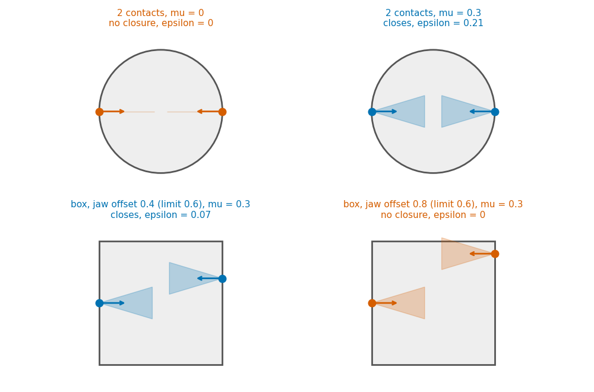

# Grasp Quality

> Learn how to tell whether a robot hand's grip will hold, and how much margin it has.

**Type:** Build   **Prerequisites:** 11/01 Contact Models   **Time:** ~15 minutes

## In Plain Words

Grasp quality asks whether your contacts can resist both a push and a twist. Pinch a small box between fingertips on opposite sides, then slide one finger up: the inward pushes now twist the box, even if you squeeze as hard.

Friction lets a fingertip also push along the surface, within a limit. If the available pushes and twists cannot oppose every disturbance, the grasp lacks force closure.

## Key Terms

- **Wrench**: a push and a twist packed together; in 2-D, three numbers `(fx, fy, torque)`.
- **Friction cone**: all the forces a fingertip can apply without slipping.
- **Convex hull**: the tight wrapping around a set of points.
- **Force closure**: the contacts can resist a load from any direction.
- **Epsilon**: the grasp's margin: the smallest distance from the hull's inside to its surface.
- **Rank**: the number of independent directions the wrenches span.

## The Problem

Picture two fingers pinching a box. Slide one finger up and the box twists out, though every contact still grips: together they cannot resist that load.

## The Concept

A real hand drops things when a grip has no margin, so we need a number for it.

A fingertip can push with any force inside its friction cone, so the cone's two edge wrenches are its extremes. The grasp holds when some mix of such pushes cancels any load: the origin (no net push or twist) lies inside the hull of all edge wrenches.


*Each contact adds two edge wrenches; the grasp closes when their hull contains the origin inside.*

A box of width 2, `mu = 0.3`, right jaw `offset` above the left. The contacts balance only while the line joining them stays inside both cones: `offset / 2 <= mu`, so `offset <= 0.6`. Offset 0.4 gives epsilon 0.07, and 0.8 gives 0.


*The box holds until offset 0.6, then turns.*


*Without friction two opposite contacts cannot resist a twist.*



*Blue closes, orange does not.*


*Epsilon falls linearly and reaches zero at offset = 2 mu.*

## Build It

Each hull facet is a plane through three wrenches, with all others on one side. Epsilon is the origin's smallest distance to a facet, or zero if it lies outside.

```python
n = np.cross(W[j] - W[i], W[k] - W[i]); n /= np.linalg.norm(n)
side = W @ n - n @ W[i]
if np.all(side <= tol): h.append(n @ W[i])
```

Assumptions: rigid object, point contacts, one Coulomb `mu`, torque divided by a length `rho`.

```bash
cd robotics-engineering-from-scratch
python3 -m pytest phases/11-contact-and-manipulation/03-grasp-quality -q
python3 phases/11-contact-and-manipulation/03-grasp-quality/code/main.py
```

## Use It

With SciPy, solve the closure linear program for the same wrenches and compare.

Sources: Lynch and Park, *Modern Robotics*, 2017 preprint, Sec. 12.2.3 (opened 2026-11-09).

## Ship It

`outputs/skill-grasp-closure-check.md` checks a grasp for closure and a weak margin.

## Exercises

1. Add a third contact to an open grasp; find the smallest `mu` that closes it.
2. Show epsilon changes with `rho`, closure does not.
3. Rotate three contacts on a circle; find the arrangement with the largest epsilon.
