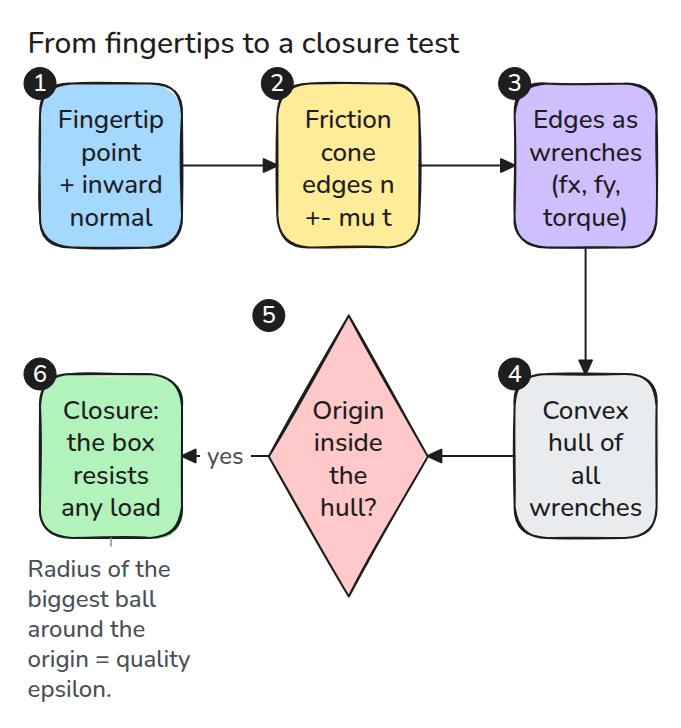

# Grasp Quality

> Learn how to tell whether a robot hand's grip will hold, and how much margin it has.

**Type:** Build   **Prerequisites:** 11/01 Contact Models   **Time:** ~15 minutes

## In Plain Words

Grasp quality asks whether your contacts can resist both a push and a twist. Pinch a small box between fingertips on opposite sides, then slide one finger up: the inward pushes now twist the box, even if you squeeze as hard.

Friction lets a fingertip also push along the surface, within a limit. If the available pushes and twists cannot oppose every disturbance, the grasp lacks force closure.

## Key Terms

- **Wrench**: a push and a twist packed together; in 2-D, three numbers `(fx, fy, torque)`.
- **Friction cone**: all the forces a fingertip can apply without slipping.
- **Convex hull**: the tight wrapping around a set of points.
- **Force closure**: the contacts can resist a load from any direction.
- **Epsilon**: the grasp's margin: the smallest distance from the hull's inside to its surface.
- **Rank**: the number of independent directions the wrenches span.

## The Problem

Picture two fingers pinching a box. Slide one finger up and the box twists out, though every contact still grips.

## The Concept

A robot hand drops things when a grip has no margin, so we need a number for that margin.

Each fingertip can push straight in and, thanks to friction, a little sideways. Together they resist a load if some mix of their pushes can cancel a push or a twist from any direction. Then the grasp is closed.



*Each contact adds pushes. The grasp closes if they can cancel any load.*


*The box holds until the jaw rises too far, then turns.*

Friction matters: two opposite contacts without it cannot resist a twist. The margin, called epsilon, says how far the grasp is from failing. A tiny epsilon means a fragile grasp.


*Without friction a twist goes unresisted.*


*Blue closes, orange does not.*


*The margin shrinks steadily and reaches zero.*

<details><summary>The math (optional)</summary>

A wrench packs a push and a twist into three numbers `(fx, fy, torque)`. A fingertip can push with any force inside its friction cone, so the cone's two edge wrenches are its extremes. The grasp closes when the origin (no net push or twist) lies strictly inside the convex hull of all edge wrenches; epsilon is the origin's smallest distance to the hull's surface. Example: a box of width 2, `mu = 0.3`, right jaw `offset` above the left. The contacts balance only while `offset / 2 <= mu`, so `offset <= 0.6`; for `mu = 0.4` that is 0.8. Offset 0.4 gives epsilon 0.07, and 0.8 gives 0. Epsilon reaches zero at offset = 2 mu.

</details>

## Build It

Epsilon is the origin's smallest distance to a hull facet, or zero if it lies outside.

```python
n = np.cross(W[j] - W[i], W[k] - W[i]); n /= np.linalg.norm(n)
side = W @ n - n @ W[i]
if np.all(side <= tol): h.append(n @ W[i])
```

Assumptions: rigid object, point contacts, one friction value.

```bash
cd robotics-engineering-from-scratch
python3 -m pytest phases/11-contact-and-manipulation/03-grasp-quality -q
python3 phases/11-contact-and-manipulation/03-grasp-quality/code/main.py
```

## Use It

With SciPy, solve the closure test as a linear program for the same wrenches and compare.

Sources: Lynch and Park, *Modern Robotics*, 2017 preprint, Sec. 12.2.3 (opened 2026-11-09).

## Ship It

`outputs/skill-grasp-closure-check.md` checks a grasp for closure and a weak margin.

## Exercises

1. Raise the jaw bit by bit; find where the box turns.
2. Add a third finger to an open grasp; see if it closes.
3. Move three fingers round a circle; find the most robust spot.
