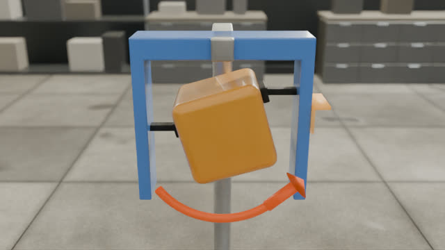
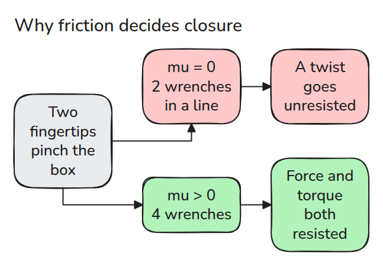
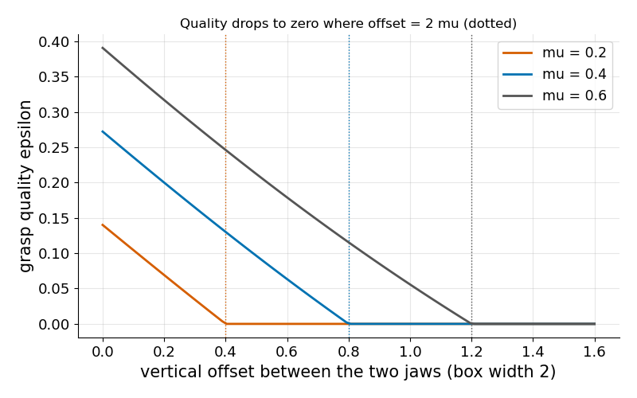

# Grasp Quality

> Learn how to tell whether a robot hand's grip will hold, and how much margin it has.

**Type:** Build   **Prerequisites:** 11/01 Contact Models   **Time:** ~15 minutes

## In Plain Words

Grasp quality asks whether fingertips can resist both a push and a twist. Pinch a small box between opposite fingertips. Slide one finger up, and the inward pushes now twist the box, no matter how hard you squeeze.

Friction, the grip between surfaces, lets a fingertip also push sideways, within a limit. If the pushes cannot cancel every outside push or twist, the grasp lacks force closure.

## Key Terms

- **Wrench**: a push and a twist packed together. In 2-D that is three numbers: push left-right, push up-down and twist.
- **Friction cone**: all the forces a fingertip can apply without slipping.
- **Convex hull**: the tight wrapping around a set of points.
- **Force closure**: the contacts can resist any outside push or twist.
- **Epsilon**: how far the grasp is from failing; zero means it fails.


## The Problem

Picture two fingers pinching a box. Slide one finger up and the box twists out, though both still grip.

## The Concept

A grip with no margin drops things, so we need a number for it.

Fingertips hold if some mix of their pushes cancels any outside push or twist. That is force closure.

Wrap every push-and-twist the fingers can make (the convex hull). If the point for "no net push or twist" is inside, the fingers can push back in every direction, so the grip holds.


*Contacts add pushes. They hold if they cancel any outside push or twist.*

[](../assets/clip-example.mp4)

*The box holds until the raised finger is too high, then it turns.*

Two opposite contacts without friction cannot resist a twist. The margin, epsilon, is how far inside that point sits. A tiny epsilon means a fragile grip.



*Without friction, a twist goes unresisted.*


*Each panel is one grip. Blue holds; orange does not.*



*As the finger rises, epsilon shrinks to zero.*

<details><summary>The math (optional)</summary>

A wrench packs a push and a twist into three numbers `(fx, fy, torque)`. The code uses `torque / rho` with `rho` = 1 length unit, and each cone edge carries a unit normal force, so epsilon depends on these scales. A fingertip can push with any force inside its friction cone, so the cone's two edge wrenches are its extremes. The grasp closes when the origin (no net push or twist) lies strictly inside the convex hull of all edge wrenches; epsilon is the origin's smallest distance to the hull's surface. Example: a box of width 2, `mu = 0.3`, right finger `offset` above the left. The contacts balance only while `offset / 2 <= mu`, so `offset <= 0.6`; for `mu = 0.4` that is 0.8. Offset 0.4 gives epsilon 0.07, and 0.8 gives 0. Epsilon reaches zero at offset = 2 mu.

</details>

## Build It

Epsilon is the smallest distance from the "no net push or twist" point to the hull's edge, or zero if outside.

```python
n = np.cross(W[j] - W[i], W[k] - W[i]); n /= np.linalg.norm(n)
side = W @ n - n @ W[i]
if np.all(side <= tol): h.append(n @ W[i])
```


```bash
cd robotics-engineering-from-scratch
python3 -m pytest phases/11-contact-and-manipulation/03-grasp-quality -q
python3 phases/11-contact-and-manipulation/03-grasp-quality/code/main.py
```

## Use It

With SciPy, run the same closure test another way and compare.

Sources: Lynch and Park, *Modern Robotics*, 2017, Sec. 12.2.3 (opened 2026-11-09).

## Ship It

`outputs/skill-grasp-closure-check.md` checks a grasp for closure and margin.

## Exercises

1. Raise the finger bit by bit; find where the box turns.
2. Take a grasp that fails, add a third finger; does it hold now?
3. Try several three-finger placements on the box's edge; keep the one with the biggest epsilon.
