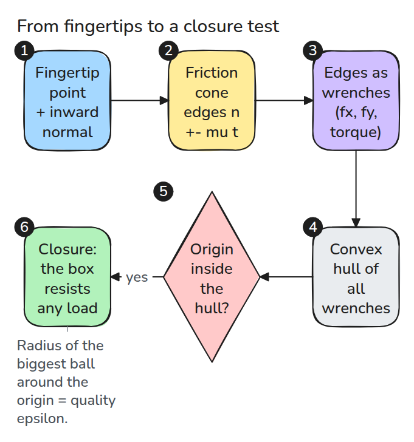
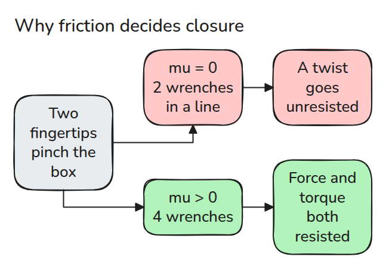
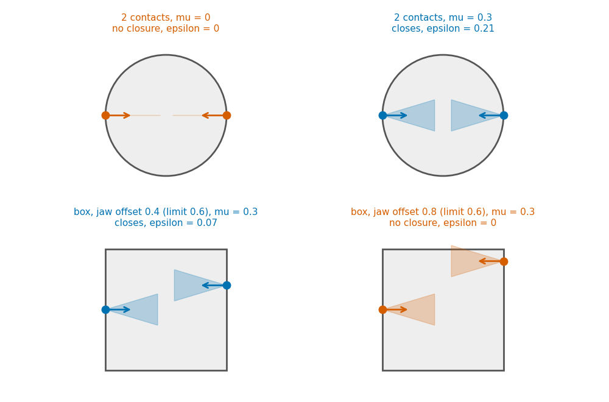
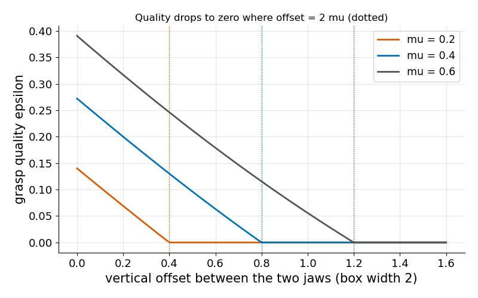

# Grasp Quality

> A grasp holds if the friction-cone wrenches of its contacts can push in every direction, and the size of the hull tells you how well.

**Type:** Build   **Prerequisites:** 11/01 Contact Models   **Time:** ~15 minutes

## In Plain Words

Grasp quality asks whether your contacts can resist both a push and a twist. Pinch a small box between fingertips on opposite sides.
Sliding a finger upward changes the torque those inward pushes create, even if you squeeze just as hard.

Friction lets each fingertip also push along the box's surface, within a limit. If the available forces and torques cannot oppose every
disturbance direction, the grasp lacks force closure. A grasp with little margin can lose closure after a small shift.

## The Problem

Two fingers pinch a box. Slide one finger up and the box twists out, even though the squeeze force is the same. A grasp can fail without any contact losing grip, because the contacts together cannot resist some direction of load.

## The Concept

A wrench packs a push and a twist into three numbers `(fx, fy, torque)`. A fingertip can push with any force inside its friction cone, so the two edge wrenches are its extremes. The grasp holds when some mix of such pushes (never pulls) cancels any load, that is, when the origin (no net push or twist) lies inside the hull, the tight wrapping of all edge wrenches in 3-D.



*Each contact contributes the two edges of its friction cone as wrenches. The grasp closes when their convex hull contains the origin in its interior.*

Take a box of width 2 and `mu = 0.3`, with the right jaw `offset` above the left. The contacts balance only while the line joining them stays inside both cones, which needs `offset / 2 <= mu`, so `offset <= 0.6`. Offset 0.4 closes with margin epsilon 0.07 (from `epsilon()`), and 0.8 gives 0.


*Watch the right jaw rise: the box holds until offset 0.6, then turns.*



*Without friction two opposite contacts give only two wrenches on a line, and a twist goes unresisted.*



*Blue closes, orange does not.*



*Epsilon falls linearly and reaches zero at offset = 2 mu.*

## Build It

Each facet of the hull is a plane through three wrenches with all others on one side. Epsilon is the smallest distance from the origin to a facet, and zero if the origin is outside or the rank is below 3.

```python
n = np.cross(W[j] - W[i], W[k] - W[i]); n /= np.linalg.norm(n)
side = W @ n - n @ W[i]
if np.all(side <= tol): h.append(n @ W[i])
```

Assumptions: rigid object, point contacts with known inward normals, Coulomb friction with one `mu`, torque divided by a length `rho` so all three axes have comparable size. Closure does not depend on `rho`, but epsilon does.

```bash
cd robotics-engineering-from-scratch
python3 -m pytest phases/11-contact-and-manipulation/03-grasp-quality -q
python3 phases/11-contact-and-manipulation/03-grasp-quality/code/main.py
```

## Use It

With SciPy, solve the closure linear program for the same wrenches. The test suite compares both on random three-finger grasps and they agree.

Sources: Lynch and Park, *Modern Robotics*, May 2017 preprint, Sec. 12.2.3 (opened 2026-11-09): force closure means the composite wrench cone contains the whole wrench space, and a planar grasp can close with two frictional contacts.

## Ship It

`outputs/skill-grasp-closure-check.md` checks a grasp for closure and a weak margin.

## Exercises

1. Add a third contact to an open grasp and find the smallest `mu` that closes it.
2. Show that epsilon changes with `rho` while closure does not.
3. Rotate three contacts on a circle and find the arrangement with the largest epsilon.
