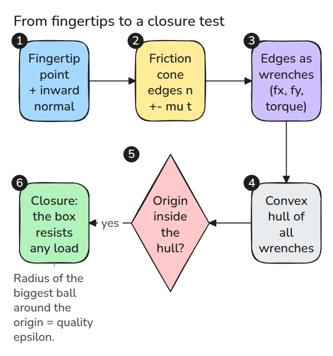
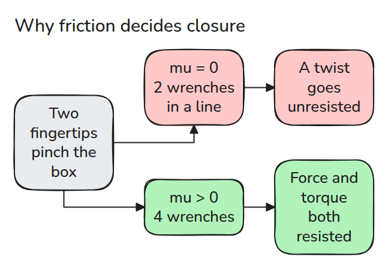
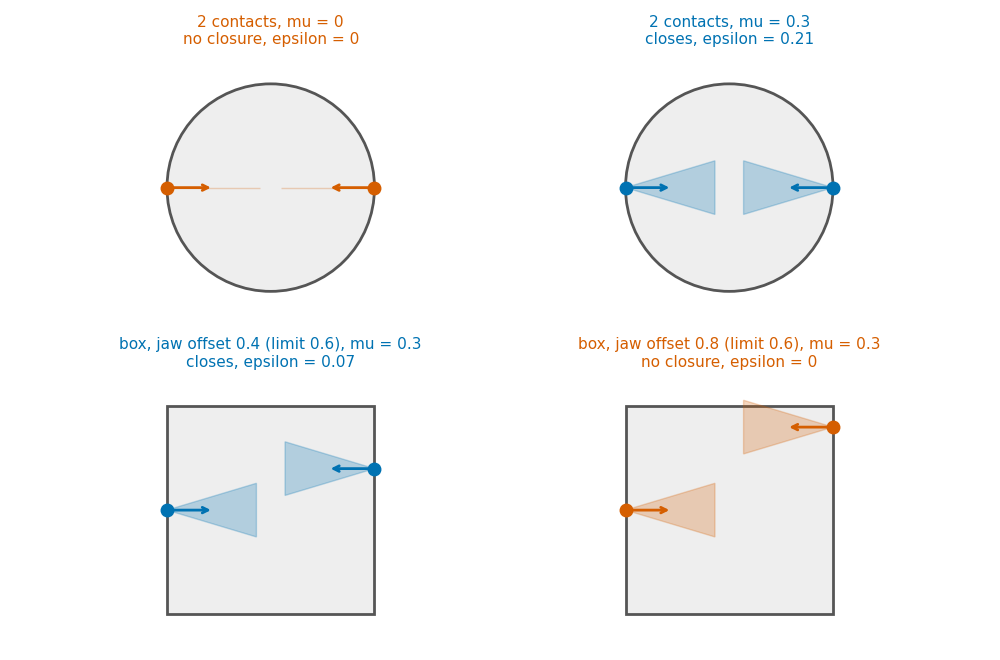
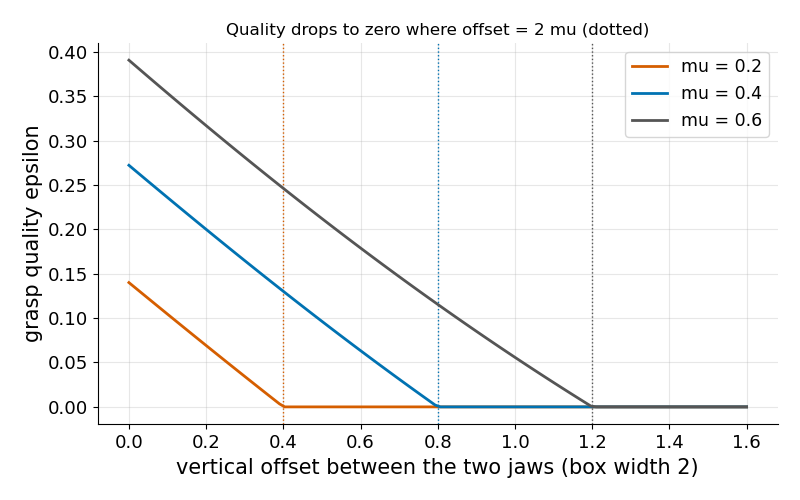

# 파지 품질 (Grasp Quality)

> 로봇 손의 쥐기가 버틸지, 여유가 얼마나 되는지 판단하는 방법을 알아봅니다.

**유형:** 만들기   **선수 지식:** 11/01 접촉 모델   **시간:** 약 15분

## 쉽게 말하면

grasp quality는 손끝이 밀림과 비틀림을 모두 버틸 수 있는지 봐요. 작은 상자의 양옆을 손끝으로 집어 보세요. 한쪽 손가락을 위로 옮기면 아무리 세게 눌러도 안쪽으로 미는 힘이 상자를 비틀어요.

면 사이의 달라붙는 힘인 friction 덕분에 손끝은 옆으로도 힘을 낼 수 있지만 상한이 있어요. 미는 힘이 바깥에서 오는 어떤 밀기나 비틀림도 상쇄하지 못하면 force closure가 없어요.

## 핵심 용어

- **Wrench**: 밀기와 비틀기를 함께 묶은 것입니다. 2차원에서는 세 숫자, 즉 좌우로 미는 힘, 위아래로 미는 힘, 비틀림입니다.
- **Friction cone**: 손끝이 미끄러지지 않고 낼 수 있는 모든 힘입니다.
- **Convex hull**: 점들의 집합을 팽팽하게 감싼 껍질입니다.
- **Force closure**: 접촉이 바깥에서 오는 어떤 밀기나 비틀림도 버틸 수 있는 상태입니다.
- **Epsilon**: 쥐기가 실패에서 얼마나 떨어져 있는지입니다. 0이면 실패합니다.


## 문제

손가락 두 개로 상자를 집었다고 상상해 보세요. 한 손가락을 위로 밀어 올리면 두 손가락이 여전히 쥐고 있는데도 상자가 비틀려 빠집니다.

## 개념

실제 로봇 손은 쥐기에 여유가 없으면 물건을 떨어뜨리므로 그 여유를 나타내는 숫자가 필요합니다.

손끝의 밀기를 적당히 섞어 바깥에서 오는 어떤 밀기나 비틀림도 상쇄할 수 있으면 버팁니다. 이것이 force closure입니다.

손끝이 만들 수 있는 모든 밀기와 비틀림을 감싸 보세요(convex hull). "알짜 밀기와 비틀림이 없음"을 뜻하는 점이 그 안에 있으면 손끝이 모든 방향으로 맞밀 수 있어서 쥐기가 버팁니다.



*접촉마다 밀기가 더해지고 바깥의 어떤 밀기나 비틀림도 상쇄하면 버팁니다.*


*올린 손가락이 너무 높아지기 전까지는 상자가 버티다가 그 뒤에 돕니다.*

마주 보는 접촉 두 개는 마찰이 없으면 비틀림을 견디지 못합니다. 여유를 나타내는 epsilon은 그 점이 hull 안쪽으로 얼마나 깊이 들어와 있는지입니다. epsilon이 아주 작으면 쥐기가 쉽게 깨집니다.



*마찰이 없으면 비틀림을 견디지 못합니다.*



*그림 하나가 쥐기 하나입니다. 파란색은 버티고 주황색은 버티지 못합니다.*



*손가락이 올라갈수록 epsilon이 줄어 0에 이릅니다.*

<details><summary>The math (optional)</summary>

wrench는 밀기와 비틀기를 `(fx, fy, torque)` 세 숫자로 묶은 것입니다.
손끝은 마찰 cone 안의 어떤 힘으로도 밀 수 있으므로 cone의 두 모서리 wrench가 그 양 끝입니다.
원점(알짜 밀기와 비틀기가 없는 상태)이 모든 모서리 wrench의 convex hull 안쪽에 엄밀하게 들어 있으면 쥐기가 닫힙니다. epsilon은 원점에서 hull 표면까지의 최소 거리입니다.
예를 들어 폭이 2인 상자에서 `mu = 0.3`이고 오른쪽 손가락이 왼쪽보다 `offset`만큼 높다고 합시다.
접촉은 `offset / 2 <= mu`인 동안에만 균형을 잡으므로 `offset <= 0.6`입니다. `mu = 0.4`이면 이 한계는 0.8입니다.
offset이 0.4이면 epsilon은 0.07이고 0.8이면 0입니다.
epsilon은 offset = 2 mu에서 0이 됩니다.

</details>

## 만들기

epsilon은 "알짜 밀기와 비틀림이 없음" 점에서 hull의 가장자리까지의 최소 거리이며 그 점이 밖에 있으면 0입니다.

```python
n = np.cross(W[j] - W[i], W[k] - W[i]); n /= np.linalg.norm(n)
side = W @ n - n @ W[i]
if np.all(side <= tol): h.append(n @ W[i])
```

```bash
cd robotics-engineering-from-scratch
python3 -m pytest phases/11-contact-and-manipulation/03-grasp-quality -q
python3 phases/11-contact-and-manipulation/03-grasp-quality/code/main.py
```

## 실제 도구로 보기

SciPy로 같은 closure 검사를 다른 방법으로 해 보고 결과를 비교하세요.

출처: Lynch와 Park, *Modern Robotics*, 2017년 5월 preprint, 12.2.3절(2026년 11월 9일 열람).

## 결과물

`outputs/skill-grasp-closure-check.md`는 쥐기가 닫히는지와 여유가 작은지를 점검합니다.

## 연습 문제

1. 손가락을 조금씩 올리면서 상자가 돌기 시작하는 곳을 찾으세요.
2. 버티지 못하는 쥐기에 세 번째 손가락을 더하고 이제 버티는지 보세요.
3. 손가락 세 개를 상자 가장자리에 여러 가지로 놓아 보고 epsilon이 가장 큰 배치를 고르세요.
