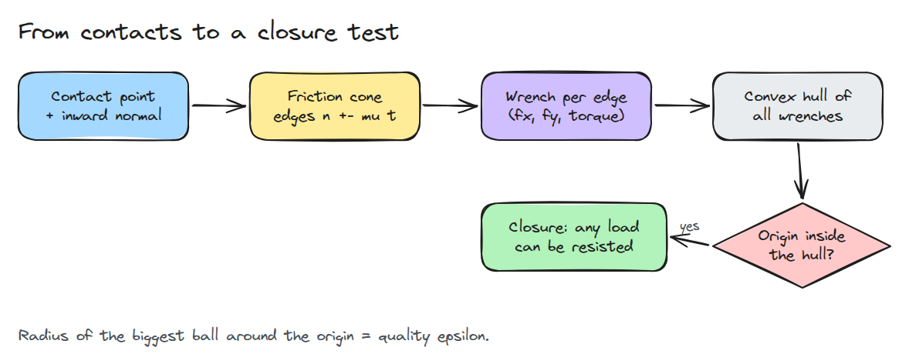
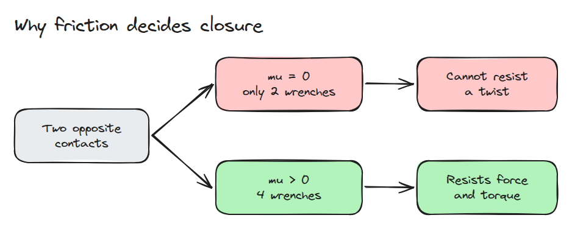
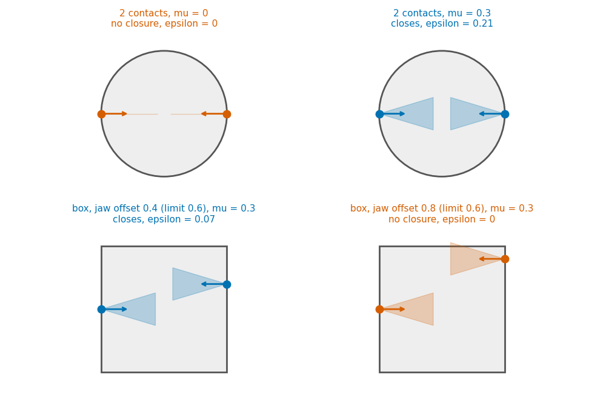
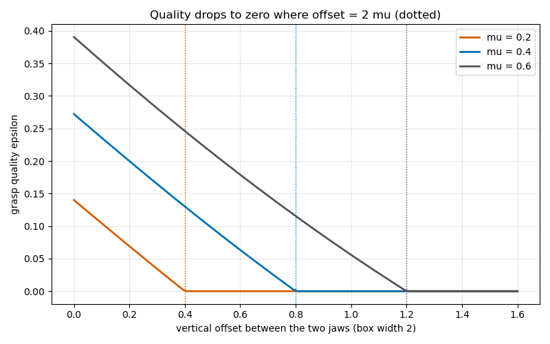

# 파지 품질 (Grasp Quality)

> 접촉들의 마찰 cone wrench가 모든 방향으로 밀 수 있으면 파지가 버티고 hull의 크기가 얼마나 잘 버티는지를 알려 줍니다.

**유형:** 만들기   **선수 지식:** 11/01 접촉 모델   **시간:** 약 15분

## 문제

손가락 두 개로 상자를 집습니다. 한 손가락을 조금 위로 밀면 쥐는 힘은 같은데도 상자가 돌아 빠집니다. 접촉 하나가 미끄러지지 않아도 파지는 실패할 수 있습니다. 접촉들이 모여서 어떤 방향의 하중을 견디지 못하기 때문입니다.

## 개념



*접촉마다 마찰 cone의 두 모서리를 wrench(힘과 토크)로 더합니다. 이 wrench들의 convex hull이 원점을 안쪽에 품으면 파지가 닫힙니다.*

평면 wrench는 `(fx, fy, torque)` 세 성분이라 hull은 3차원에 있습니다. 마찰이 있으면 접촉 하나가 모서리 wrench 두 개를 주고 접촉 두 개만으로도 네 개가 되어 원점을 둘러쌀 수 있습니다.



*마찰이 없으면 마주 보는 접촉 두 개는 한 직선 위의 wrench 두 개뿐이어서 비틀림을 견디지 못합니다.*



*파란색은 닫히고 주황색은 닫히지 않습니다. 오른쪽 jaw를 0.4에서 0.8로 옮기면 두 접촉을 잇는 선이 cone 밖으로 나갑니다.*



*품질 epsilon은 직선으로 줄어 offset = 2 mu, 즉 상자 폭 곱하기 mu에서 0이 됩니다.*

## 만들기

hull의 면은 wrench 세 개를 지나고 나머지가 모두 한쪽에 있는 평면입니다. epsilon은 원점에서 면까지의 최소 거리이며 원점이 밖에 있거나 rank가 3보다 작으면 0입니다.

```python
n = np.cross(W[j] - W[i], W[k] - W[i]); n /= np.linalg.norm(n)
side = W @ n - n @ W[i]
if np.all(side <= tol): h.append(n @ W[i])
```

가정은 강체, 안쪽 법선을 아는 점 접촉, 하나의 `mu`를 쓰는 쿨롱 마찰, 세 축의 크기를 맞추려고 토크를 길이 `rho`로 나누는 것입니다. closure 여부는 `rho`에 무관하지만 epsilon은 `rho`에 따라 달라집니다.

```bash
cd robotics-engineering-from-scratch
python3 -m pytest phases/11-contact-and-manipulation/03-grasp-quality -q
python3 phases/11-contact-and-manipulation/03-grasp-quality/code/main.py
```

## 실제 도구로 보기

SciPy로 같은 wrench에 대한 closure 선형계획을 풀어 비교합니다. 테스트가 무작위 손가락 세 개 파지에서 둘을 비교하며 두 답이 일치합니다.

출처: Lynch와 Park, *Modern Robotics*, 2017년 5월 preprint, 12.2.3절(2026년 11월 9일 열람).

force closure는 합성 wrench cone이 wrench 공간 전체를 포함하는 것입니다. 평면 파지는 마찰 접촉 두 개로도 닫힐 수 있습니다.

## 결과물

`outputs/skill-grasp-closure-check.md`는 파지가 닫히는지와 여유가 작은지를 점검합니다.

## 연습 문제

1. 열린 파지에 세 번째 접촉을 더하고 닫히는 가장 작은 `mu`를 찾으세요.
2. epsilon은 `rho`에 따라 변하지만 closure는 변하지 않는다는 것을 보이세요.
3. 원 위의 세 접촉을 돌려 가며 epsilon이 가장 큰 배치를 찾으세요.
