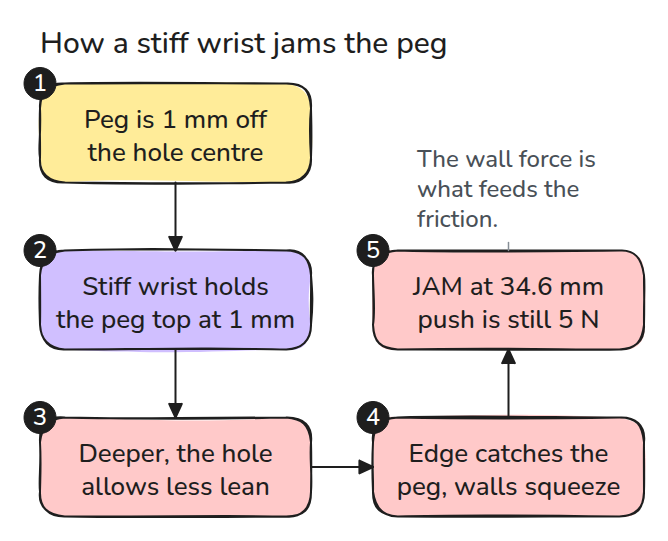
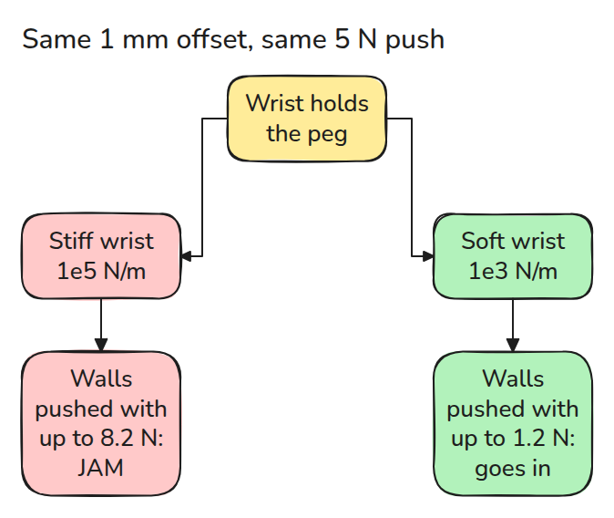
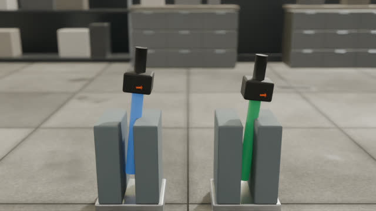
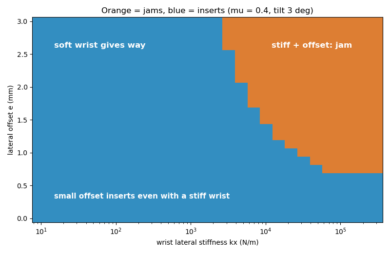
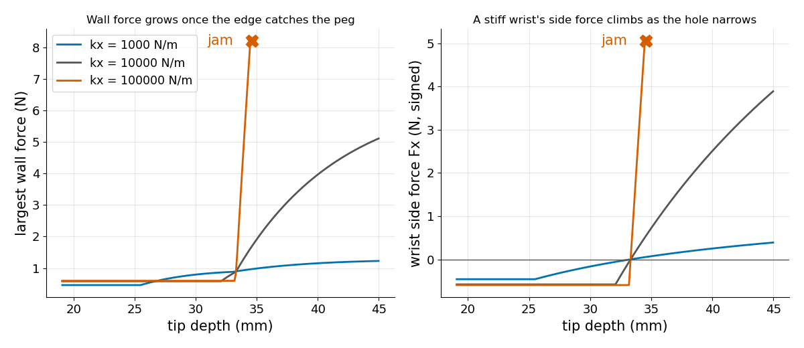

# Compliance in Assembly

> Learn why a stiff robot jams a peg in a tight hole, and why a gentler wrist slides it in.

**Type:** Build   **Prerequisites:** 11/01 Contact Models   **Time:** ~15 minutes

## In Plain Words

A robot arm pushes a thin peg into a tight hole, its top held a little off centre. The deeper it goes, the less the walls let it lean.

A rigid wrist will not give, so the peg wedges and friction grows until it beats the push. A wrist that gives way, called compliance, lets it slide in.

## Key Terms

- **Compliance**: the ability to give way under a force instead of holding a position rigidly.
- **Jam**: the peg stops because wall friction holds against the push.
- **Stiffness (`kx`)**: the sideways force per metre the wrist is stretched.

- **Chamfer**: a slanted hole edge that guides the peg in.

## The Problem

Picture a robot pushing a peg into a tight hole, a millimetre or less out of line. The peg stops halfway, and twice the push only goes a little deeper, then stops again.

## The Concept

A real assembly robot is never perfectly aligned, so it must give way a little to get the part in.

A stiff wrist keeps the peg leaning the same way while the hole allows less lean. The peg wedges, and the squeeze feeds friction, which holds it. This is a jam.



*Stiff wrist: the peg wedges and friction holds it.*

A soft wrist gives way sideways, called compliance. The walls squeeze lightly, and the peg slides down.



*Soft wrist: it gives, and the peg slides down.*

[](../assets/clip-example.mp4)

*Blue jams halfway. Green goes in.*



*Orange marks jams. Stiff wrists jam. Soft wrists insert.*



*The stiff wrist's wall force climbs once the edge catches the peg.*

Without friction the peg never jams.

<details><summary>The math (optional)</summary>

Stiffness `kx` is sideways force per metre of stretch, so the side force is `kx` times the misalignment: the gap between where the hole holds the peg's top and where the wrist wants it. With only the tip touching, the peg leans where the wrist's twist balances: 1.7° at 1e5 N/m, 2.2° at 1e3 N/m. The hole allows a lean of at most `2h` (1 mm) over the depth, so the edge catches it at 33.2 mm (1e5) or 25.5 mm (1e3); the largest wall force reaches 8.2 N or 1.2 N. At 34.6 mm the stiff peg locks: the friction cones balance the wrist's push and twist. Doubling the push from 5 to 10 N moves it to 36.4 mm. A jam means the negated wrist wrench is a non-negative mix of three of four cone-edge wrenches. A stiff wrist jams from about 0.7 mm offset; below about 2e3 N/m it inserts at every offset up to 3 mm.

</details>

## Build It

The code checks each depth for a jam.

```python
A = edges[list(idx)].T
if abs(np.linalg.det(A)) > 1e-12 and (np.linalg.solve(A, -wr) >= -1e-9).all():
    return True
```

Assumptions: zero-width peg, sharp hole, slow motion. Landing on the hole edge is not covered.

```bash
cd robotics-engineering-from-scratch
python3 -m pytest phases/11-contact-and-manipulation/04-compliance-in-assembly -q
python3 phases/11-contact-and-manipulation/04-compliance-in-assembly/code/main.py
```

## Use It

Real work cells use a wrist that gives sideways, or software that lets the arm give. Compare the stiffness you chose with the jam map.

Sources: Wikipedia, "Remote center compliance" (opened 2026-11-09).

## Ship It

`outputs/skill-assembly-compliance-check.md` reviews an insertion for jam risk before you tune the push.

## Exercises

1. Find the stiffest wrist that still inserts a 1 mm offset.
2. Make the surfaces grippier; see the jam boundary move.
3. Start the wedge shallower to mimic a chamfer; does the peg go in more easily?
