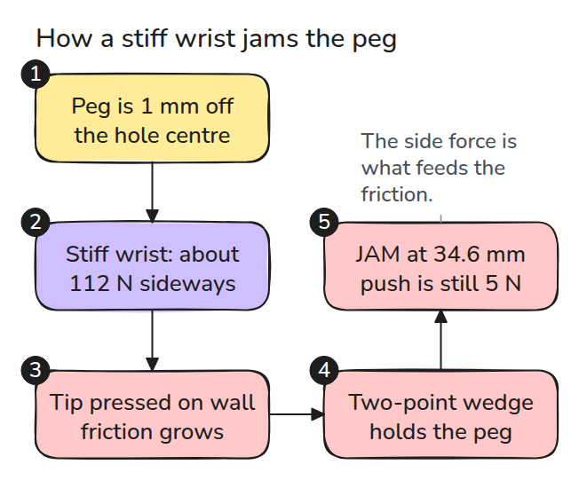
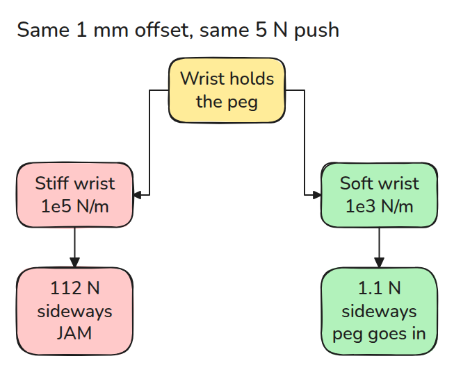
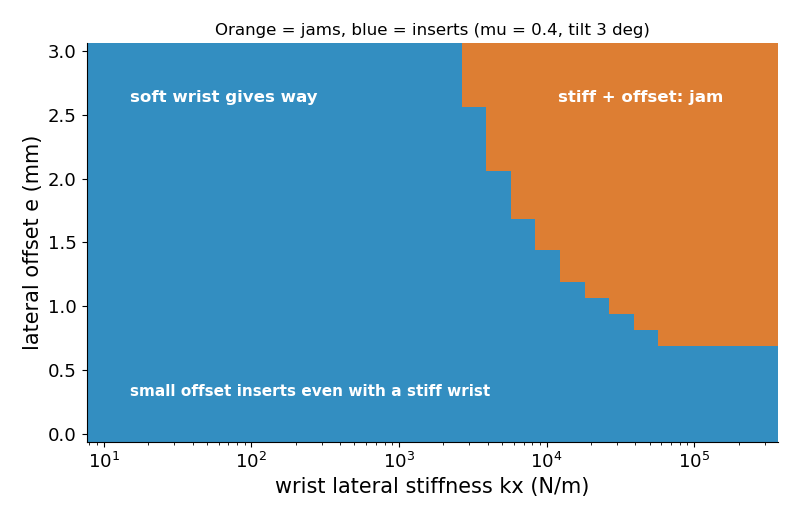
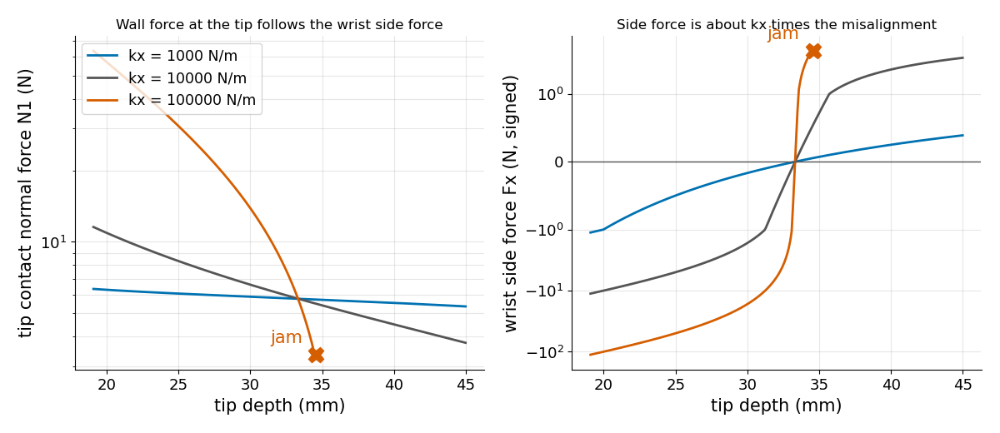

# Compliance in Assembly

> A peg jams when the tool is too stiff to give way, because the side force it creates feeds the friction that holds the peg.

**Type:** Build   **Prerequisites:** 11/01 Contact Models, 11/02 Force and Hybrid Control   **Time:** ~15 minutes

## In Plain Words

A robot arm pushes a thin peg into a tight hole, starting a little off to one side.

A rigid wrist holds the peg's top where the tool says and fights any offset, so it shoves the peg sideways into the walls. The walls push back, and their friction resists the downward push. A wrist that gives way sideways, called compliance, lets the peg straighten and slide in.

## The Problem

Misaligned by a millimetre or less, the peg stops halfway, and pushing harder holds it more firmly.

## The Concept



*A stiff wrist turns a small offset into a large side force. It presses the tip on the wall, and friction grows until the contacts hold the peg.*



*A soft wrist makes a small side force, so the peg slides down and its tilt shrinks.*

The peg's tip rests on one hole wall and its side on the hole edge, so the tip depth (how far the tip is below the hole mouth) fixes its pose, and at each depth the wrist pushes and twists it. Stiffness `kx` is sideways force per metre of stretch. With a 1 mm offset and a 5 N push, the tilted peg swings its top about 2.1 mm from the hole centre while the tool holds it 1 mm, so the wrist stretches about 1.1 mm: 1e5 N/m gives 112 N sideways, 1e3 N/m gives 1.1 N and slides in. Deeper, the peg straightens and the side force shrinks. At 34.6 mm the forces inside the two friction cones cancel the wrist's push and twist, so the stiff peg locks.


*Red arrows: the wrist's sideways push. The blue peg stops at 34.6 mm, the green goes in. Depth drawn 9 times larger.*



*Orange jams. A stiff wrist jams from about 0.7 mm of offset, while a wrist below about 2.5e3 N/m inserts for every offset shown.*



*The soft wrist keeps the tip force near the push. The stiff one starts with tens of newtons and jams where its side force changes sign.*

## Build It

Every depth gives a wrist wrench `wr` and the four cone-edge wrenches. It is a jam if `-wr` is a non-negative combination of three of them.

```python
A = edges[list(idx)].T
if abs(np.linalg.det(A)) > 1e-12 and (np.linalg.solve(A, -wr) >= -1e-9).all():
    return True
```

Assumptions: a zero-width peg, a sharp hole with no chamfer, quasi-static motion, contact only at the tip and the mouth edge. The wrist is a lateral spring `kx`, a torsion spring and a constant push, with Coulomb friction `mu`. The model starts already wedged, so landing on the edge is not covered.

```bash
cd robotics-engineering-from-scratch
python3 -m pytest phases/11-contact-and-manipulation/04-compliance-in-assembly -q
python3 phases/11-contact-and-manipulation/04-compliance-in-assembly/code/main.py
```

## Use It

Real cells use a remote center compliance device or software compliance. Compare your wrist's stiffness with a jam map for your clearance and `mu`.

Sources: Wikipedia, "Remote center compliance" (opened 2026-11-09): a misaligned peg stalls under side force, and a compliant device corrects it.

## Ship It

`outputs/skill-assembly-compliance-check.md` reviews an insertion for jam risk before you tune the push force.

## Exercises

1. Find the largest `kx` that still inserts at `e = 1 mm`.
2. Raise `mu` from 0.1 to 0.6 and plot how the jam boundary moves.
3. Add a chamfer by starting the wedge at a smaller depth.
