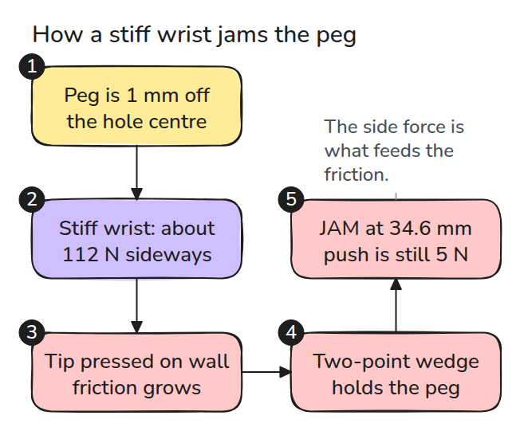
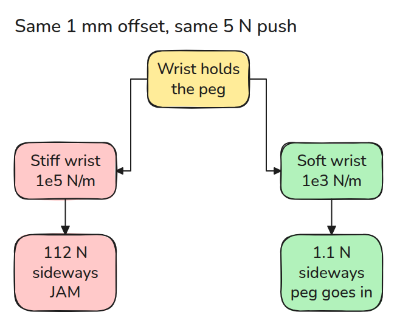
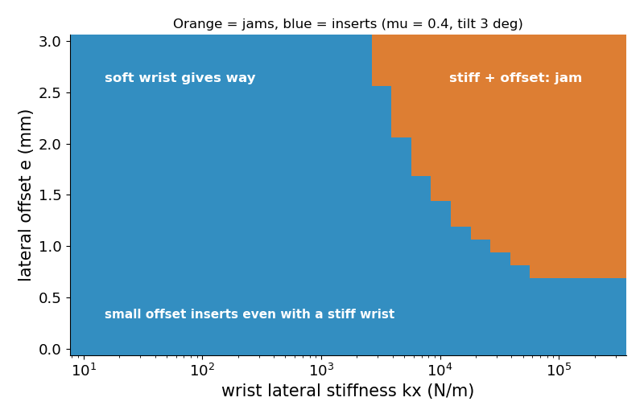
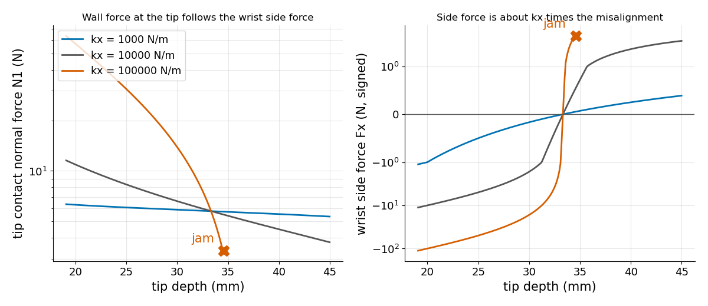

# 조립에서의 compliance (Compliance in Assembly)

> 도구가 너무 딱딱해 비켜 주지 못하면 peg가 jam됩니다. 그 도구가 만드는 옆힘이 peg를 붙드는 마찰을 키우기 때문입니다.

**유형:** 만들기   **선수 지식:** 11/01 접촉 모델, 11/02 힘 제어와 하이브리드 제어   **시간:** 약 15분

## 쉽게 말하면

로봇 팔이 가느다란 peg를 꼭 맞는 구멍에 밀어 넣어요. peg는 처음부터 한쪽으로 조금 치우쳐 있어요.

딱딱한 손목은 peg의 윗부분을 도구가 말한 자리에 붙들고 어긋남을 버티기 때문에 peg를 옆으로 밀어 벽에 붙여요.
벽은 peg를 되밀고 벽의 friction은 아래로 미는 힘을 막아요. 옆으로 비켜 주는 손목(compliance)은 peg가 곧게 서서 미끄러져 들어가게 해 줘요.

## 문제

1 mm 이하로 어긋나면 peg가 중간에서 멈추고 더 세게 밀수록 더 단단히 멈춥니다.

## 개념



*딱딱한 손목은 작은 offset을 큰 옆힘으로 바꿉니다. 그 힘이 끝점을 벽에 눌러 마찰이 커지고 두 접촉이 peg를 붙들 수 있게 됩니다.*



*같은 offset에서 부드러운 손목은 작은 옆힘만 만들므로 peg가 미끄러져 내려가고 기울기가 줄어듭니다.*

peg의 끝점은 한쪽 벽에, peg의 옆면은 구멍 모서리에 닿으므로 끝점 깊이(끝점이 구멍 입구보다 얼마나 아래인가) 하나만으로 자세가 정해집니다. 깊이마다 손목이 peg를 밀고 비틉니다. 강성 `kx`는 옆으로 1 m 늘어났을 때 드는 옆힘입니다.

1 mm 어긋남과 5 N 밀기에서 기울어진 peg의 윗부분은 구멍 중심에서 약 2.1 mm 벗어나 있는데 도구는 1 mm에 붙들고 있으므로 손목이 약 1.1 mm 늘어납니다. 그래서 1e5 N/m는 옆으로 112 N이 되고 1e3 N/m는 1.1 N이 되어 peg가 미끄러져 들어갑니다.

더 깊이 들어가면 peg가 곧게 서면서 옆힘이 줄어듭니다. 34.6 mm에서 두 마찰 cone 안의 힘이 손목의 밀기와 비틀기를 상쇄하므로 딱딱한 쪽 peg는 고정됩니다.


*빨간 화살표는 손목이 peg를 옆으로 미는 힘입니다. 파란 peg는 34.6 mm에서 멈추고 초록 peg는 들어갑니다. 깊이는 9배로 크게 그렸습니다.*



*주황색이 jam입니다. 딱딱한 손목은 약 0.7 mm 어긋남부터 jam되고 약 2.5e3 N/m보다 부드러운 손목은 그림의 모든 offset에서 삽입됩니다.*



*부드러운 손목은 끝점 힘을 미는 힘 근처에 둡니다. 딱딱한 손목은 벽에 수십 N을 주며 시작하고 옆힘의 부호가 바뀌는 곳에서 jam됩니다.*

## 만들기

깊이마다 손목 wrench(`wr`)와 cone 모서리 wrench 네 개가 나옵니다. `-wr`이 그중 세 개의 음이 아닌 조합이면 jam입니다.

```python
A = edges[list(idx)].T
if abs(np.linalg.det(A)) > 1e-12 and (np.linalg.solve(A, -wr) >= -1e-9).all():
    return True
```

가정은 폭이 0인 peg, chamfer 없는 날카로운 구멍, 준정적 운동, 끝점과 입구 모서리 두 곳의 접촉입니다.

손목은 옆 방향 spring(`kx`)과 비틀림 spring과 일정한 미는 힘이고 마찰은 쿨롱 `mu`입니다. 모델은 이미 wedge가 된 상태에서 시작하므로 모서리에 얹히는 과정은 다루지 않습니다.

```bash
cd robotics-engineering-from-scratch
python3 -m pytest phases/11-contact-and-manipulation/04-compliance-in-assembly -q
python3 phases/11-contact-and-manipulation/04-compliance-in-assembly/code/main.py
```

## 실제 도구로 보기

실제 셀은 remote center compliance 장치나 소프트웨어 compliance를 씁니다. 여러분 손목의 옆 방향 강성을 clearance와 `mu`에 대한 jam 지도와 비교합니다.

출처: Wikipedia "Remote center compliance"(2026년 11월 9일 열람). 어긋난 peg는 옆힘을 받아 멈추고 compliant 장치는 이를 바로잡습니다.

## 결과물

`outputs/skill-assembly-compliance-check.md`는 미는 힘을 조정하기 전에 삽입의 jam 위험을 점검합니다.

## 연습 문제

1. `e = 1 mm`에서 여전히 삽입되는 가장 큰 `kx`를 찾으세요.
2. `mu`를 0.1에서 0.6까지 올리며 jam 경계가 어떻게 움직이는지 그리세요.
3. wedge를 더 얕은 깊이에서 시작해 chamfer를 흉내 내세요.
