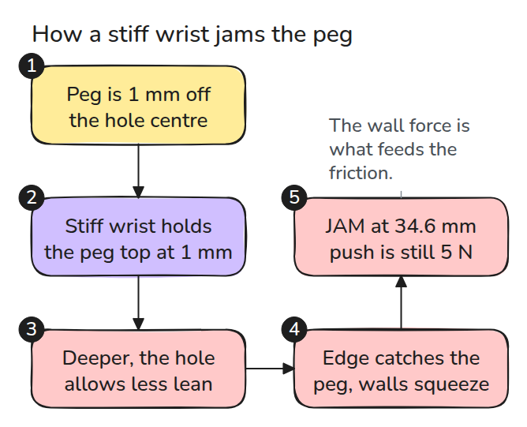

# 조립에서의 compliance (Compliance in Assembly)

> 딱딱한 로봇의 peg가 꼭 맞는 구멍에서 jam되는 이유와 부드러운 손목이면 peg가 미끄러져 들어가는 이유를 알아봅니다.

**유형:** 만들기   **선수 지식:** 11/01 접촉 모델   **시간:** 약 15분

## 쉽게 말하면

로봇 팔이 가느다란 peg를 꼭 맞는 구멍에 밀어 넣어요. peg의 윗부분은 중심에서 조금 벗어난 채 잡혀 있고 깊이 들어갈수록 벽이 peg를 덜 기울게 해요.

딱딱한 손목은 비켜 주지 않아서 peg가 끼고 friction이 커져 결국 미는 힘을 이겨요. 비켜 주는 손목(compliance)은 peg가 미끄러져 들어가게 해 줘요.

## 핵심 용어

- **Compliance**: 위치를 딱딱하게 고집하지 않고 힘을 받으면 비켜 주는 성질입니다.
- **Jam**: 벽의 마찰이 미는 힘을 버텨서 peg가 멈추는 상태입니다.
- **Stiffness (`kx`)**: 손목이 옆으로 1 m 늘어났을 때 드는 옆힘입니다.

- **Chamfer**: peg가 들어가도록 안내하는 비스듬한 구멍 모서리입니다.

## 문제

로봇이 peg를 꼭 맞는 구멍에 밀어 넣는데 위치가 1 mm 이하로 어긋나 있다고 상상해 보세요. peg가 중간에서 멈추고 미는 힘을 두 배로 해도 조금 더 들어갔다가 다시 멈춥니다.

## 개념

실제 조립 로봇은 완벽하게 정렬할 수 없으므로 부품을 넣으려면 조금 비켜 줘야 합니다.

딱딱한 손목은 구멍이 허락하는 기울기가 줄어도 peg를 같은 기울기로 잡고 있습니다. 그러면 peg가 벽 사이에 끼고 그 조임이 마찰을 키워서 마찰이 peg를 붙듭니다. 이것이 jam입니다.



*딱딱한 손목에서는 peg가 끼고 마찰이 peg를 붙듭니다.*

부드러운 손목은 옆으로 비켜 주는데 이것을 compliance라고 합니다. 그러면 벽을 조이는 힘이 작아서 peg는 미끄러져 내려갑니다.


*부드러운 손목은 비켜 주고 peg가 미끄러져 내려갑니다.*

[](../assets/clip-example.mp4)

*파랑은 중간에서 jam되고 초록은 들어갑니다.*


*주황색이 jam입니다. 딱딱한 손목은 jam되고 부드러운 손목은 삽입됩니다.*


*모서리가 peg를 잡은 뒤에 딱딱한 손목의 벽 힘이 커집니다.*

마찰이 없으면 peg는 jam되지 않습니다.

<details><summary>The math (optional)</summary>

강성 `kx`는 손목이 옆으로 1 m 늘어났을 때 드는 옆힘이므로 옆힘은 `kx`에 어긋남을 곱한 값입니다. 여기서 어긋남은 구멍이 잡은 peg 윗부분의 위치와 손목이 원하는 위치의 차이입니다.
끝만 닿아 있을 때 peg는 손목의 비틂이 균형을 이루는 기울기를 취합니다. 1e5 N/m에서는 1.7°이고 1e3 N/m에서는 2.2°입니다.
구멍이 허락하는 기울기는 최대 `2h`(1 mm)를 깊이로 나눈 값입니다. 그래서 모서리는 1e5 N/m에서 33.2 mm, 1e3 N/m에서 25.5 mm 깊이에서 peg를 잡습니다.
그다음 가장 큰 벽 힘은 1e5 N/m에서 8.2 N까지 오르지만 1e3 N/m에서는 1.2 N에 그칩니다.
34.6 mm 깊이에서 두 마찰 cone 안의 힘이 손목의 밀기와 비틀기를 상쇄할 수 있으므로 딱딱한 손목의 peg는 그 자리에 고정됩니다.
jam은 손목 wrench(밀기와 비틀기)에 마이너스를 붙인 것이 cone 모서리 wrench 네 개 중 세 개를 음이 아닌 계수로 섞은 것과 같을 때를 말합니다.
미는 힘을 5 N에서 10 N으로 두 배로 해도 딱딱한 손목의 jam은 34.6 mm에서 36.4 mm로 조금 깊어질 뿐입니다.
딱딱한 손목은 약 0.7 mm 어긋남부터 jam되고 약 2e3 N/m보다 부드러운 손목은 그림의 모든 offset에서 삽입됩니다.

</details>

## 만들기

코드는 깊이마다 jam인지 검사합니다.

```python
A = edges[list(idx)].T
if abs(np.linalg.det(A)) > 1e-12 and (np.linalg.solve(A, -wr) >= -1e-9).all():
    return True
```

가정은 폭이 0인 peg, 날카로운 구멍, 느린 운동입니다. 구멍 모서리에 얹히는 과정은 다루지 않습니다.

```bash
cd robotics-engineering-from-scratch
python3 -m pytest phases/11-contact-and-manipulation/04-compliance-in-assembly -q
python3 phases/11-contact-and-manipulation/04-compliance-in-assembly/code/main.py
```

## 실제 도구로 보기

실제 작업 셀에서는 옆으로 비켜 주는 손목을 쓰거나 팔이 비켜 주게 하는 소프트웨어를 씁니다. 고른 강성을 jam 지도와 비교해 보세요.

출처: Wikipedia "Remote center compliance"(2026년 11월 9일 열람).

## 결과물

`outputs/skill-assembly-compliance-check.md`는 미는 힘을 조정하기 전에 삽입의 jam 위험을 점검합니다.

## 연습 문제

1. 1 mm 어긋남에서도 peg가 들어가는 가장 뻣뻣한 손목을 찾으세요.
2. 표면을 더 잘 붙게 만들고 jam 경계가 어디로 움직이는지 보세요.
3. wedge를 더 얕게 시작해서 chamfer를 흉내 내고 peg가 더 쉽게 들어가는지 보세요.
