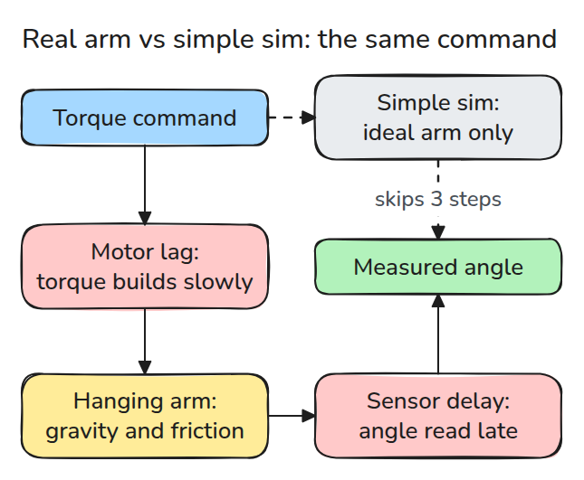
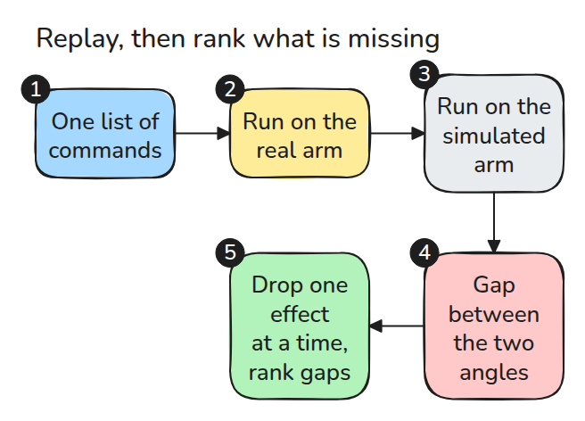
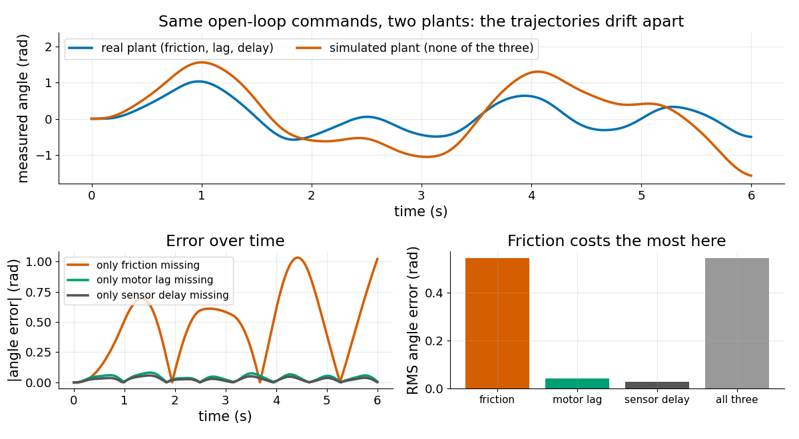

# What a Simulator Approximates

> A simulator is the real joint with some effects deleted, and you can measure what each deletion costs.

**Type:** Build   **Prerequisites:** 03/02 Gravity Compensation   **Time:** ~15 minutes

## In Plain Words

A playground swing on a screen may keep moving longer than the real swing after the same timed pushes. Leaving out hinge friction
removes a force that opposes motion. A delayed angle display causes a different mismatch: it shows an earlier position, even though the
swing itself has already moved.

This lesson replays identical commands while removing effects from a simulated joint. Comparing each result with the reference
separates missing physics from delayed measurements and shows which omission matters most.

## The Problem

A trajectory looks perfect in simulation and the real joint undershoots it, lags behind it and stops short. Nobody changed the command. The simulator quietly left out things the hardware does, and you do not know which of them matters most.

## The Concept



*The real command passes through motor lag, a joint with friction and a delayed sensor. The simple sim skips three of those steps.*

We use one small plant for the whole phase: a pendulum joint with inertia `J`, viscous damping `b`, Coulomb friction `c`, gravity `k = m*g*l`, a first-order motor lag `Tm` and a sensor delay.



*Open-loop commands cannot correct themselves, so every difference between the plants shows up as divergence.*



*Top: the two trajectories separate. Bottom left: the error without friction swings up to 1 rad while lag and delay stay under 0.1 rad. Bottom right: RMS error is 0.545 rad without friction, 0.042 rad without lag and 0.029 rad without delay.*

## Build It

Integrate `J*w' = tm - b*w - c*tanh(w/eps) - k*sin(q)` and `Tm*tm' = u - tm` with RK4. The measured angle is the true angle shifted by `delay`.

```python
def measured(p, u_fn, T):
    q, n = simulate(p, u_fn, T)[:, 0], round(p["delay"] / DT)
    return np.concatenate([np.full(n, q[0]), q[: len(q) - n]]) if n else q
```

`effect_costs()` removes one effect at a time from the sim, replays the same commands and returns the RMS angle error. A frictionless, lag-free joint conserves energy to 1e-6, so the integrator is not the cause.

```bash
cd robotics-engineering-from-scratch
python3 -m pytest phases/12-simulation-and-sim-to-real/01-what-a-simulator-approximates -q
python3 phases/12-simulation-and-sim-to-real/01-what-a-simulator-approximates/code/main.py
```

## Use It

MuJoCo can switch these effects on one at a time: joint `frictionloss` for dry friction, actuator `dyntype="filter"` for first-order dynamics on the actuator activation (`act_dot = (ctrl - act) / dynprm[0]`), and actuator `delay` with `nsample` for a delayed control input. Add them to a model and rerun the ranking.

Sources: MuJoCo XML reference, `joint/frictionloss`, `actuator/dyntype`, `actuator/delay` (https://mujoco.readthedocs.io/en/stable/XMLreference.html, opened 2026-11-09).

## Ship It

`outputs/skill-sim-gap-ranking.md` ranks which missing effect to model first.

## Exercises

1. Halve `c` in the real plant and see whether friction is still the biggest cost.
2. Make the command ten times faster and check whether delay overtakes friction.
3. Explain why "all three" is not the sum of the three single costs.
