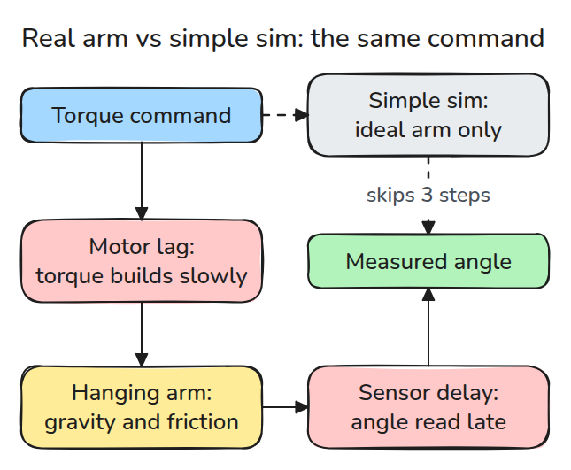
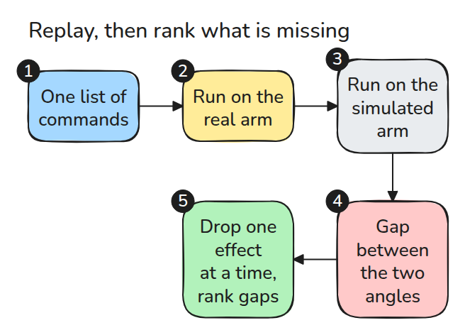
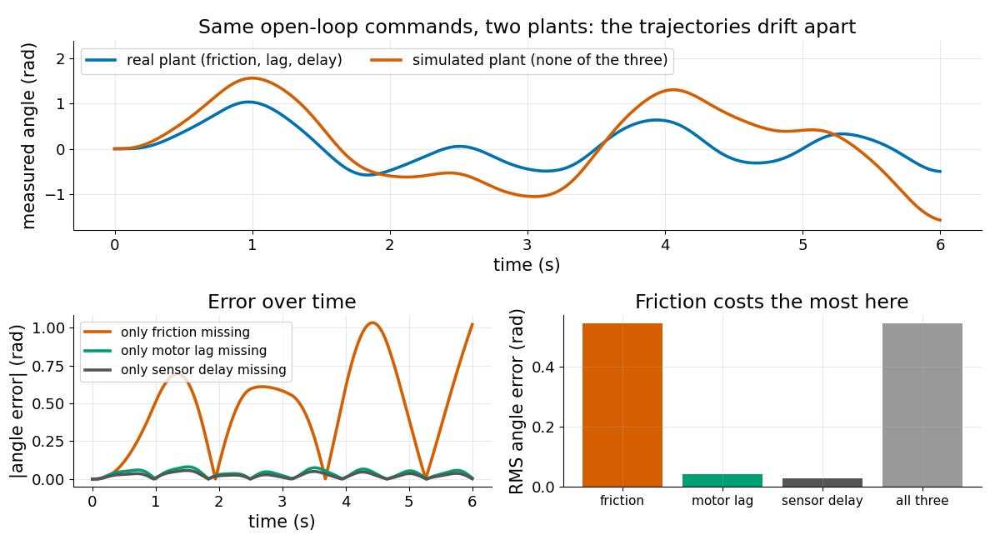

# What a Simulator Approximates

> Find out which things a simulator leaves out of a real joint, and which one costs you most.

**Type:** Build   **Prerequisites:** 03/02 Gravity Compensation   **Time:** ~15 minutes

## In Plain Words

A metal arm hangs from a motor on a wall. The real hinge rubs, so each swing shrinks. A simulator with no friction swings farther.

The motor is also slow to push and the sensor is late. This lesson removes one effect at a time and measures which hurts most.

## Key Terms

- **Plant**: the thing being controlled. Here it is one pendulum joint.
- **Torque**: the twisting push a motor applies to a joint.
- **Friction**: a rubbing force that drains motion energy.
- **Motor lag**: the delay before the motor's push catches up with the command.
- **Open-loop**: sending commands without sensor feedback to correct them.
- **RMS error**: a typical size of the gap between two signals.

## The Problem

You test an arm in simulation and it looks perfect. On the real robot the same commands lag and stop short. The simulator left out something the hardware does.

## The Concept

A simulator is where you test robot code safely, so you need to know how far to trust it.



*The real command passes through motor lag, a joint with friction and a delayed sensor. The simple sim skips all three.*

Inertia `J` is how hard the arm is to speed up, damping `b` is drag that grows with speed, Coulomb friction `c` is a constant rub, `k = m*g*l` is gravity's pull, `Tm` is motor lag.



*Open-loop commands cannot correct themselves, so every difference shows up as divergence.*



*RMS error is 0.545 rad without friction, 0.042 without lag, 0.029 without delay.*

One radian (rad) is about 57 degrees. On the clip's 0.4 m arm, 0.545 rad is a fingertip 22 cm off. Lag and delay cost 1 to 2 cm. Friction costs 13 times more than lag, so model it first.


*Blue is the real arm. Ghosts miss friction, motor lag, sensor delay, left to right.*

## Build It

`q` is the angle, `w` its speed, `u` the command, `tm` the motor torque. Integrate `J*w' = tm - b*w - c*tanh(w/eps) - k*sin(q)` and `Tm*tm' = u - tm` with RK4 (a standard step method). The measured angle is the true angle shifted by `delay`.

```python
def measured(p, u_fn, T):
    q, n = simulate(p, u_fn, T)[:, 0], round(p["delay"] / DT)
    return np.concatenate([np.full(n, q[0]), q[: len(q) - n]]) if n else q
```

`effect_costs()` removes one effect at a time and returns the RMS error. A frictionless, lag-free joint conserves energy to 1e-6, so the integrator is not the cause.

```bash
cd robotics-engineering-from-scratch
python3 -m pytest phases/12-simulation-and-sim-to-real/01-what-a-simulator-approximates -q
python3 phases/12-simulation-and-sim-to-real/01-what-a-simulator-approximates/code/main.py
```

## Use It

MuJoCo switches these on one at a time: `frictionloss`, actuator `dyntype="filter"` and actuator `delay` with `nsample`.

Sources: MuJoCo XML reference, `joint/frictionloss`, `actuator/dyntype`, `actuator/delay` (https://mujoco.readthedocs.io/en/stable/XMLreference.html, opened 2026-11-09).

## Ship It

`outputs/skill-sim-gap-ranking.md` ranks which missing effect to model first.

## Exercises

1. Halve `c`. Is friction still the biggest cost?
2. Make the command ten times faster. Does delay overtake friction?
3. Why is "all three" not the sum of the single costs?
