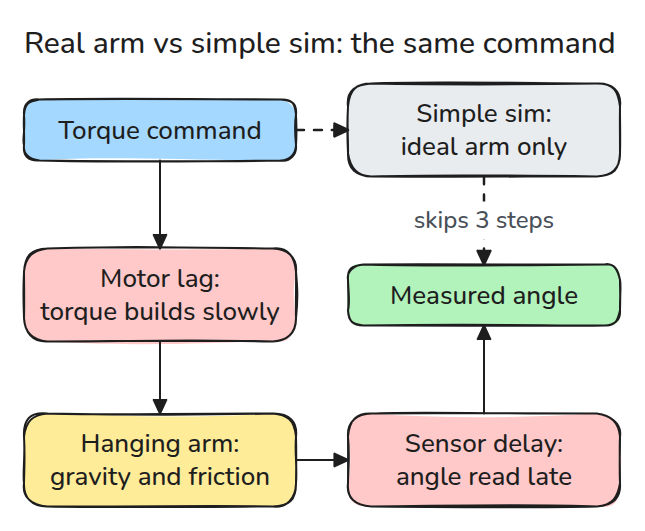
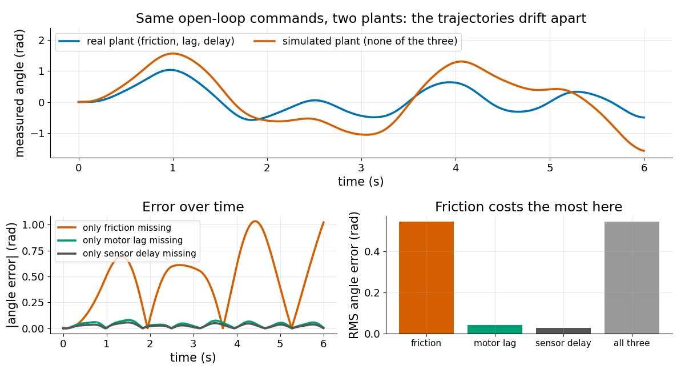

# 시뮬레이터가 근사하는 것

> 시뮬레이터가 실제 관절에서 빼먹는 것이 무엇인지, 그중 무엇이 가장 큰 손해인지 알아봅니다.

**유형:** 만들기   **선수 지식:** 03/02 중력 보상   **시간:** 약 15분

## 쉽게 말하면

벽에 달린 모터에 금속 팔이 매달려 있어요. 실제 경첩은 마찰 때문에 흔들릴 때마다 폭이 줄어요. 마찰이 없는 시뮬레이터는 더 멀리 흔들려요.

모터는 힘을 내는 데 시간이 걸리고 센서는 팔이 방금 있던 위치를 알려 줘요. 이 레슨에서는 효과를 하나씩 빼고 어느 것이 가장 크게 영향을 주는지 재요.

## 핵심 용어

- **Plant**: 제어하는 대상입니다. 여기서는 진자 관절 하나입니다.
- **Torque**: 모터가 관절을 돌리려고 주는 비트는 힘입니다.
- **Friction**: 움직임의 에너지를 빼앗는 마찰력입니다.
- **Motor lag**: 모터의 힘이 명령을 따라잡기까지 걸리는 지연입니다.
- **Open-loop**: 센서 feedback으로 고치지 않고 명령만 보내는 방식입니다.
- **RMS error**: 두 신호가 벌어진 크기의 전형적인 값입니다.

## 문제

시뮬레이션에서는 팔이 완벽해 보이는데 같은 명령을 실제 로봇에 보내면 뒤처지고 일찍 멈춥니다. 하드웨어가 하는 어떤 일이 시뮬레이터에서 빠졌는데 그것이 무엇인지 알 수 없습니다.

## 개념

시뮬레이터는 로봇 코드를 안전하게 시험하는 곳이라서 얼마나 믿어도 되는지 알아야 합니다.



*실제 명령은 모터 지연, 마찰이 있는 관절, 늦게 읽는 센서를 차례로 지납니다. 단순한 시뮬은 이 셋을 모두 건너뜁니다.*

관성 `J`는 팔의 속도를 올리기 어려운 정도, 감쇠 `b`는 속도에 따라 커지는 저항, 쿨롱 마찰 `c`는 일정하게 막는 마찰, `k = m*g*l`은 중력이 당기는 힘, `Tm`은 모터 지연입니다.


*open-loop 명령은 스스로 오차를 고치지 못하므로 차이가 그대로 divergence, 곧 두 각도의 벌어짐으로 나타납니다.*



*RMS 오차는 마찰이 없으면 0.545 rad, 모터 지연이 없으면 0.042, 센서 지연이 없으면 0.029입니다.*

1 radian(rad)은 약 57도입니다. 클립의 0.4 m 팔에서 0.545 rad은 손끝이 22 cm 벗어나는 크기입니다. 모터 지연과 센서 지연은 1 cm에서 2 cm쯤 어긋납니다. 마찰의 비용이 모터 지연의 13배이므로 마찰을 먼저 모델링하세요.


*파란 팔이 실제 관절입니다. 유령 팔은 왼쪽부터 마찰, motor lag, sensor delay를 뺀 시뮬레이션입니다. 왼쪽 유령 팔만 벌어집니다.*

## 만들기

`q`는 각도, `w`는 각속도, `u`는 명령, `tm`은 모터 토크입니다. `J*w' = tm - b*w - c*tanh(w/eps) - k*sin(q)`와 `Tm*tm' = u - tm`을 RK4(널리 쓰는 적분법)로 적분합니다.
측정 각도는 실제 각도를 `delay`만큼 늦춘 값입니다.

```python
def measured(p, u_fn, T):
    q, n = simulate(p, u_fn, T)[:, 0], round(p["delay"] / DT)
    return np.concatenate([np.full(n, q[0]), q[: len(q) - n]]) if n else q
```

`effect_costs()`는 효과를 하나씩 빼고 RMS 오차를 돌려줍니다. 마찰도 지연도 없는 관절은 에너지를 1e-6 안에서 보존하므로 원인이 integrator가 아닙니다.

```bash
cd robotics-engineering-from-scratch
python3 -m pytest phases/12-simulation-and-sim-to-real/01-what-a-simulator-approximates -q
python3 phases/12-simulation-and-sim-to-real/01-what-a-simulator-approximates/code/main.py
```

## 실제 도구로 보기

MuJoCo는 이 효과들을 하나씩 켤 수 있습니다. `frictionloss`는 마른 마찰, actuator의 `dyntype="filter"`는 1차 지연, actuator의 `delay`와 `nsample`은 늦게 들어오는 입력입니다.

출처는 MuJoCo XML reference의 `joint/frictionloss`, `actuator/dyntype`, `actuator/delay`입니다. 2026년 11월 9일에 열어 확인했습니다.

https://mujoco.readthedocs.io/en/stable/XMLreference.html

## 결과물

`outputs/skill-sim-gap-ranking.md`는 어떤 빠진 효과를 먼저 모델링할지 순위를 매겨 줍니다.

## 연습 문제

1. `c`를 절반으로 줄이세요. 마찰이 여전히 가장 큰 비용인가요?
2. 명령을 10배 빠르게 하세요. 지연이 마찰을 넘어서나요?
3. "all three"가 단일 비용의 합이 아닌 이유를 설명하세요.
