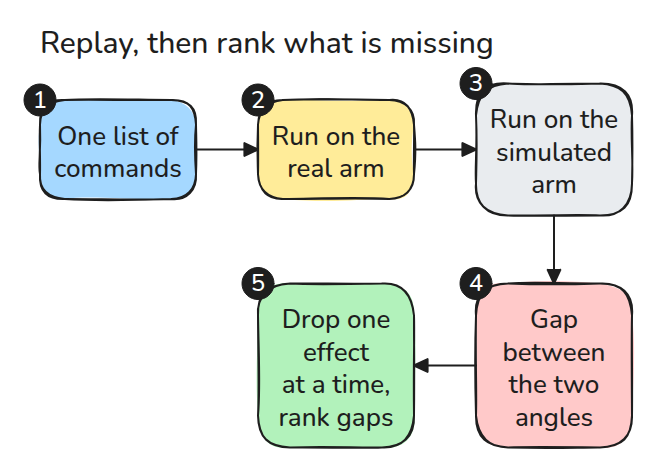

# 시뮬레이터가 근사하는 것

> 시뮬레이터가 실제 관절에서 빼먹는 것이 무엇인지, 그중 무엇이 가장 큰 손해인지 알아봅니다.

**유형:** 만들기   **선수 지식:** 없음   **시간:** 약 15분

## 쉽게 말하면

벽에 달린 모터에 금속 팔이 매달려 있어요. 실제 경첩은 마찰 때문에 흔들릴 때마다 폭이 줄어요. 마찰이 없는 시뮬레이터는 더 멀리 흔들려요.

모터는 힘을 내는 데 시간이 걸리고 센서는 늦게 알려 줘요. 이 레슨에서는 효과를 하나씩 빼고 어느 것이 가장 크게 영향을 주는지 재요.

## 핵심 용어

- **Torque**: 모터가 관절을 돌리려고 주는 비트는 힘입니다.
- **Friction**: 움직임을 조금씩 빼앗는 마찰입니다.
- **Motor lag**: 모터의 힘이 명령을 따라잡기까지 걸리는 지연입니다.
- **Open-loop**: 센서로 확인해서 고치지 않고 명령만 보내는 방식입니다.
- **RMS error**: 복사본이 실제 팔에서 평균적으로 얼마나 벌어졌는지 나타내는 숫자 하나입니다. 빠진 효과의 비용이라고 부릅니다.

## 문제

시뮬레이션에서는 팔이 완벽해 보이는데 같은 명령을 실제 로봇에 보내면 뒤처지고 일찍 멈춥니다. 시뮬레이터가 하드웨어가 하는 어떤 일을 빼먹었습니다.

## 개념

시뮬레이터는 로봇 코드를 안전하게 시험하는 곳이라서 얼마나 믿어도 되는지 알아야 합니다. 실제 팔과 시뮬레이션 복사본에 같은 명령을 주고 복사본에서 실제 효과를 하나씩 지워서 얼마나 벌어지는지 봅니다.


*실제 명령은 느린 모터, 마찰이 있는 관절, 늦는 센서를 차례로 지납니다. 단순한 시뮬레이터는 이 셋을 모두 건너뜁니다.*



*둘 다 같은 명령을 받고 센서로 확인해서 고치지 않으므로 차이는 계속 커집니다.*


*마찰을 뺀 복사본은 크게 벗어납니다. 지연을 빼는 것은 거의 영향이 없습니다.*

마찰이 지연보다 훨씬 중요하므로 마찰을 먼저 모델링하세요.


*파란 팔이 실제 관절입니다. 유령 팔은 각각 마찰, motor lag, sensor delay 중 하나를 뺐습니다. 마찰을 뺀 유령 팔만 벗어납니다.*

<details><summary>The math (optional)</summary>

모델은 `J*w' = tm - b*w - c*tanh(w/eps) - k*sin(q)`와 `Tm*tm' = u - tm`이고 RK4로 적분합니다.
`J`는 팔의 속도를 올리기 어려운 정도, `b`는 속도에 따라 커지는 저항, `c`는 일정한 마찰, `k = m*g*l`은 중력이 당기는 힘, `Tm`은 모터 지연입니다.
RMS 오차는 마찰이 없으면 0.545 rad, 모터 지연이 없으면 0.042 rad, 센서 지연이 없으면 0.029 rad입니다(1 rad은 약 57도). 0.4 m 팔에서 0.545 rad은 손끝이 22 cm 벗어나는 크기이고 모터 지연과 센서 지연은 각각 1 cm에서 2 cm쯤만
어긋나므로 마찰의 비용이 모터 지연의 13배입니다.
마찰도 지연도 없는 관절은 에너지를 1e-6 안에서 보존합니다.

</details>

## 만들기

모델은 마찰, 느린 모터, 늦는 센서가 있는 흔들리는 팔입니다.

```python
def measured(p, u_fn, T):
    q, n = simulate(p, u_fn, T)[:, 0], round(p["delay"] / DT)
    return np.concatenate([np.full(n, q[0]), q[: len(q) - n]]) if n else q
```

`effect_costs()`는 효과를 하나씩 빼고 오차를 돌려줍니다.

```bash
cd robotics-engineering-from-scratch
python3 -m pytest phases/12-simulation-and-sim-to-real/01-what-a-simulator-approximates -q
python3 phases/12-simulation-and-sim-to-real/01-what-a-simulator-approximates/code/main.py
```

## 실제 도구로 보기

MuJoCo는 이 효과들을 하나씩 켤 수 있습니다. 일정한 마찰(dry friction), 느린 actuator(모터의 구동 부분), 늦게 들어오는 명령입니다.

출처는 MuJoCo XML reference의 `joint/frictionloss`, `actuator/dyntype`, `actuator/delay`입니다. 2026년 11월 9일에 열어 확인했습니다.

https://mujoco.readthedocs.io/en/stable/XMLreference.html

## 결과물

`outputs/skill-sim-gap-ranking.md`는 어떤 빠진 효과를 먼저 모델링할지 순위를 매겨 줍니다.

## 연습 문제

1. 마찰을 절반으로 줄이세요. 여전히 가장 큰 비용인가요?
2. 명령을 10배 빠르게 하세요. 이제 지연이 더 중요해지나요?
3. 세 효과를 한꺼번에 빼세요. 합친 비용이 각각의 비용을 더한 값과 같은가요?
