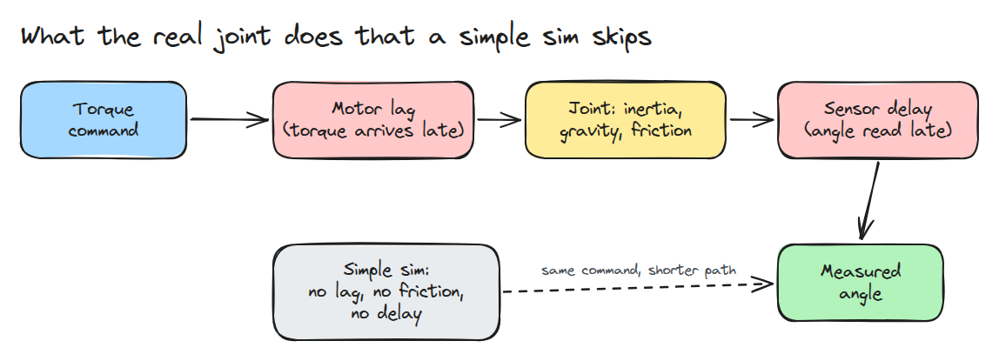
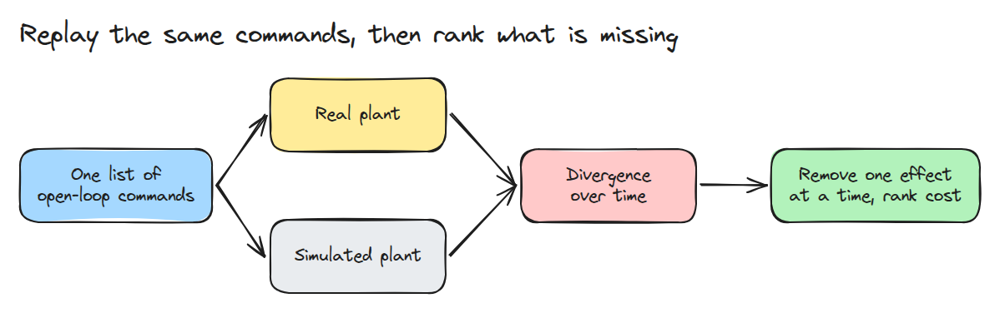
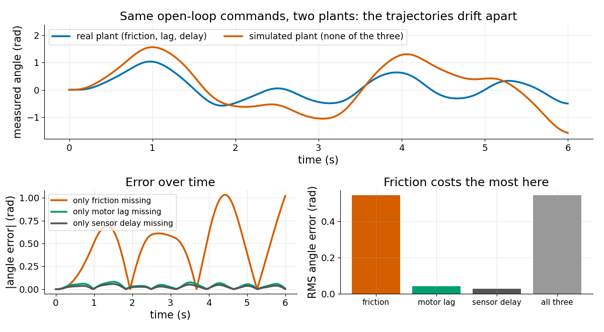

# 시뮬레이터가 근사하는 것

> 시뮬레이터는 실제 관절에서 몇 가지 효과를 지운 것이고 지운 효과마다 얼마나 손해인지 잴 수 있습니다.

**유형:** 만들기   **선수 지식:** 03/02 중력 보상   **시간:** 약 15분

## 문제

궤적이 시뮬레이션에서는 완벽해 보이는데 실제 관절은 목표에 못 미치고 뒤처지고 일찍 멈춥니다. 명령은 그대로입니다. 시뮬레이터가 하드웨어가 하는 일을 몰래 빼 먹었고 그중 무엇이 중요한지 알 수 없습니다.

## 개념



*실제 명령은 모터 지연, 마찰이 있는 관절, 늦게 읽는 센서를 차례로 지납니다. 단순한 시뮬은 그중 세 단계를 건너뜁니다.*

이 phase 전체에서 작은 plant 하나를 씁니다. 관성 `J`, 점성 감쇠 `b`, 쿨롱 마찰 `c`, 중력 `k = m*g*l`, 1차 모터 지연 `Tm`, 센서 지연이 있는 진자 관절입니다.



*open-loop 명령은 스스로 오차를 고치지 못하므로 두 plant의 차이가 그대로 divergence로 나타납니다.*



*위는 궤적이 갈라지는 모습입니다. 왼쪽 아래는 마찰이 없을 때 오차가 1 rad까지 오르고 지연 둘은 0.1 rad 아래인 모습입니다. 오른쪽 아래의 RMS 오차는 마찰 0.545 rad, 모터 지연 0.042 rad, 센서 지연 0.029 rad입니다.*

## 만들기

`J*w' = tm - b*w - c*tanh(w/eps) - k*sin(q)`와 `Tm*tm' = u - tm`을 RK4로 적분합니다. 측정 각도는 실제 각도를 `delay`만큼 늦춘 값입니다.

```python
def measured(p, u_fn, T):
    q, n = simulate(p, u_fn, T)[:, 0], round(p["delay"] / DT)
    return np.concatenate([np.full(n, q[0]), q[: len(q) - n]]) if n else q
```

`effect_costs()`는 시뮬에서 효과를 하나씩 빼고 같은 명령을 replay해서 RMS 각도 오차를 돌려줍니다. 마찰도 지연도 없는 관절은 에너지를 1e-6 안에서 보존하므로 원인이 integrator가 아님을 확인할 수 있습니다.

```bash
cd robotics-engineering-from-scratch
python3 -m pytest phases/12-simulation-and-sim-to-real/01-what-a-simulator-approximates -q
python3 phases/12-simulation-and-sim-to-real/01-what-a-simulator-approximates/code/main.py
```

## 실제 도구로 보기

MuJoCo는 이 효과들을 하나씩 켤 수 있습니다. 관절의 `frictionloss`는 건마찰입니다. actuator의 `dyntype="filter"`는 actuator activation에 거는 1차 dynamics(`act_dot = (ctrl - act) / dynprm[0]`)입니다.

actuator의 `delay`와 `nsample`은 늦게 들어오는 제어 입력입니다. 모델에 넣고 순위를 다시 매겨 보세요.

출처는 MuJoCo XML reference의 `joint/frictionloss`, `actuator/dyntype`, `actuator/delay`입니다. 2026년 11월 9일에 열어 확인했습니다.

https://mujoco.readthedocs.io/en/stable/XMLreference.html

## 결과물

`outputs/skill-sim-gap-ranking.md`는 어떤 빠진 효과를 먼저 모델링할지 순위를 매겨 줍니다.

## 연습 문제

1. 실제 plant의 `c`를 절반으로 줄이고 마찰이 여전히 가장 큰 비용인지 확인하세요.
2. 명령을 10배 빠르게 하고 지연이 마찰을 넘어서는지 확인하세요.
3. "all three"가 세 단일 비용의 합이 아닌 이유를 설명하세요.
