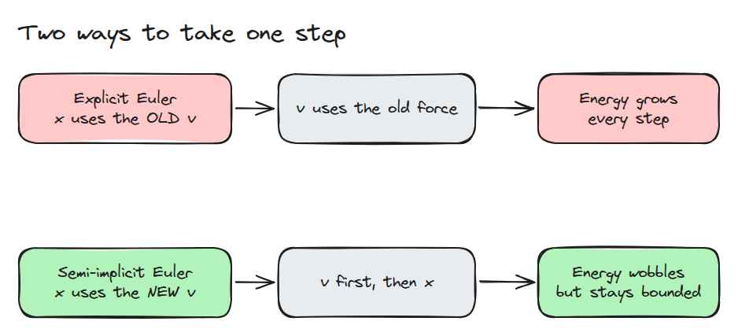
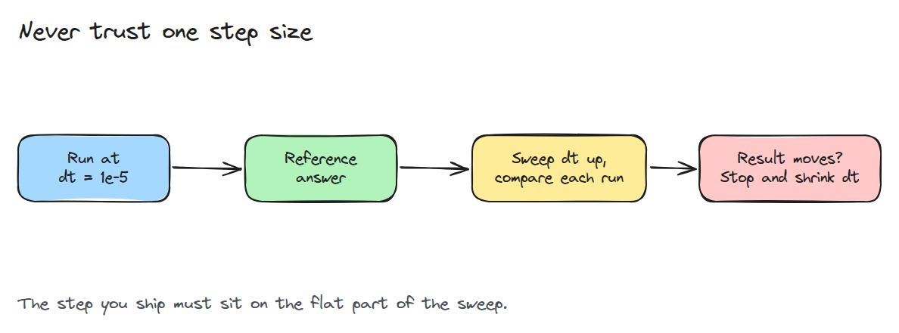
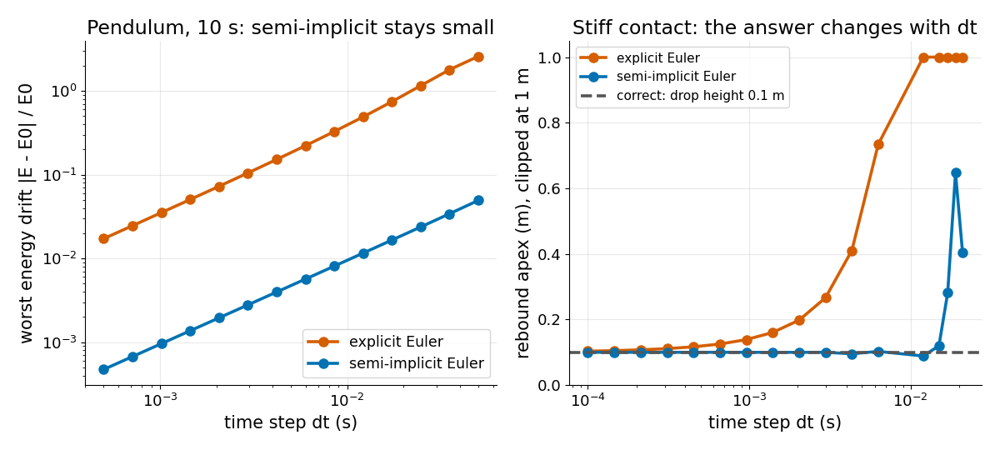

# Timestep and Solver

> The step size and the integrator are part of the model, and a result that changes with them is not a result yet.

**Type:** Build   **Prerequisites:** 12/01 What a Simulator Approximates   **Time:** ~15 minutes

## In Plain Words

A ball in a phone game bounces higher than its release point, although nothing gave it an extra push. The floor's upward force is being
calculated in discrete steps. How the game updates speed and position can add energy that the physical model never supplied.

Explicit Euler moves with the old speed; semi-implicit Euler uses the updated speed. That change improves energy behaviour, but an
oversized timestep can still spoil a bounce. Smaller-step comparisons reveal whether the result is trustworthy.

## The Problem

A robot link hits a stiff contact in simulation and bounces higher than it fell, or the arm jitters when you raise the time step to run faster. The physics is the same and only the numerical method changed. Unless you vary the step, you cannot tell a real effect from an integration artifact.

## The Concept



*Explicit Euler moves `x` with the old velocity. Semi-implicit Euler updates velocity first and moves `x` with the new one.*

For a linear oscillator with frequency `w`, explicit Euler multiplies the energy by `1 + (w*dt)^2` every step, so it always gains energy. Semi-implicit Euler conserves a shadow energy `v^2/2 + w^2 x^2/2 - dt*w^2*x*v/2` exactly, so the true energy only wobbles. It is stable while `w*dt < 2`.



*Take a tiny step as the reference, then raise `dt` until the result moves.*



*Left: at `dt` = 0.01 s explicit Euler drifts 39% in 10 s and semi-implicit 0.95%. Right: a 1 kg mass dropped 0.1 m onto a 10 kN/m contact. Explicit Euler rebounds to 0.14 m at 1 ms, semi-implicit stays within 5% up to 3 ms and returns 0.65 m at 19 ms.*

## Build It

One step function covers both methods. The contact is a penalty spring that pushes up only below the floor.

```python
def step(method, x, v, acc, dt):
    if method == "euler":
        return x + dt * v, v + dt * acc(x)
    v = v + dt * acc(x)
    return x + dt * v, v
```

`pendulum_drift()` returns the worst energy error of an undamped pendulum over 10 s. `rebound_height()` returns the apex after the first bounce, which should equal the drop height.

```bash
cd robotics-engineering-from-scratch
python3 -m pytest phases/12-simulation-and-sim-to-real/02-timestep-and-solver -q
python3 phases/12-simulation-and-sim-to-real/02-timestep-and-solver/code/main.py
```

## Use It

MuJoCo exposes `timestep` and `integrator` in the `option` element. Its default integrator is semi-implicit Euler, and it also offers RK4 and implicit variants. Rerun a contact task at half the step and compare.

Sources: MuJoCo XML reference, `option/timestep` and `option/integrator` (https://mujoco.readthedocs.io/en/stable/XMLreference.html, opened 2026-11-09).

## Ship It

`outputs/skill-timestep-sweep.md` is a checklist for proving a simulated result does not depend on `dt`.

## Exercises

1. Halve the contact stiffness and check that the largest safe semi-implicit `dt` grows by about 1.4.
2. Find the largest `dt` at which the pendulum drift stays under 1%.
3. Explain why the 19 ms run is not a clean blow-up.
