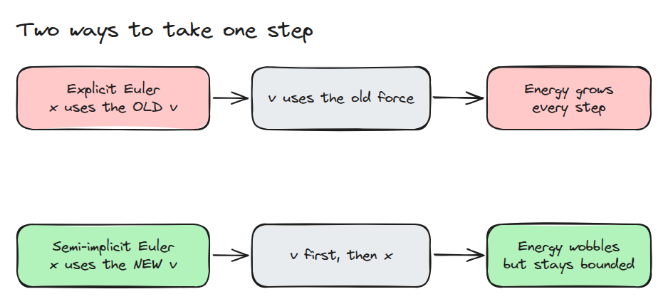
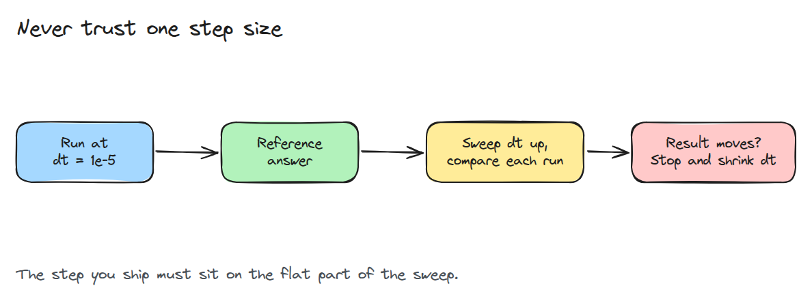
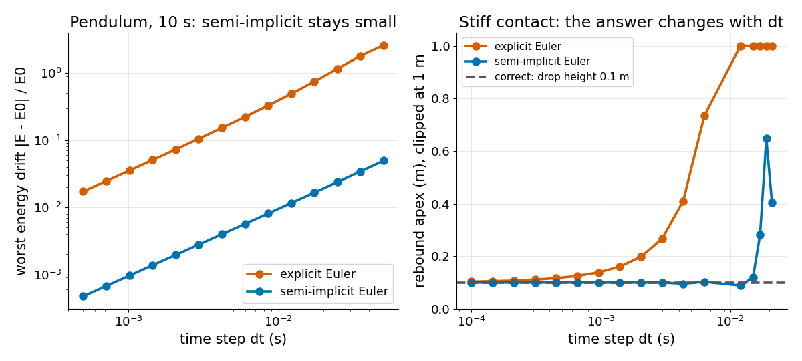

# Timestep and Solver

> Learn why a simulated ball can bounce higher than it fell, and the one-line fix.

**Type:** Build   **Prerequisites:** 12/01 What a Simulator Approximates   **Time:** ~15 minutes

## In Plain Words

A crate drops onto a stiff spring pad. The squashed pad pushes it up, so it should rise to its drop height and no higher. A computer predicts this in fixed steps. Moving the crate with its old speed makes the pad store extra energy, so it bounces too high. Updating the speed first fixes most of that.

## Key Terms

- **Time step (`dt`)**: the fixed slice of time the computer jumps forward each update.
- **Integrator**: the update rule that turns force and speed into the next position.
- **Explicit Euler**: an integrator that moves with the old velocity.
- **Semi-implicit Euler**: an integrator that updates velocity first, then moves with the new one.
- **Energy drift**: simulated energy that creeps up when it should stay constant.
- **Stiff contact**: a very hard surface that needs small steps.

## The Problem

You drop a simulated ball and it bounces higher than where it fell. The physics did not change, only the calculation.

## The Concept

Every simulator moves time forward in steps, so a wrong step can make robot tests lie.



*Explicit Euler moves `x` with the old velocity. Semi-implicit updates velocity first.*

A mass on a spring has position `x`, speed `v` and frequency `w`, updated every `dt` seconds. Explicit Euler multiplies its energy by `1 + (w*dt)^2` each step, so energy always grows. Semi-implicit Euler conserves a nearby shadow energy, so the true energy only wobbles. It stays stable (never blows up) while `w*dt < 2`.



*Raise `dt` from a tiny step until the result moves.*



*Left: at `dt` 0.01 s explicit Euler drifts 39% in 10 s, semi-implicit 0.95%. Right: a 1 kg mass dropped 0.1 m onto a 10 kN/m contact. Semi-implicit at 19 ms still returns a plausible-looking 0.65 m: the error only grows while touching.*

A correct bounce returns to 0.1 m. Explicit Euler returns 0.274 m at `dt` = 3 ms, 2.7 times too high, and 0.103 m at 0.1 ms. Shrink `dt` until the answer stops moving.


*Explicit Euler at 3 ms, 1 ms, 0.1 ms, left to right. Only green reaches the drop height.*

## Build It

One step function covers both methods. The contact is a penalty spring that pushes up only below the floor.

```python
def step(method, x, v, acc, dt):
    if method == "euler":
        return x + dt * v, v + dt * acc(x)
    v = v + dt * acc(x)
    return x + dt * v, v
```

`rebound_height()` returns the top of the first bounce, which should equal the drop height.

```bash
cd robotics-engineering-from-scratch
python3 -m pytest phases/12-simulation-and-sim-to-real/02-timestep-and-solver -q
python3 phases/12-simulation-and-sim-to-real/02-timestep-and-solver/code/main.py
```

## Use It

MuJoCo exposes `timestep` and `integrator` in `option`. Its default is semi-implicit Euler.

Sources: MuJoCo XML reference, `option/timestep` and `option/integrator` (https://mujoco.readthedocs.io/en/stable/XMLreference.html, opened 2026-11-09).

## Ship It

`outputs/skill-timestep-sweep.md` checks that a result does not depend on `dt`.

## Exercises

1. Halve the contact stiffness. Does the largest safe `dt` grow by about 1.4?
2. Find the largest `dt` with drift under 1%.
3. Why is the 19 ms run not a clean blow-up?
