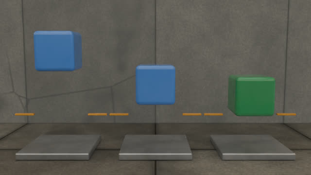

# Timestep and Solver

> Learn why a simulated ball can bounce higher than it fell, and the one-line fix.

**Type:** Build   **Prerequisites:** 12/01 What a Simulator Approximates   **Time:** ~15 minutes

## In Plain Words

A crate drops onto a stiff spring pad. The pad pushes it back up, so it should rise to its drop height and no higher. The computer predicts this in fixed steps. If it moves the crate using its old speed, the crate gains energy (extra bounce) from nowhere and bounces too high. Updating the speed first fixes most of that.

## Key Terms

- **Time step (`dt`)**: the small slice of time the computer jumps forward on each update.
- **Integrator**: the rule that moves the simulation forward by one step.
- **Old-speed update**: an integrator that moves using the old speed.
- **Speed-first update**: an integrator that updates the speed first, then moves using the new speed.
- **Energy drift**: a simulated crate or pendulum gaining bounce or swing that it should not have.
- **Stiff contact**: a very hard surface, which needs small steps.

## The Problem

You drop a simulated ball and it bounces higher than where it fell, or a simulated arm shakes when you make the time step bigger. The physics did not change, only the calculation.

## The Concept

Every simulator moves time forward in steps, so a wrong step can make robot tests lie. The old-speed update creates extra bounce (energy) out of nowhere. The speed-first update drifts far less. Even then a step that is too big can make the result blow up, so shrink the step until the answer stops changing.


*Left: move with the old speed. Right: update the speed first, then move.*


*Start from a tiny step and make it bigger until the result changes.*


*Left: worst pendulum energy drift by step size, far smaller with the speed-first update. Right: first bounce height by step size.*

[](../assets/clip-example.mp4)

*Same drop, three step sizes. Only the smallest step (green) bounces back to the drop height.*

<details><summary>The math (optional)</summary>

The old-speed update is called explicit Euler and the speed-first update semi-implicit Euler. A mass on a spring has position `x`, speed `v` and frequency `w`. Explicit Euler multiplies its energy by `1 + (w*dt)^2` each step. Semi-implicit Euler stays stable while `w*dt < 2`. At `dt` 0.01 s explicit Euler drifts 39% in 10 s and semi-implicit 0.95%. A 1 kg mass dropped 0.1 m onto a 10 kN/m contact should return to 0.1 m. Explicit Euler returns 0.274 m at 3 ms (2.7 times too high) and 0.103 m at 0.1 ms. Semi-implicit stays within 5% up to 3 ms and returns 0.65 m at 19 ms, 6 times too high.

</details>

## Build It

One step function covers both methods. The contact is a spring that pushes up only below the floor.

```python
def step(method, x, v, acc, dt):
    if method == "euler":
        return x + dt * v, v + dt * acc(x)
    v = v + dt * acc(x)
    return x + dt * v, v
```

`pendulum_drift()` measures the worst energy error of a pendulum, and `rebound_height()` the top of the first bounce.

```bash
cd robotics-engineering-from-scratch
python3 -m pytest phases/12-simulation-and-sim-to-real/02-timestep-and-solver -q
python3 phases/12-simulation-and-sim-to-real/02-timestep-and-solver/code/main.py
```

## Use It

MuJoCo's default integrator is the speed-first update.

Sources: MuJoCo XML reference, `option/timestep` and `option/integrator` (https://mujoco.readthedocs.io/en/stable/XMLreference.html, opened 2026-11-09).

## Ship It

`outputs/skill-timestep-sweep.md` checks that a result does not depend on `dt`.

## Exercises

1. Halve the contact stiffness. How much bigger can the step be?
2. Find the biggest step where the pendulum energy drifts under 1%.
3. The 19 ms run bounces far too high but does not blow up. Why?
